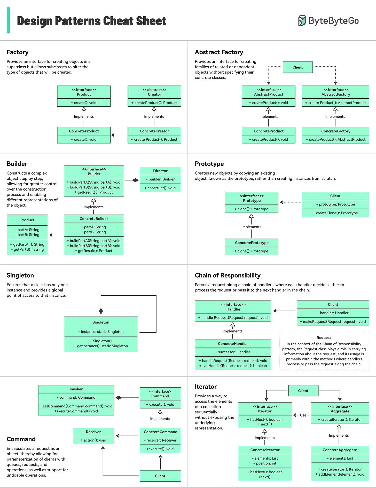
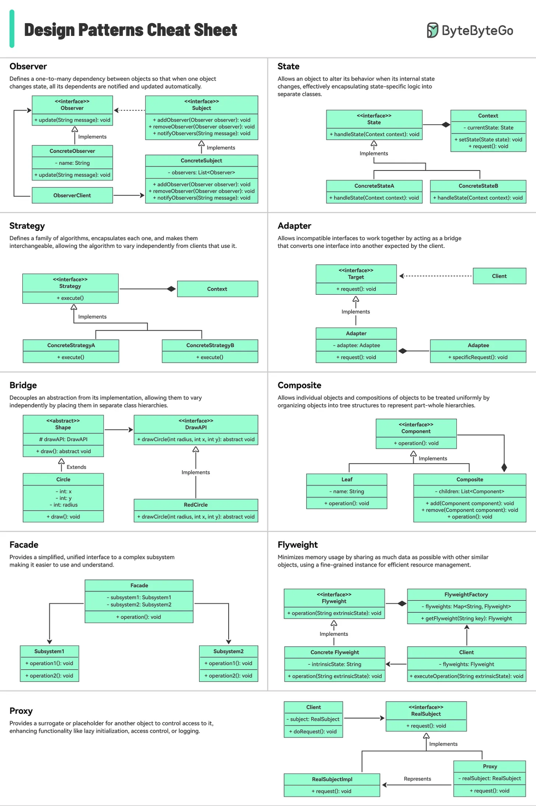

# 148 - Design Patterns Cheat Sheet

- Nguồn: ByteByteGo Big Archive System Design 2025
- Trang PDF: 305-307
- Ảnh minh họa: `../assets/148/figure-01.png`, `../assets/148/figure-02.png`

## Hình minh họa

## Dịch sát

Cheat sheet giải thích ngắn gọn từng pattern và cách dùng nó.

Bao gồm những gì?

- Factory
- Builder
- Prototype
- Singleton
- Chain of Responsibility
- Và nhiều pattern khác!

## Dịch nội dung trong hình

Hai hình cheat sheet minh họa nhiều design pattern phổ biến, gồm nhóm creational, structural và behavioral:

- `Factory`, `Abstract Factory`, `Builder`, `Prototype`, `Singleton`.
- `Chain of Responsibility`, `Iterator`, `Command`, `Observer`, `State`, `Strategy`.
- `Adapter`, `Bridge`, `Composite`, `Facade`, `Flyweight`, `Proxy`.

## Tóm tắt & giải thích dễ hiểu

Design pattern là lời giải đã được đúc kết cho các vấn đề thiết kế lặp lại. Creational pattern giúp tạo object linh hoạt. Structural pattern giúp tổ chức object/class. Behavioral pattern giúp điều phối hành vi và giao tiếp giữa object.

Pattern hữu ích khi nó giảm complexity thật sự. Nếu áp dụng máy móc, pattern có thể làm code khó đọc hơn. Hãy bắt đầu từ vấn đề cụ thể: tạo object phức tạp, thay implementation, giảm coupling, xử lý event, hoặc đóng gói algorithm.

## Ví dụ thực tế - không nằm trong tài liệu gốc

Factory phù hợp khi tạo payment gateway theo provider. Strategy phù hợp khi có nhiều thuật toán tính phí ship. Observer phù hợp event notification. Adapter phù hợp bọc SDK bên thứ ba để domain code không phụ thuộc trực tiếp vendor.

## Thuật ngữ chính

- `Creational pattern`: pattern tạo object.
- `Structural pattern`: pattern tổ chức cấu trúc object/class.
- `Behavioral pattern`: pattern điều phối hành vi.
- `Factory`: tạo object qua factory method/class.
- `Strategy`: thay đổi algorithm qua interface chung.
- `Observer`: publish/subscribe event.
- `Adapter`: chuyển interface không tương thích thành interface mong muốn.

## Câu hỏi ôn tập + trả lời + thinking học tập + liên hệ

> Đây là phần học tập thêm ở cuối file. Câu hỏi ưu tiên lấy từ tài liệu gốc và được trả lời trực tiếp; nếu bài không có câu hỏi riêng thì dùng tiêu đề/nội dung chính để tạo câu hỏi tự kiểm tra.

### Câu hỏi 1

**Nguồn câu hỏi:** Suy ra từ tiêu đề/nội dung chính vì bài gốc không có câu hỏi riêng.

**Câu hỏi:** Sau khi đọc bài “Design Patterns Cheat Sheet”, ý chính cần trả lời và áp dụng vào system design là gì?

**Trả lời:** Trọng tâm cần đem vào thực tế là: Design pattern là lời giải đã được đúc kết cho các vấn đề thiết kế lặp lại. Creational pattern giúp tạo object linh hoạt. Structural pattern giúp tổ chức object/class. Behavioral pattern giúp điều phối hành vi và giao tiếp giữa object. Pattern hữu ích khi nó giảm complexity thật sự. Nếu áp dụng máy móc, pattern có thể làm code khó đọc hơn. Hãy bắt đầu từ vấn đề cụ thể: tạo object phức tạp, thay implementation, giảm coupling, xử lý event, hoặc đóng gói algorithm. Khi áp dụng vào hệ thống thật, hãy kiểm thêm requirement, constraint, traffic, dữ liệu, failure mode và khả năng vận hành của team.

**Thinking học tập + liên hệ:** Liên hệ `Design Patterns Cheat Sheet` bằng một scenario thật sẽ giúp thấy trade-off rõ hơn so với chỉ đọc định nghĩa. Lens chính là requirement, constraint, traffic, dữ liệu, failure mode và khả năng vận hành của team. Khi gặp system design thật, hãy biến khái niệm thành quyết định: boundary ở đâu, data flow thế nào, bottleneck nào đến trước và rollback ra sao. Khi ghi chú lại, hãy giải thích được các keyword: `Creational pattern`, `Structural pattern`, `Behavioral pattern`, `Factory`, `Strategy`.
