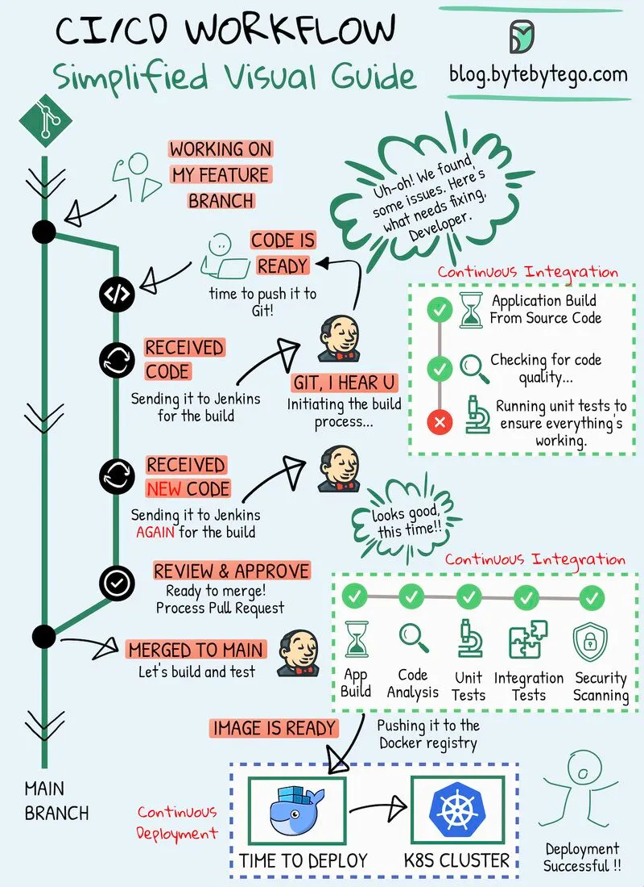

# 149 - Visual guide đơn giản về CI/CD

- Nguồn: ByteByteGo Big Archive System Design 2025
- Trang PDF: 308-309
- Ảnh minh họa: `../assets/149/figure-01.png`

## Hình minh họa

## Dịch sát

Dù bạn là developer, DevOps specialist, tester, hoặc tham gia bất kỳ modern IT role nào, CI/CD pipeline đã trở thành một phần integral của software development process.

Continuous Integration (CI) là practice trong đó code change được combine thường xuyên vào shared repository. Process này gồm automatic check để bảo đảm code mới hoạt động tốt với existing code.

Continuous Deployment (CD) chịu trách nhiệm tự động đưa các code change này vào real-world use. Nó bảo đảm process chuyển code mới lên production mượt và reliable.

Visual guide này được thiết kế để giúp bạn nắm bắt và cải thiện method tạo và deliver software hiệu quả hơn.

## Dịch nội dung trong hình

- Developer làm việc trên `feature branch`, code ready thì gửi PR.
- CI chạy application build from source code, checking code quality và running unit tests.
- Nếu fail, developer sửa bug và gửi lại.
- Nếu pass, PR được review/approve rồi merge vào main.
- CD pipeline build image, chạy code analysis, unit/integration/security scanning.
- Image ready thì deploy tới K8S cluster và deployment successful.

## Tóm tắt & giải thích dễ hiểu

CI giúp phát hiện lỗi sớm trước khi code vào main. CD giúp biến artifact đã kiểm tra thành deployment lặp lại được. Pipeline tốt giảm thao tác thủ công, giảm lỗi release và tăng tốc feedback loop.

## Ví dụ thực tế - không nằm trong tài liệu gốc

Một pull request có thể chạy lint, unit test, typecheck và build Docker image. Sau khi merge main, pipeline push image lên registry, cập nhật Helm chart, ArgoCD sync staging, chạy smoke test rồi promote production bằng manual approval hoặc canary.

## Thuật ngữ chính

- `CI`: Continuous Integration.
- `CD`: Continuous Deployment/Delivery.
- `Feature branch`: branch làm feature.
- `Pull request`: yêu cầu review/merge code.
- `Static analysis`: phân tích code không cần chạy.
- `Security scanning`: quét lỗ hổng.
- `K8S`: Kubernetes.

