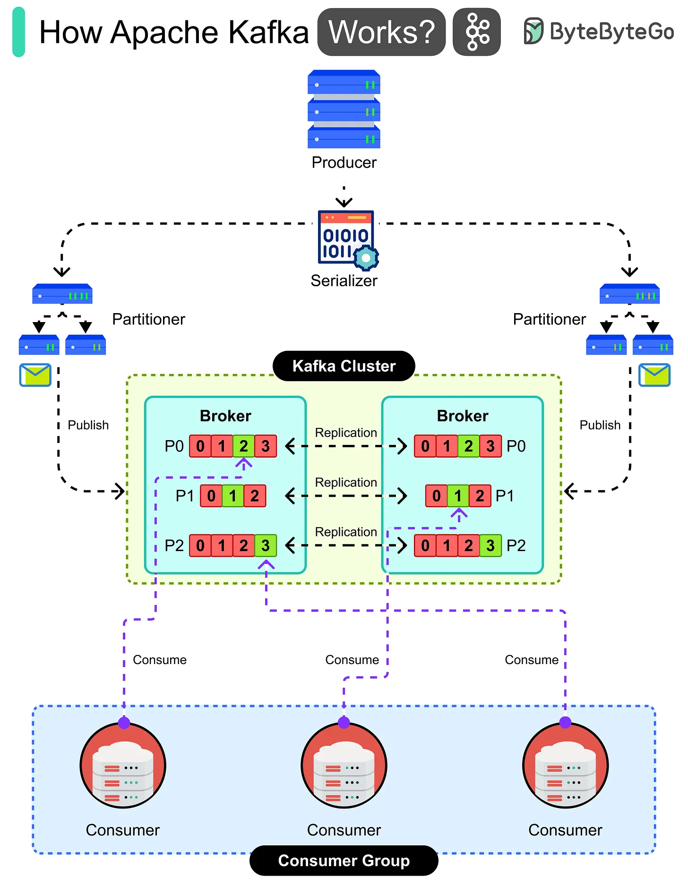

# 150 - Apache Kafka hoạt động như thế nào?

- Nguồn: ByteByteGo Big Archive System Design 2025
- Trang PDF: 310-311
- Ảnh minh họa: `../assets/150/figure-01.png`

## Hình minh họa

## Dịch sát

Apache Kafka là một distributed event streaming platform cho phép producer publish data và consumer subscribe data theo real-time. Đây là cách nó hoạt động:

1. Producer application tạo data, như website click hoặc payment event.

2. Data được serializer convert thành byte để Kafka có thể handle.

3. Partitioner quyết định message nên đi tới topic partition nào.

4. Message được publish vào Kafka cluster gồm nhiều broker.

5. Mỗi broker store partition của topic và replicate chúng sang broker khác để an toàn.

6. Message bên trong partition được store theo order và available để read.

7. Consumer group subscribe topic và chịu trách nhiệm process data.

8. Mỗi consumer trong group read từ các partition khác nhau để balance work.

9. Consumer process data real-time, chẳng hạn update dashboard hoặc trigger action.

## Dịch nội dung trong hình

- Producer gửi message qua serializer và partitioner.
- Kafka cluster có nhiều broker; topic được chia thành partition như P0, P1, P2.
- Partition được replicate giữa broker để tăng durability/availability.
- Consumer group gồm nhiều consumer; mỗi consumer consume một số partition để chia tải.

## Tóm tắt & giải thích dễ hiểu

Kafka lưu event theo topic/partition. Producer ghi event vào topic, partitioner chọn partition, broker lưu và replicate event, consumer group đọc event theo partition. Partition là đơn vị song song hóa và ordering: Kafka bảo đảm order trong một partition, không nhất thiết trên toàn topic.

## Ví dụ thực tế - không nằm trong tài liệu gốc

Payment Service publish event `payment_succeeded` vào Kafka. Email Service gửi receipt, Analytics Service update dashboard, Fraud Service kiểm tra bất thường. Các consumer group độc lập có thể đọc cùng event stream cho mục đích khác nhau.

## Thuật ngữ chính

- `Kafka`: distributed event streaming platform.
- `Producer`: bên publish event.
- `Consumer`: bên đọc/process event.
- `Topic`: luồng event theo chủ đề.
- `Partition`: phần chia của topic.
- `Broker`: server Kafka.
- `Consumer group`: nhóm consumer chia nhau partition.
- `Replication`: sao chép dữ liệu để an toàn.

## Câu hỏi ôn tập + trả lời + thinking học tập + liên hệ

> Đây là phần học tập thêm ở cuối file. Câu hỏi ưu tiên lấy từ tài liệu gốc và được trả lời trực tiếp; nếu bài không có câu hỏi riêng thì dùng tiêu đề/nội dung chính để tạo câu hỏi tự kiểm tra.

### Câu hỏi 1

**Nguồn câu hỏi:** Suy ra từ tiêu đề/nội dung chính vì bài gốc không có câu hỏi riêng.

**Câu hỏi:** How Apache Kafka Works?

**Trả lời:** Hãy tách flow thành các bước có state rõ ràng: request/dữ liệu đi vào đâu, qua thành phần nào, state đổi ở đâu và kết quả trả ra thế nào. Với `Apache Kafka hoạt động như thế nào?`, ý chính là: Kafka lưu event theo topic/partition. Producer ghi event vào topic, partitioner chọn partition, broker lưu và replicate event, consumer group đọc event theo partition. Partition là đơn vị song song hóa và ordering: Kafka bảo đảm order trong một partition, không nhất thiết trên toàn topic.

**Thinking học tập + liên hệ:** Luồng trong `Apache Kafka hoạt động như thế nào?` nên được vẽ từ input tới output, kèm owner của từng bước và failure mode ở mỗi boundary. Lens chính là quality, latency, cost/token, privacy, cập nhật tri thức và rủi ro hallucination. Khi build AI app, hãy nối model với pipeline thật: data vào đâu, context lấy từ đâu, output được kiểm thế nào và chi phí tăng theo traffic ra sao. Khi ghi chú lại, hãy giải thích được các keyword: `Kafka`, `Producer`, `Consumer`, `Topic`, `Partition`.
