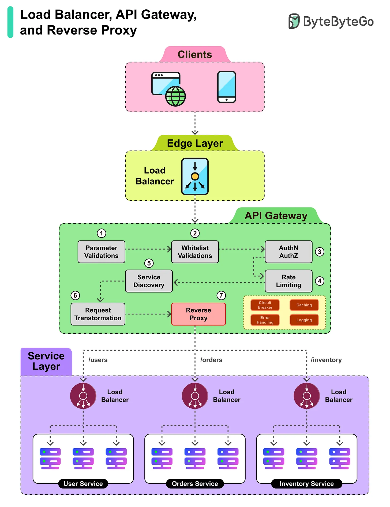

# 151 - Load Balancer vs API Gateway vs Reverse Proxy và cách chúng làm việc cùng nhau

- Nguồn: ByteByteGo Big Archive System Design 2025
- Trang PDF: 312-313
- Ảnh minh họa: `../assets/151/figure-01.png`

## Hình minh họa

## Dịch sát

Mặc dù load balancer, API gateway và reverse proxy thường overlap functionality của nhau, chúng cũng có role cụ thể có thể được leverage trong project.

1. Client request đầu tiên hit edge load balancer, cung cấp single entry point và distribute traffic tới API Gateway.

2. API Gateway tiếp quản và thực hiện initial parameter validation để bảo đảm request well-formed.

3. Tiếp theo, whitelist verification kiểm tra source có trusted và được phép access API hay không.

4. Authentication và authorization validate identity của requester và permission của họ.

5. Rate limiting bảo đảm client không overwhelm system bằng quá nhiều request.

6. Cuối cùng, reverse proxy bên trong gateway forward request tới correct service endpoint.

7. Ở service layer, một load balancer khác distribute request qua nhiều instance của target microservice.

8. Service instance được chọn process request và trả response về client.

## Dịch nội dung trong hình

- `Clients` gửi request vào `Edge Layer`.
- `Load Balancer` phân phối traffic tới `API Gateway`.
- API Gateway gồm parameter validation, whitelist validation, authN/authZ, service discovery, rate limiting, request transformation và reverse proxy.
- Reverse proxy route tới service endpoint như `/users`, `/orders`, `/inventory`.
- `Service Layer` có load balancer riêng trước nhiều instance của User Service, Orders Service, Inventory Service.

## Tóm tắt & giải thích dễ hiểu

Load balancer chủ yếu phân phối traffic. API Gateway là cổng API cấp ứng dụng, xử lý auth, rate limit, validation, routing, transformation. Reverse proxy nhận request thay backend và forward tới service phù hợp. Trong thực tế, một sản phẩm như Nginx/Envoy/Kong có thể đảm nhiệm nhiều vai trò, nhưng tư duy thiết kế nên tách trách nhiệm rõ.

## Ví dụ thực tế - không nằm trong tài liệu gốc

Một request mobile đi qua Cloud Load Balancer, vào Kong API Gateway để validate JWT/rate limit, rồi Kong reverse proxy tới `order-service`. Bên trong Kubernetes, Service load balance request tới một trong nhiều pod `order-service`.

## Thuật ngữ chính

- `Load balancer`: phân phối traffic.
- `API Gateway`: cổng API xử lý policy/routing.
- `Reverse proxy`: proxy đứng trước backend service.
- `AuthN`: authentication.
- `AuthZ`: authorization.
- `Rate limiting`: giới hạn tốc độ request.
- `Service discovery`: tìm endpoint service.

