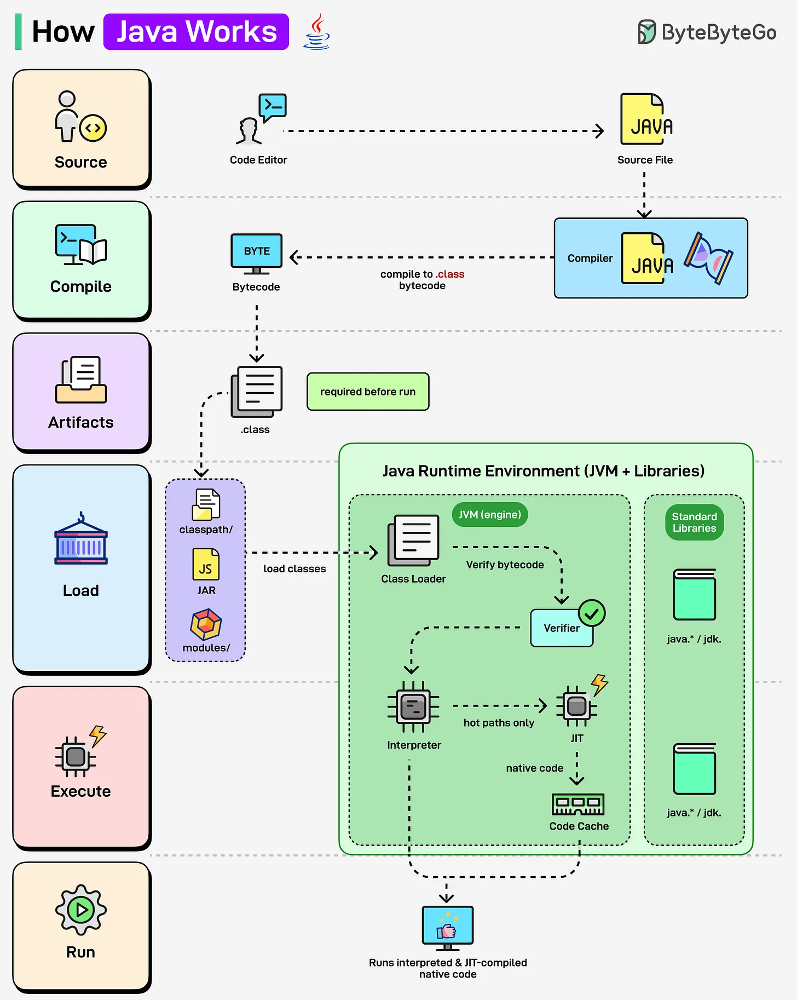

# 152 - Java hoạt động như thế nào?

- Nguồn: ByteByteGo Big Archive System Design 2025
- Trang PDF: 314-315
- Ảnh minh họa: `../assets/152/figure-01.png`

## Hình minh họa

## Dịch sát

Bạn từng tự hỏi điều gì xảy ra phía sau khi chạy một Java program chưa? Hãy cùng tìm hiểu:

Java (JVM Runtime):

- Java source code (`.java`) được compile thành `.class` bytecode bằng `javac`.

- Class Loader load bytecode vào Java Runtime Environment (JVM).

- Bytecode được verify và execute.

- JVM dùng cả Interpreter và JIT Compiler; code được dùng thường xuyên (hot paths) được convert thành native machine code, giúp Java nhanh hơn.

## Dịch nội dung trong hình

- Source file `.java` đi qua compiler thành `.class` bytecode.
- Artifact như JAR được load vào Java Runtime Environment.
- JVM gồm class loader, verifier, interpreter, JIT compiler, code cache và standard libraries.
- Interpreter chạy bytecode ban đầu; hot path được JIT compile thành native code để chạy nhanh hơn.

## Tóm tắt & giải thích dễ hiểu

Java chạy theo mô hình “compile once, run on JVM”. Source code được compile thành bytecode độc lập nền tảng. JVM load, verify và execute bytecode. Ban đầu interpreter chạy code; khi phát hiện đoạn chạy nhiều, JIT compile thành native machine code để tối ưu performance.

## Ví dụ thực tế - không nằm trong tài liệu gốc

Một Java service mới start có thể chưa đạt tốc độ tối đa ngay vì JVM cần warm up JIT. Sau một thời gian nhận traffic, hot method được compile tối ưu, latency có thể ổn định hơn. Đây là lý do benchmark Java cần warm-up phase.

## Thuật ngữ chính

- `JVM`: Java Virtual Machine.
- `javac`: Java compiler.
- `Bytecode`: mã trung gian `.class`.
- `Class Loader`: load class vào JVM.
- `Verifier`: kiểm tra bytecode an toàn/hợp lệ.
- `Interpreter`: thông dịch bytecode.
- `JIT`: Just-In-Time compiler.
- `JAR`: Java archive.

## Câu hỏi ôn tập + trả lời + thinking học tập + liên hệ

> Đây là phần học tập thêm ở cuối file. Câu hỏi ưu tiên lấy từ tài liệu gốc và được trả lời trực tiếp; nếu bài không có câu hỏi riêng thì dùng tiêu đề/nội dung chính để tạo câu hỏi tự kiểm tra.

### Câu hỏi 1

**Nguồn câu hỏi:** Suy ra từ tiêu đề/nội dung chính vì bài gốc không có câu hỏi riêng.

**Câu hỏi:** Java hoạt động như thế nào?

**Trả lời:** Luồng tốt nhất là lần theo input tới output: request/dữ liệu đi vào đâu, qua thành phần nào, state đổi ở đâu và kết quả trả ra thế nào. Với `Java hoạt động như thế nào?`, ý chính là: Java chạy theo mô hình “compile once, run on JVM”. Source code được compile thành bytecode độc lập nền tảng. JVM load, verify và execute bytecode. Ban đầu interpreter chạy code; khi phát hiện đoạn chạy nhiều, JIT compile thành native machine code để tối ưu performance.

**Thinking học tập + liên hệ:** Luồng trong `Java hoạt động như thế nào?` nên được vẽ từ input tới output, kèm owner của từng bước và failure mode ở mỗi boundary. Lens chính là requirement, constraint, traffic, dữ liệu, failure mode và khả năng vận hành của team. Khi gặp system design thật, hãy biến khái niệm thành quyết định: boundary ở đâu, data flow thế nào, bottleneck nào đến trước và rollback ra sao. Khi ghi chú lại, hãy giải thích được các keyword: `JVM`, `javac`, `Bytecode`, `Class Loader`, `Verifier`.
