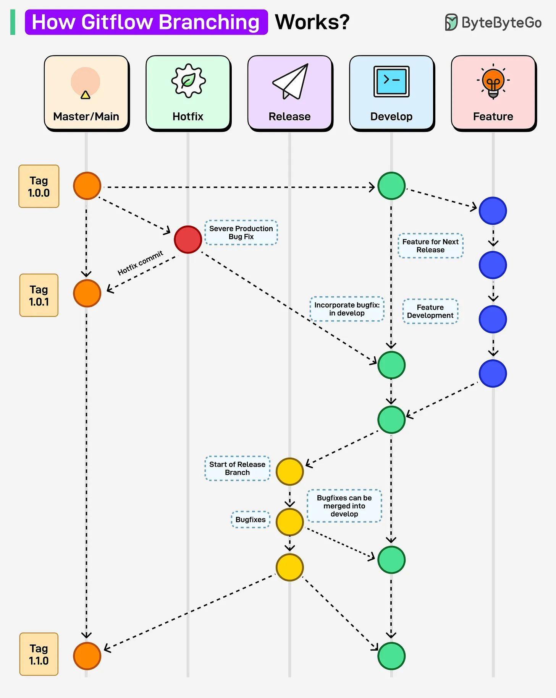

# 153 - Gitflow Branching hoạt động như thế nào?

- Nguồn: ByteByteGo Big Archive System Design 2025
- Trang PDF: 316-317
- Ảnh minh họa: `../assets/153/figure-01.png`

## Hình minh họa

## Dịch sát

Gitflow branching strategy là một Git workflow tổ chức development vào các branch chuyên biệt cho feature, release, hotfix và main production line. Đây là Git branching strategy lý tưởng cho project có deployment versioned định kỳ.

Đây là cách nó hoạt động:

1. Development bắt đầu trên branch `develop`, nơi feature mới được integrate.

2. Mỗi feature branch được tạo từ `develop` và merge trở lại khi feature hoàn tất.

3. Khi chuẩn bị release, một release branch được tạo từ `develop` cho final bug fix.

4. Release branch được merge vào `main` cho production và merge ngược lại `develop` để giữ history consistent.

5. Với urgent fix, hotfix branch được tạo trực tiếp từ `main`, rồi merge trở lại cả `main` và `develop`.

## Dịch nội dung trong hình

- Branch/lane gồm `Master/Main`, `Hotfix`, `Release`, `Develop`, `Feature`.
- Feature branch bắt đầu từ develop và merge về develop.
- Release branch bắt đầu từ develop, fix bug trước release rồi merge vào main và develop.
- Hotfix branch bắt đầu từ main khi cần fix production, rồi merge về main và develop.
- Main có tag release như `1.0.0`, `1.0.1`, `1.1.0`.

## Tóm tắt & giải thích dễ hiểu

Gitflow phù hợp team release theo version/chu kỳ rõ ràng. Nó tách luồng phát triển feature, chuẩn bị release và hotfix production. Đổi lại, Gitflow nhiều branch và ceremony hơn trunk-based development, nên có thể chậm với team deploy liên tục nhiều lần mỗi ngày.

## Ví dụ thực tế - không nằm trong tài liệu gốc

Product desktop release mỗi tháng có thể dùng Gitflow: feature merge vào develop, cuối tháng tạo release branch `release/1.4.0`, QA fix bug, merge vào main tag `v1.4.0`. Nếu production có bug nghiêm trọng, tạo `hotfix/1.4.1` từ main.

## Thuật ngữ chính

- `Gitflow`: branching model có main/develop/feature/release/hotfix.
- `develop`: branch tích hợp feature.
- `feature branch`: branch phát triển tính năng.
- `release branch`: branch chuẩn bị phát hành.
- `hotfix branch`: branch sửa lỗi production khẩn cấp.
- `tag`: nhãn version trong Git.
- `Trunk-based development`: workflow phát triển gần main/trunk hơn.

