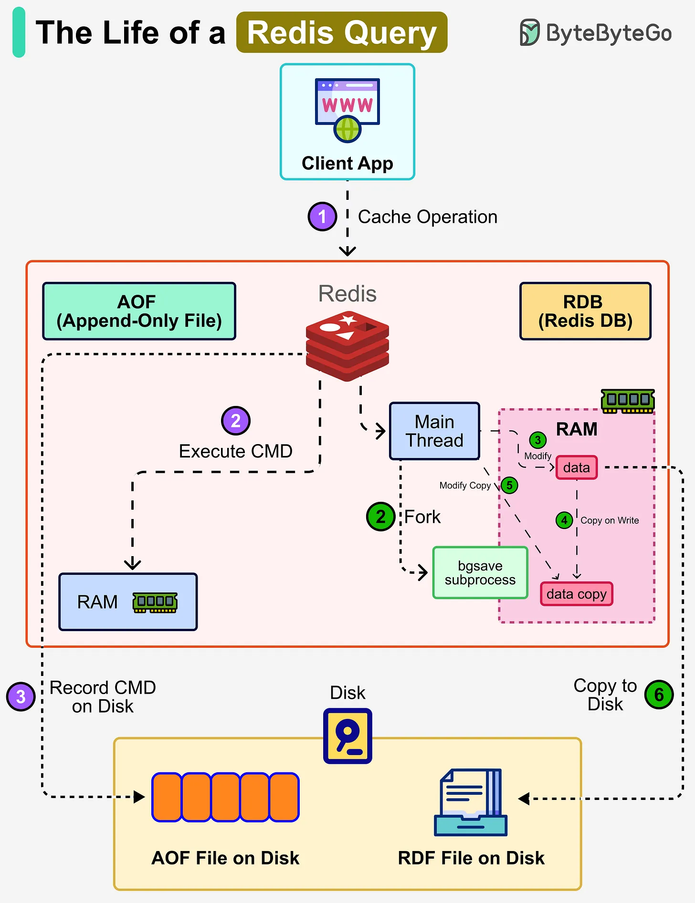

# 154 - Vòng đời của một Redis query

- Nguồn: ByteByteGo Big Archive System Design 2025
- Trang PDF: 318-319
- Ảnh minh họa: `../assets/154/figure-01.png`

## Hình minh họa

## Dịch sát

Redis là một in-memory database, nghĩa là toàn bộ data sống trong RAM để có tốc độ cao. Tuy nhiên, nếu server crash hoặc restart, data có thể bị mất. Để giải quyết problem này, Redis cung cấp hai persistence mechanism để write data xuống disk:

1. AOF (Append-Only File)
   Khi client gửi command, Redis trước tiên execute nó trong memory (RAM). Sau đó, Redis log command bằng cách append nó vào AOF file trên disk. Điều này bảo đảm mọi operation có thể được replay sau này để rebuild dataset. Vì command được execute trước và log sau đó, write là non-blocking. Recovery process dùng event log để replay các recorded command.

2. RDB (Redis Database)
   Thay vì write mọi command, Redis có thể định kỳ take snapshot của toàn bộ dataset.

   Main thread fork một subprocess (`bgsave`) chia sẻ toàn bộ in-memory data của main thread. Subprocess `bgsave` đọc data từ main thread và write vào RDB file.

   Redis dùng copy-on-write. Khi main thread modify data, một copy của data được tạo và process làm việc trên bản đó để write không bị block. Snapshot sau đó được write thành RDB file trên disk, cho phép Redis nhanh chóng reload snapshot vào memory khi cần.

3. Mixed Approach
   Trong production, Redis thường dùng cả AOF và RDB. RDB cung cấp fast reload với compact snapshot. AOF bảo đảm durability bằng cách record mọi operation kể từ snapshot gần nhất.

## Dịch nội dung trong hình

- Client app gửi cache operation tới Redis.
- `AOF`: Redis execute command trong RAM, rồi record command on disk vào AOF file.
- `RDB`: main thread fork `bgsave` subprocess, copy-on-write RAM data rồi copy to disk thành RDB file.
- Recovery có thể replay AOF command hoặc load RDB snapshot.

## Tóm tắt & giải thích dễ hiểu

Redis nhanh vì chạy in-memory, nhưng cần persistence để giảm mất dữ liệu. AOF giống nhật ký lệnh, replay được nhiều operation chi tiết hơn. RDB giống snapshot định kỳ, load nhanh và file gọn hơn. Production thường kết hợp cả hai để cân bằng durability và recovery speed.

## Ví dụ thực tế - không nằm trong tài liệu gốc

Nếu Redis dùng cho session quan trọng, bật AOF với fsync phù hợp để giảm mất dữ liệu khi crash. Nếu Redis chỉ là cache có thể rebuild, RDB hoặc không persistence có thể đủ. Với workload write nhiều, cần đo overhead persistence và disk I/O.

## Thuật ngữ chính

- `Redis`: in-memory data store.
- `AOF`: Append-Only File.
- `RDB`: Redis Database snapshot.
- `bgsave`: subprocess tạo RDB snapshot.
- `Copy-on-write`: copy dữ liệu khi có ghi mới.
- `Replay`: chạy lại log command để rebuild data.
- `Durability`: độ bền dữ liệu sau crash.

