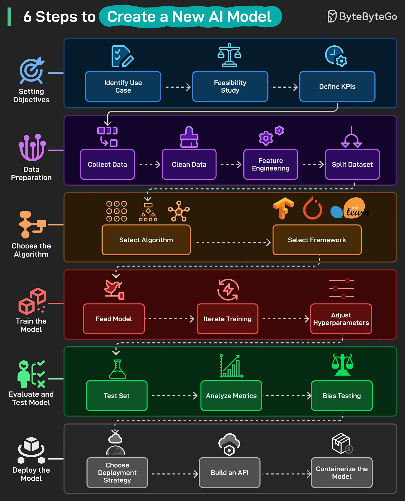

# 155 - 6 bước để tạo một AI model mới

- Nguồn: ByteByteGo Big Archive System Design 2025
- Trang PDF: 320-321
- Ảnh minh họa: `../assets/155/figure-01.png`

## Hình minh họa

## Dịch sát

1. Setting Objectives: Define problem cần được AI model giải quyết bằng cách identify use case, check feasibility và set KPI rõ ràng cho success.

2. Data Preparation: Gather và clean raw data, engineer useful feature và split data thành training, validation và test set.

3. Choose the Algorithm: Chọn algorithm đúng cho problem của bạn và chọn framework, ví dụ TensorFlow, PyTorch, Scikit-Learn.

4. Train the Model: Feed data vào model, iterate training và tune hyperparameter cho tới khi performance cải thiện.

5. Evaluate and Test Model: Test trên unseen data, analyze performance metric và check bias hoặc unfair outcome.

6. Deploy the Model: Chọn deployment strategy, build API và containerize model cho production use.

## Dịch nội dung trong hình

- `Setting Objectives`: identify use case, feasibility study, define KPIs.
- `Data Preparation`: collect data, clean data, feature engineering, split dataset.
- `Choose the Algorithm`: select algorithm và select framework.
- `Train the Model`: feed model, iterate training, adjust hyperparameters.
- `Evaluate and Test Model`: test set, analyze metrics, bias testing.
- `Deploy the Model`: choose deployment strategy, build an API, containerize the model.

## Tóm tắt & giải thích dễ hiểu

Tạo AI model không bắt đầu từ thuật toán mà bắt đầu từ mục tiêu và dữ liệu. Nếu use case mơ hồ hoặc data bẩn, model khó tốt. Sau training, cần evaluate bằng dữ liệu chưa thấy, kiểm tra bias, rồi deploy như một software system có API, monitoring và rollback.

## Ví dụ thực tế - không nằm trong tài liệu gốc

Muốn tạo model dự đoán churn, trước hết define KPI như AUC/precision@k và impact business. Sau đó thu thập lịch sử sử dụng, làm feature như số lần login/thanh toán, train model, test trên tháng gần nhất, kiểm tra bias theo nhóm user, rồi deploy API scoring batch hoặc realtime.

## Thuật ngữ chính

- `KPI`: chỉ số thành công.
- `Feature engineering`: tạo đặc trưng từ dữ liệu.
- `Training set`: dữ liệu train.
- `Validation set`: dữ liệu tune model.
- `Test set`: dữ liệu đánh giá cuối.
- `Hyperparameter`: tham số cấu hình quá trình học.
- `Bias testing`: kiểm tra thiên lệch.
- `Model deployment`: đưa model vào production.

