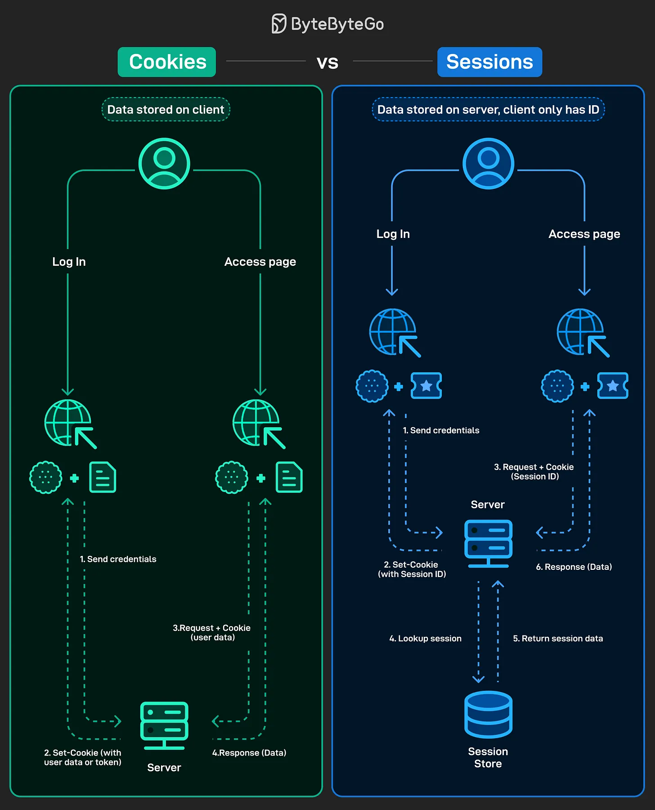

# 156 - Cookies vs Sessions

- Nguồn: ByteByteGo Big Archive System Design 2025
- Trang PDF: 322-323
- Ảnh minh họa: `../assets/156/figure-01.png`

## Hình minh họa

## Dịch sát

Mọi web app đều cần một cách để remember user sau khi họ login, và cách chúng quản lý việc này tạo khác biệt lớn về performance, scalability và security của web application đó.

Cookies:

- Store data trực tiếp trên client, như user info hoặc token.
- Mỗi request gửi cookie trở lại server.
- Đơn giản hơn để implement, nhưng có thể expose data nếu không secure đúng cách.

Sessions:

- Store data trên server; client chỉ giữ Session ID trong cookie.
- Mỗi request dùng Session ID, và server lookup data trong session store.
- An toàn hơn, nhưng cần thêm server-side storage và management.

## Dịch nội dung trong hình

- `Cookies`: data stored on client. Khi login, server trả cookie; khi access page, client gửi cookie lên server; server dùng cookie để xử lý và trả response.
- `Sessions`: data stored on server, client only has ID. Client gửi credential, server tạo session trong session store và trả session ID qua cookie; request sau gửi session ID, server lookup session data rồi trả response.

## Tóm tắt & giải thích dễ hiểu

Cookie là cơ chế lưu dữ liệu nhỏ ở client và tự gửi theo request tới domain phù hợp. Session là mô hình lưu state ở server, client chỉ giữ session ID. Cookie tiện và scale tốt hơn nếu stateless, nhưng dữ liệu nhạy cảm không nên để lộ. Session kiểm soát tốt hơn phía server, dễ revoke hơn, nhưng cần session store như Redis và phải scale nó.

## Ví dụ thực tế - không nằm trong tài liệu gốc

Một app có thể lưu session ID trong cookie `HttpOnly; Secure; SameSite=Lax`, còn dữ liệu user/role nằm trong Redis session store. Nếu dùng JWT trong cookie, cần đặt expiration ngắn, không lưu secret trong payload và có chiến lược revoke/refresh token.

## Thuật ngữ chính

- `Cookie`: dữ liệu nhỏ browser lưu theo domain.
- `Session`: trạng thái login lưu phía server.
- `Session ID`: ID tham chiếu session.
- `HttpOnly`: cookie không đọc được từ JavaScript.
- `Secure`: chỉ gửi cookie qua HTTPS.
- `SameSite`: hạn chế gửi cookie cross-site.
- `Session store`: nơi lưu session server-side.

## Câu hỏi ôn tập + trả lời + thinking học tập + liên hệ

> Đây là phần học tập thêm ở cuối file. Câu hỏi ưu tiên lấy từ tài liệu gốc và được trả lời trực tiếp; nếu bài không có câu hỏi riêng thì dùng tiêu đề/nội dung chính để tạo câu hỏi tự kiểm tra.

### Câu hỏi 1

**Nguồn câu hỏi:** Suy ra từ tiêu đề/nội dung chính vì bài gốc không có câu hỏi riêng.

**Câu hỏi:** Sau khi đọc bài “Cookies vs Sessions”, ý chính cần trả lời và áp dụng vào system design là gì?

**Trả lời:** Điểm khác nhau nên nhìn từ boundary và trách nhiệm chính. Với `Cookies vs Sessions`, hãy tách rõ mỗi bên giải quyết vấn đề gì, dữ liệu đi qua đâu, ai sở hữu state và lỗi sẽ lan như thế nào. Ý chính để giữ lại là: Cookie là cơ chế lưu dữ liệu nhỏ ở client và tự gửi theo request tới domain phù hợp. Session là mô hình lưu state ở server, client chỉ giữ session ID. Cookie tiện và scale tốt hơn nếu stateless, nhưng dữ liệu nhạy cảm không nên để lộ. Session kiểm soát tốt hơn phía server, dễ revoke hơn, nhưng cần session store như Redis và phải scale nó.

**Thinking học tập + liên hệ:** Khi so sánh trong `Cookies vs Sessions`, hãy tách responsibility, boundary, state, failure mode và cost vận hành thay vì chỉ so tên công nghệ. Lens chính là actor, trust boundary, dữ liệu nhạy cảm, lifetime của token/key, quyền truy cập và cơ chế revoke. Khi làm API thật, một endpoint chạy được chưa đủ; phải kiểm thêm abuse, audit log, error leakage, rate limit và quyền ở service chứa dữ liệu. Khi ghi chú lại, hãy giải thích được các keyword: `Cookie`, `Session`, `Session ID`, `HttpOnly`, `Secure`.
