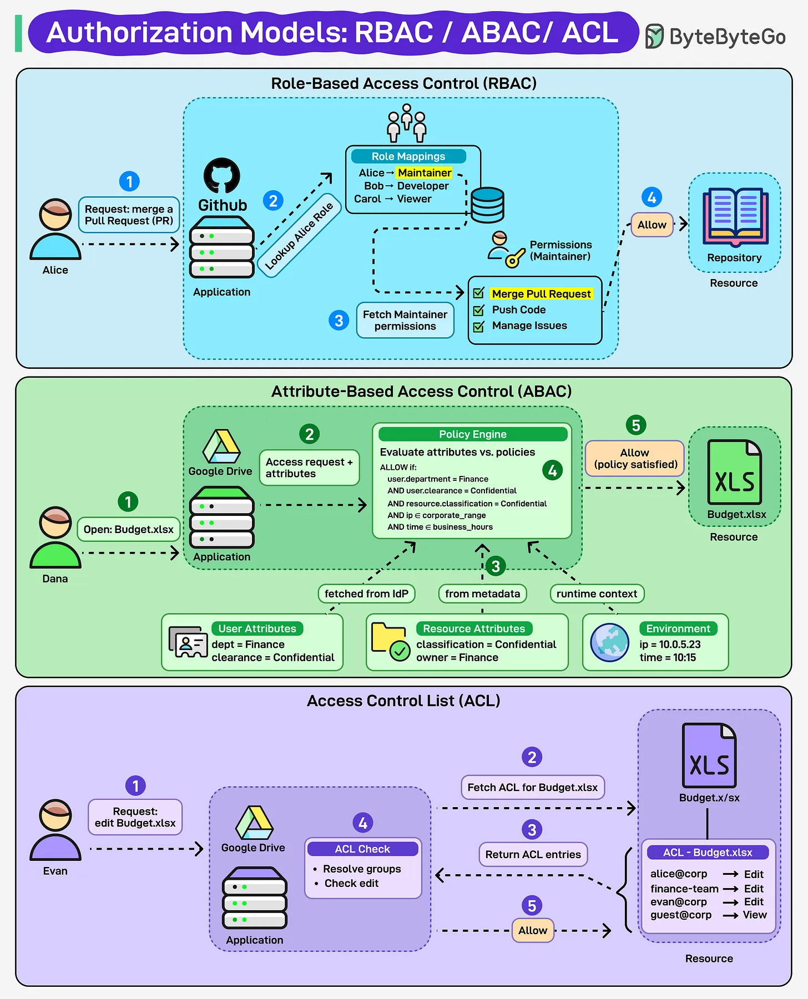

# 157 - Giải thích rõ Access Control

- Nguồn: ByteByteGo Big Archive System Design 2025
- Trang PDF: 324-325
- Ảnh minh họa: `../assets/157/figure-01.png`

## Hình minh họa

## Dịch sát

Access control quyết định ai được vào và ai bị khóa bên ngoài - nhưng rule thì khác nhau.

- Role-Based Access Control (RBAC): Access dựa trên role, ví dụ Maintainer, Viewer. Đơn giản, scalable.

- Attribute-Based Access Control (ABAC): Access dựa trên attribute như user, resource, environment. Linh hoạt, nhưng phức tạp.

- Access Control List (ACL): Permission explicit cho từng user hoặc group. Trực tiếp, nhưng khó manage ở scale lớn.

RBAC = roles.
ABAC = attributes.
ACL = explicit permissions.

## Dịch nội dung trong hình

- `RBAC`: Alice request merge pull request; GitHub app fetch role mapping/permissions, role Maintainer có quyền merge pull request/push code/manage issues nên allow repository resource.
- `ABAC`: Dana mở budget.xlsx trong Google Drive; policy engine evaluate attribute như job title, clearance, file confidentiality, current time/location rồi allow.
- `ACL`: Evan request edit budget.xlsx; app fetch ACL for file, check ACL entry theo user/group như accountant/edit, employee/read, guest/view rồi allow/deny.

## Tóm tắt & giải thích dễ hiểu

RBAC dễ hiểu vì quyền đi theo vai trò. ABAC mạnh hơn vì quyết định dựa trên nhiều điều kiện động. ACL rõ ràng cho từng resource nhưng khi user/resource nhiều thì quản lý rất nặng.

Trong hệ thống thực tế, các mô hình thường được kết hợp: role cho quyền cơ bản, attribute cho rule ngữ cảnh, ACL cho sharing tài nguyên cụ thể.

## Ví dụ thực tế - không nằm trong tài liệu gốc

Google Drive-like app có thể dùng RBAC cho admin/editor/viewer, ACL cho từng file được share, và ABAC để chặn download file mật nếu user ngoài văn phòng hoặc thiết bị chưa compliant.

## Thuật ngữ chính

- `Access control`: kiểm soát truy cập.
- `RBAC`: role-based access control.
- `ABAC`: attribute-based access control.
- `ACL`: access control list.
- `Role`: vai trò như Admin/Viewer.
- `Attribute`: thuộc tính user/resource/environment.
- `Policy engine`: thành phần đánh giá rule truy cập.

