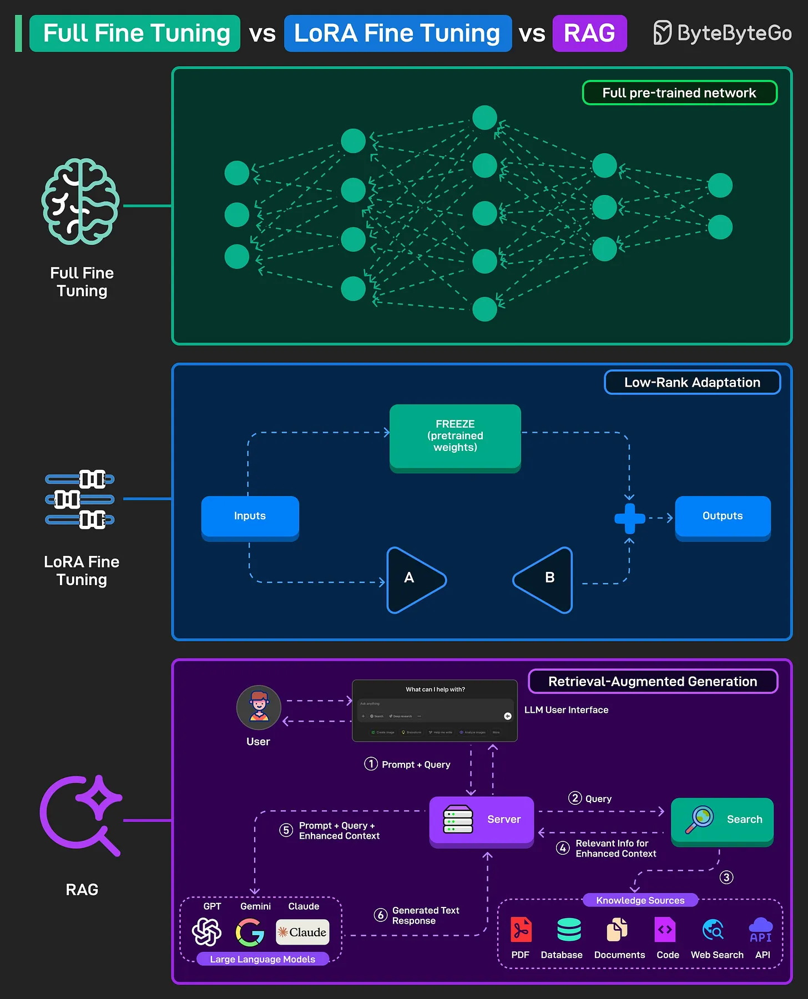

# 158 - Full Fine-Tuning vs LoRA vs RAG

- Nguồn: ByteByteGo Big Archive System Design 2025
- Trang PDF: 326-327
- Ảnh minh họa: `../assets/158/figure-01.png`

## Hình minh họa

## Dịch sát

Cả ba đều là các cách khác nhau để adapt một large pre-trained language model cho task hoặc knowledge mới.

1. Full Fine-Tuning
   Toàn bộ pre-trained model được retrain trên data mới. Điều này nghĩa là tất cả weight của network được update, cho accuracy cao nhưng cần nhiều computing power và storage hơn.

2. LoRA Fine-Tuning
   LoRA là Low-Rank Adaptation. Thay vì thay đổi toàn bộ model, main weights được freeze, và chỉ các small additional layer được train. Cách này nhanh hơn và rẻ hơn nhiều so với full fine-tuning trong khi vẫn adapt model cho task mới.

3. RAG
   RAG là retrieval-augmented generation. Model không retrain. Thay vào đó, nó retrieve thông tin từ external source như database, web, document, v.v. khi cần. Query được enhance bằng relevant context trước khi passed tới model, làm nó accurate và up-to-date hơn mà không cần heavy retraining.

## Dịch nội dung trong hình

- `Full Fine Tuning`: cập nhật full pre-trained network.
- `LoRA Fine Tuning`: freeze pretrained weights, train low-rank adapter A/B để tạo output.
- `RAG`: user query qua LLM interface, retrieve context từ search/vector/database/document rồi đưa vào LLM để generate response.

## Tóm tắt & giải thích dễ hiểu

Full fine-tuning thay đổi toàn bộ model, mạnh nhưng tốn kém và rủi ro quên kiến thức cũ. LoRA train thêm adapter nhỏ, tiết kiệm hơn và dễ quản lý nhiều domain/task. RAG không train model mà đưa knowledge bên ngoài vào context, phù hợp khi cần cập nhật dữ liệu thường xuyên.

Nếu kiến thức thay đổi liên tục, ưu tiên RAG. Nếu cần model học style/task domain riêng nhưng chi phí vừa phải, dùng LoRA. Nếu có nhiều data, compute và cần tối ưu sâu, cân nhắc full fine-tuning.

## Ví dụ thực tế - không nằm trong tài liệu gốc

Chatbot hỏi chính sách công ty nên dùng RAG vì policy đổi thường xuyên. Model phân loại ticket theo taxonomy riêng có thể dùng LoRA. Model chuyên ngành y tế cực kỳ đặc thù với dataset lớn có thể cần full fine-tuning hoặc post-training mạnh hơn.

## Thuật ngữ chính

- `Fine-tuning`: train tiếp model cho task/domain.
- `LoRA`: Low-Rank Adaptation.
- `Frozen weights`: weight gốc không update.
- `Adapter`: layer nhỏ train thêm.
- `RAG`: Retrieval-Augmented Generation.
- `External knowledge`: tri thức ngoài model.
- `Context`: thông tin đưa vào prompt.

