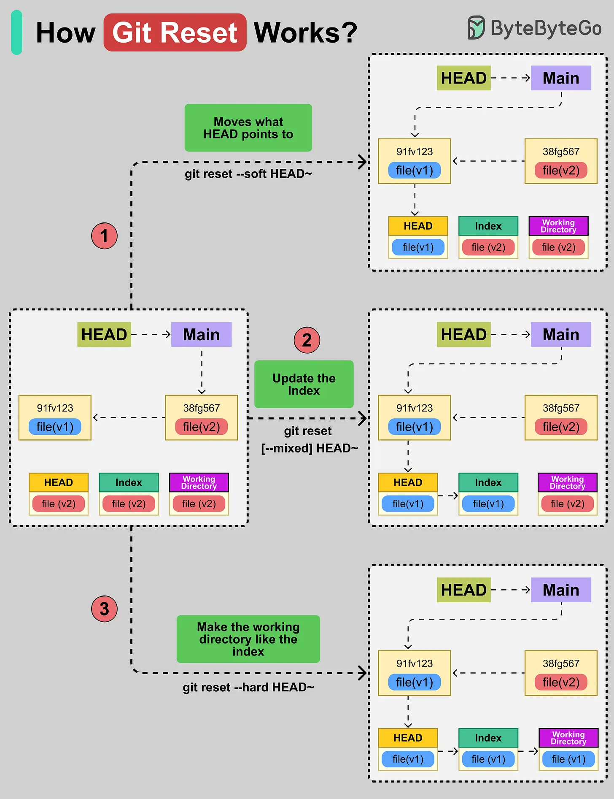

# 159 - Git Reset hoạt động như thế nào?

- Nguồn: ByteByteGo Big Archive System Design 2025
- Trang PDF: 328-329
- Ảnh minh họa: `../assets/159/figure-01.png`

## Hình minh họa

## Dịch sát

Git Reset di chuyển git branch hiện tại của bạn (HEAD) tới một commit khác và có thể làm index và working directory match commit đó.

Có ba option với command `git reset`:

1. Move HEAD (`--soft`)
   Di chuyển nơi HEAD trỏ tới. Tuy nhiên, index và working file giữ nguyên. Ví dụ, command `git reset --soft HEAD~` di chuyển pointer lùi lại một commit.

2. Updating the Index (`--mixed`)
   Đây là option mặc định. Nó update index với content của snapshot mà HEAD hiện trỏ tới, nhưng để working file của bạn nguyên vẹn.

3. Updating the Working Directory (`--hard`)
   Option này di chuyển HEAD, reset index và làm working directory match commit đó. Command `git reset --hard HEAD~` set mọi thứ gồm pointer, index, file về commit cũ hơn.

## Dịch nội dung trong hình

- `--soft`: move what HEAD points to; working directory và index không đổi.
- `--mixed`: update index; working directory giữ nguyên.
- `--hard`: make working directory like the index; HEAD, index và working tree đều quay về commit target.

## Tóm tắt & giải thích dễ hiểu

`git reset` tác động lên ba vùng: HEAD/branch pointer, staging area/index và working directory. `--soft` chỉ đổi commit pointer, giữ thay đổi staged. `--mixed` bỏ staged nhưng giữ file thay đổi. `--hard` nguy hiểm nhất vì xóa thay đổi trong working directory để khớp commit.

## Ví dụ thực tế - không nằm trong tài liệu gốc

Nếu commit nhầm nhưng muốn giữ thay đổi để commit lại: `git reset --soft HEAD~1`. Nếu muốn bỏ staged nhưng giữ file: `git reset HEAD~1` hoặc `--mixed`. Nếu chắc chắn muốn vứt mọi thay đổi local: `git reset --hard`, nhưng nên kiểm tra `git status` trước.

## Thuật ngữ chính

- `HEAD`: con trỏ tới commit hiện tại.
- `Index`: staging area.
- `Working directory`: file đang nằm trong thư mục làm việc.
- `Commit`: snapshot trong Git.
- `--soft`: reset chỉ HEAD.
- `--mixed`: reset HEAD và index.
- `--hard`: reset HEAD, index và working tree.

## Câu hỏi ôn tập + trả lời + thinking học tập + liên hệ

> Đây là phần học tập thêm ở cuối file. Câu hỏi ưu tiên lấy từ tài liệu gốc và được trả lời trực tiếp; nếu bài không có câu hỏi riêng thì dùng tiêu đề/nội dung chính để tạo câu hỏi tự kiểm tra.

### Câu hỏi 1

**Nguồn câu hỏi:** Suy ra từ tiêu đề/nội dung chính vì bài gốc không có câu hỏi riêng.

**Câu hỏi:** How Git Reset Works?

**Trả lời:** Hãy tách flow thành các bước có state rõ ràng: request/dữ liệu đi vào đâu, qua thành phần nào, state đổi ở đâu và kết quả trả ra thế nào. Với `Git Reset hoạt động như thế nào?`, ý chính là: `git reset` tác động lên ba vùng: HEAD/branch pointer, staging area/index và working directory. `--soft` chỉ đổi commit pointer, giữ thay đổi staged. `--mixed` bỏ staged nhưng giữ file thay đổi. `--hard` nguy hiểm nhất vì xóa thay đổi trong working directory để khớp commit.

**Thinking học tập + liên hệ:** Luồng trong `Git Reset hoạt động như thế nào?` nên được vẽ từ input tới output, kèm owner của từng bước và failure mode ở mỗi boundary. Lens chính là feedback loop, rollback, collaboration, code review và mức tự động hóa phù hợp team. Khi áp dụng vào team thật, hãy nhìn developer workflow như một hệ thống: commit, review, test, deploy và rollback đều phải giảm rủi ro production. Khi ghi chú lại, hãy giải thích được các keyword: `HEAD`, `Index`, `Working directory`, `Commit`, `--soft`.
