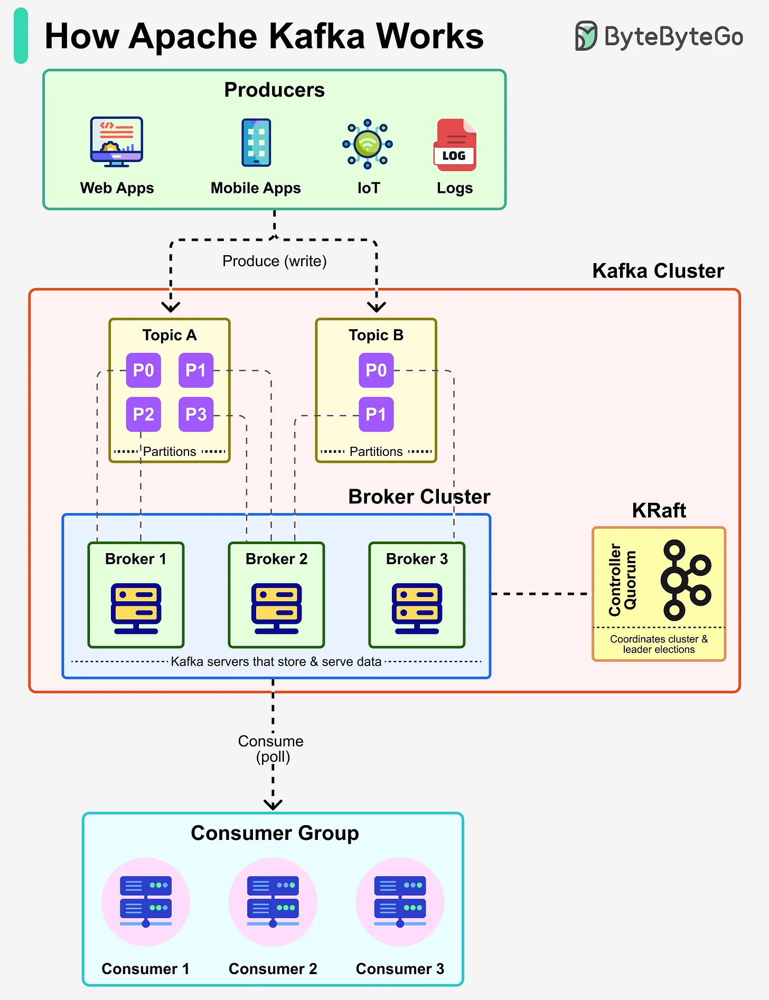

# 160 - Giải thích Apache Kafka ở high level

- Nguồn: ByteByteGo Big Archive System Design 2025
- Trang PDF: 330-331
- Ảnh minh họa: `../assets/160/figure-01.png`

## Hình minh họa

## Dịch sát

Từ Netflix tới Uber tới LinkedIn, Apache Kafka là backbone của real-time data infrastructure. Nó là một distributed event streaming platform được xây để handle massive stream of data với low latency và high reliability.

- Producers: Application như web, mobile, IoT, log, v.v. publish message tới Kafka topic.

- Topics & Partitions: Message được organize thành topic, topic được split thành partition cho scalability và parallelism.

- Broker Cluster: Kafka broker store và serve partitioned data. Nhiều broker tạo thành cluster để bảo đảm reliability và fault tolerance.

- KRaft (Controller Quorum): Coordinate cluster metadata và leader election, bảo đảm cluster remain consistent.

- Consumer Groups: Application subscribe topic và consume message.

## Dịch nội dung trong hình

- `Producers`: web apps, mobile apps, IoT, logs publish/write tới Topic A/B.
- `Kafka Cluster`: topic chia partition P0/P1/P2/P3; broker cluster gồm Broker 1/2/3.
- `KRaft`: controller quorum quản lý cluster metadata và leader election.
- `Consumer Group`: Consumer 1/2/3 consume/read từ các partition.

## Tóm tắt & giải thích dễ hiểu

Kafka là log phân tán cho event. Producer ghi event vào topic. Topic được chia partition để scale và giữ order trong từng partition. Broker lưu partition và replicate để chịu lỗi. Consumer group đọc song song, mỗi partition thường được một consumer trong group xử lý tại một thời điểm.

## Ví dụ thực tế - không nằm trong tài liệu gốc

Clickstream từ web/mobile có thể publish vào topic `user_events`. Một consumer group cập nhật dashboard real-time, group khác train recommendation feature, group khác phát hiện fraud. Các group đọc độc lập từ cùng event stream.

## Thuật ngữ chính

- `Event streaming`: xử lý dòng event liên tục.
- `Topic`: kênh event.
- `Partition`: phần chia của topic.
- `Broker`: node Kafka.
- `KRaft`: cơ chế metadata quorum mới của Kafka.
- `Leader election`: chọn leader cho partition/metadata.
- `Consumer group`: nhóm consumer chia tải.

## Câu hỏi ôn tập + trả lời + thinking học tập + liên hệ

> Đây là phần học tập thêm ở cuối file. Câu hỏi ưu tiên lấy từ tài liệu gốc và được trả lời trực tiếp; nếu bài không có câu hỏi riêng thì dùng tiêu đề/nội dung chính để tạo câu hỏi tự kiểm tra.

### Câu hỏi 1

**Nguồn câu hỏi:** Suy ra từ tiêu đề/nội dung chính vì bài gốc không có câu hỏi riêng.

**Câu hỏi:** Sau khi đọc bài “Apache Kafka Explained (At the high level)”, ý chính cần trả lời và áp dụng vào system design là gì?

**Trả lời:** Nếu rút thành checklist thiết kế thì ý chính là: Kafka là log phân tán cho event. Producer ghi event vào topic. Topic được chia partition để scale và giữ order trong từng partition. Broker lưu partition và replicate để chịu lỗi. Consumer group đọc song song, mỗi partition thường được một consumer trong group xử lý tại một thời điểm. Khi áp dụng vào hệ thống thật, hãy kiểm thêm quality, latency, cost/token, privacy, cập nhật tri thức và rủi ro hallucination.

**Thinking học tập + liên hệ:** Ôn tập `Giải thích Apache Kafka ở high level` bằng cách biến khái niệm thành quyết định thiết kế cụ thể: chọn gì, bỏ gì, đo gì và ai chịu trách nhiệm. Lens chính là quality, latency, cost/token, privacy, cập nhật tri thức và rủi ro hallucination. Khi build AI app, hãy nối model với pipeline thật: data vào đâu, context lấy từ đâu, output được kiểm thế nào và chi phí tăng theo traffic ra sao. Khi ghi chú lại, hãy giải thích được các keyword: `Event streaming`, `Topic`, `Partition`, `Broker`, `KRaft`.
