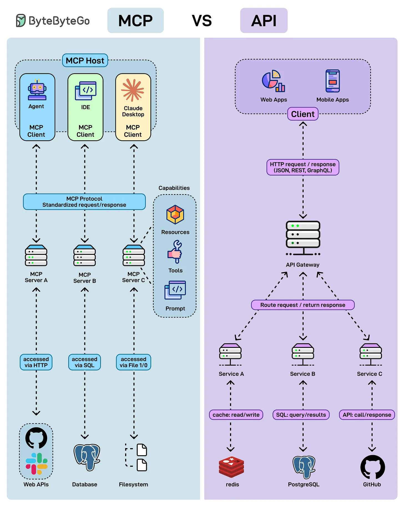

# 161 - MCP vs API: khác nhau ở đâu?

- Nguồn: ByteByteGo Big Archive System Design 2025
- Trang PDF: 332-333
- Ảnh minh họa: `../assets/161/figure-01.png`

## Hình minh họa

## Dịch sát

API đã là backbone của software-to-software communication trong nhiều thập kỷ. Bây giờ, một người chơi mới - Model Context Protocol (MCP) - đang nổi lên như một AI-native protocol được thiết kế cho agent, IDE và LLM.

API (Application Programming Interface):

- Purpose: Enable software-to-software communication.
- Discovery: Requires documentation.
- Standardization: Varies - REST, GraphQL, gRPC, v.v.

MCP (Model Context Protocol):

- Purpose: Enable AI-native communication giữa client như agent, IDE, LLM và server.
- Discovery: Self-describing, không cần external docs.
- Standardization: Một uniform protocol cho resources, tools và prompts.

## Dịch nội dung trong hình

- `MCP`: MCP host gồm agent/IDE/Claude Desktop dùng MCP client; MCP protocol standard request/response tới MCP server A/B/C; capability gồm resources, tools, prompts; server có thể access web API, database, filesystem qua HTTP/DB/file I/O.
- `API`: web/mobile client gửi HTTP request/response qua API Gateway tới service A/B/C; backend service gọi Redis, PostgreSQL, GitHub; cần route request/return response theo endpoint.

## Tóm tắt & giải thích dễ hiểu

API là contract cho phần mềm gọi nhau. MCP là contract được thiết kế để AI client khám phá và dùng tool/context theo cách thống nhất. API thường cần doc để developer hiểu endpoint. MCP cố gắng self-describing để agent biết tool/resource/prompt nào có sẵn và schema dùng ra sao.

MCP không thay thế API hoàn toàn. MCP server thường vẫn gọi API/database/file system bên dưới. Nó là lớp adapter AI-native phía trên các capability đó.

## Ví dụ thực tế - không nằm trong tài liệu gốc

Một weather API có endpoint `/forecast?city=...`. Developer đọc docs để gọi. Với MCP weather server, agent có thể discover tool `get_forecast`, biết schema input/output và gọi tool qua MCP mà không cần đọc docs riêng.

## Thuật ngữ chính

- `API`: Application Programming Interface.
- `MCP`: Model Context Protocol.
- `AI-native`: thiết kế trực tiếp cho AI/agent.
- `Self-describing`: tự mô tả capability/schema.
- `Resource`: dữ liệu/context MCP cung cấp.
- `Tool`: action MCP cho phép gọi.
- `Prompt`: prompt template/capability trong MCP.

## Câu hỏi ôn tập + trả lời + thinking học tập + liên hệ

> Đây là phần học tập thêm ở cuối file. Câu hỏi ưu tiên lấy từ tài liệu gốc và được trả lời trực tiếp; nếu bài không có câu hỏi riêng thì dùng tiêu đề/nội dung chính để tạo câu hỏi tự kiểm tra.

### Câu hỏi 1

**Nguồn câu hỏi:** Suy ra từ tiêu đề/nội dung chính vì bài gốc không có câu hỏi riêng.

**Câu hỏi:** MCP vs API: what's the difference?

**Trả lời:** Điểm khác nhau nên nhìn từ boundary và trách nhiệm chính. Với `MCP vs API: khác nhau ở đâu?`, hãy tách rõ mỗi bên giải quyết vấn đề gì, dữ liệu đi qua đâu, ai sở hữu state và lỗi sẽ lan như thế nào. Ý chính để giữ lại là: API là contract cho phần mềm gọi nhau. MCP là contract được thiết kế để AI client khám phá và dùng tool/context theo cách thống nhất. API thường cần doc để developer hiểu endpoint. MCP cố gắng self-describing để agent biết tool/resource/prompt nào có sẵn và schema dùng ra sao.

**Thinking học tập + liên hệ:** Khi so sánh trong `MCP vs API: khác nhau ở đâu?`, hãy tách responsibility, boundary, state, failure mode và cost vận hành thay vì chỉ so tên công nghệ. Lens chính là quality, latency, cost/token, privacy, cập nhật tri thức và rủi ro hallucination. Khi build AI app, hãy nối model với pipeline thật: data vào đâu, context lấy từ đâu, output được kiểm thế nào và chi phí tăng theo traffic ra sao. Khi ghi chú lại, hãy giải thích được các keyword: `API`, `MCP`, `AI-native`, `Self-describing`, `Resource`.
