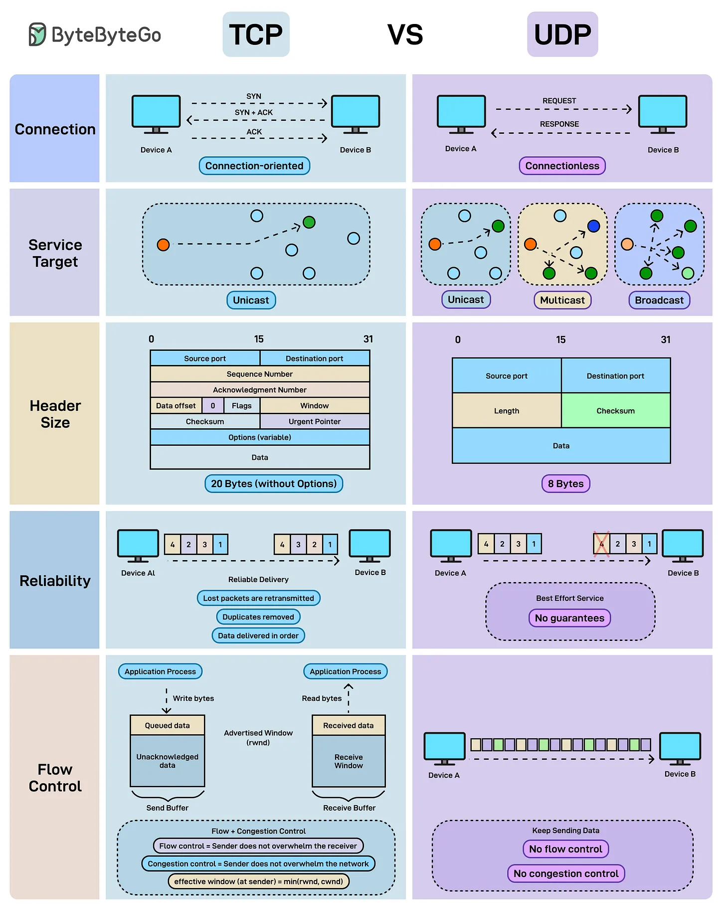

# 162 - TCP vs UDP

- Nguồn: ByteByteGo Big Archive System Design 2025
- Trang PDF: 334
- Ảnh minh họa: `../assets/162/figure-01.png`

## Hình minh họa

## Dịch sát

Mỗi lần data di chuyển qua internet, nó chọn giữa accuracy và speed. Đó là TCP vs UDP.

TCP: Connection-oriented và reliable. Nó bảo đảm delivery có thứ tự, không duplicate, với flow control và congestion control, nên lý tưởng cho web browsing, email và file transfer.

UDP: Connectionless và lightweight. Nó gửi packet mà không guarantee delivery hoặc order, nhưng overhead tối thiểu. Nó hoàn hảo cho gaming, streaming và real-time communication.

## Dịch nội dung trong hình

- `Connection`: TCP connection-oriented qua handshake; UDP connectionless gửi request trực tiếp.
- `Service Target`: TCP thường unicast; UDP hỗ trợ unicast, multicast, broadcast.
- `Header Size`: TCP header lớn hơn, có sequence/ack/window/checksum/options; UDP header nhỏ hơn gồm source port, destination port, length, checksum.
- `Reliability`: TCP reliable delivery, duplicate removal, retransmission; UDP best-effort, no guarantee.
- `Flow Control`: TCP có flow/congestion control; UDP không có flow control/congestion control built-in.

## Tóm tắt & giải thích dễ hiểu

TCP ưu tiên đúng và đủ: dữ liệu đến theo thứ tự, mất gói thì gửi lại, có kiểm soát tốc độ. UDP ưu tiên nhanh và nhẹ: gửi gói đi ngay, app tự xử lý mất gói nếu cần. Chọn TCP hay UDP phụ thuộc yêu cầu: file/API cần đúng dữ liệu, video/game/voice cần realtime hơn.

## Ví dụ thực tế - không nằm trong tài liệu gốc

HTTP/1.1 và HTTP/2 chạy trên TCP vì web/API cần dữ liệu đúng. DNS thường dùng UDP để nhanh. Game online dùng UDP để giảm latency, vì một vài packet cũ bị mất có thể không đáng gửi lại nếu state mới đã đến.

## Thuật ngữ chính

- `TCP`: Transmission Control Protocol.
- `UDP`: User Datagram Protocol.
- `Connection-oriented`: cần thiết lập kết nối.
- `Connectionless`: không cần kết nối trước.
- `Flow control`: kiểm soát tốc độ giữa sender/receiver.
- `Congestion control`: tránh làm nghẽn mạng.
- `Retransmission`: gửi lại packet bị mất.

## Câu hỏi ôn tập + trả lời + thinking học tập + liên hệ

> Đây là phần học tập thêm ở cuối file. Câu hỏi ưu tiên lấy từ tài liệu gốc và được trả lời trực tiếp; nếu bài không có câu hỏi riêng thì dùng tiêu đề/nội dung chính để tạo câu hỏi tự kiểm tra.

### Câu hỏi 1

**Nguồn câu hỏi:** Suy ra từ tiêu đề/nội dung chính vì bài gốc không có câu hỏi riêng.

**Câu hỏi:** Sau khi đọc bài “TCP vs UDP”, ý chính cần trả lời và áp dụng vào system design là gì?

**Trả lời:** Điểm khác nhau nên nhìn từ boundary và trách nhiệm chính. Với `TCP vs UDP`, hãy tách rõ mỗi bên giải quyết vấn đề gì, dữ liệu đi qua đâu, ai sở hữu state và lỗi sẽ lan như thế nào. Ý chính để giữ lại là: TCP ưu tiên đúng và đủ: dữ liệu đến theo thứ tự, mất gói thì gửi lại, có kiểm soát tốc độ. UDP ưu tiên nhanh và nhẹ: gửi gói đi ngay, app tự xử lý mất gói nếu cần. Chọn TCP hay UDP phụ thuộc yêu cầu: file/API cần đúng dữ liệu, video/game/voice cần realtime hơn.

**Thinking học tập + liên hệ:** Khi so sánh trong `TCP vs UDP`, hãy tách responsibility, boundary, state, failure mode và cost vận hành thay vì chỉ so tên công nghệ. Lens chính là DNS, transport, TLS, HTTP, proxy/CDN, application timeout và observability theo từng layer. Khi debug production, hãy tách latency theo DNS lookup, TCP connect, TLS handshake, TTFB và download để không đoán mò. Khi ghi chú lại, hãy giải thích được các keyword: `TCP`, `UDP`, `Connection-oriented`, `Connectionless`, `Flow control`.
