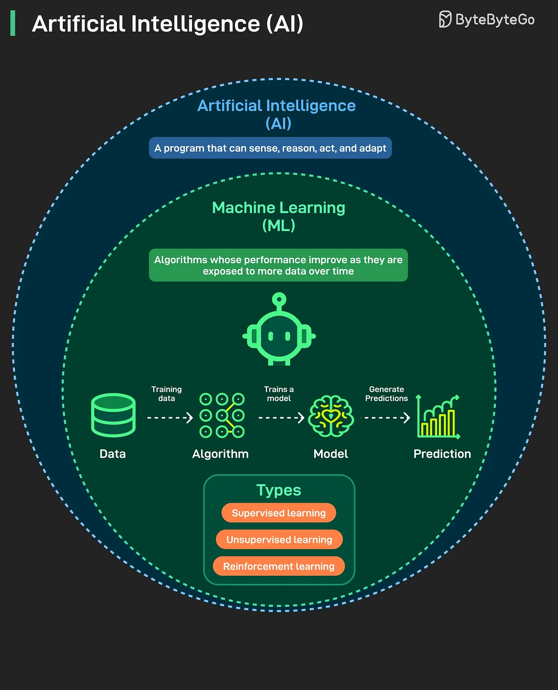

# 163 - Mỗi ngày một kiến thức: AI và Machine Learning (ML)

- Nguồn: ByteByteGo Big Archive System Design 2025
- Trang PDF: 335-336
- Ảnh minh họa: `../assets/163/figure-01.png`

## Hình minh họa

## Dịch sát

AI là gì? ML là gì? Chúng có giống nhau không? Chúng ta sẽ làm rõ confusion phổ biến trong bài này.

AI và ML thường được đối xử như thể chúng là cùng một thứ. Không phải vậy. AI là field lớn hơn. Nó nói về việc tạo program có thể sense, reason, act và adapt. Bất kỳ system nào thể hiện intelligent behavior đều có thể nằm dưới AI.

ML là một subset của AI. Nó tập trung vào algorithm học từ data và cải thiện qua experience. Đây là nơi phần lớn progress trong những năm gần đây diễn ra. Một số use case phổ biến của ML là recommendation engine, fraud detection và image recognition. Hầu hết những gì chúng ta tương tác hằng ngày.

Breakthrough lớn nhất trong những năm gần đây đến từ ML, và khi media nói về AI revolution, họ chủ yếu nói về tiến bộ trong ML, đặc biệt là deep learning.

## Dịch nội dung trong hình

- `Artificial Intelligence (AI)`: program có thể sense, reason, act và adapt.
- `Machine Learning (ML)`: algorithm cải thiện performance khi tiếp xúc với nhiều data hơn theo thời gian.
- Pipeline trong hình: data dùng để train algorithm, tạo model, model generate prediction.
- Types: supervised learning, unsupervised learning, reinforcement learning.

## Tóm tắt & giải thích dễ hiểu

AI là mục tiêu rộng: làm máy có hành vi thông minh. ML là một phương pháp trong AI: học pattern từ dữ liệu thay vì viết rule thủ công. Deep learning là một nhánh của ML dùng neural network sâu và là nguồn của nhiều tiến bộ gần đây.

## Ví dụ thực tế - không nằm trong tài liệu gốc

Rule-based spam filter có thể được xem là AI kiểu cổ điển nhưng không nhất thiết là ML. Spam filter học từ email đã gắn nhãn spam/not spam là ML. Model nhận diện ảnh bằng CNN hoặc LLM sinh text là deep learning/ML hiện đại.

## Thuật ngữ chính

- `AI`: Artificial Intelligence.
- `ML`: Machine Learning.
- `Supervised learning`: học từ dữ liệu có label.
- `Unsupervised learning`: học pattern không cần label rõ.
- `Reinforcement learning`: học qua reward/feedback.
- `Model`: hàm/hệ thống đã học từ data.
- `Prediction`: dự đoán đầu ra.

## Câu hỏi ôn tập + trả lời + thinking học tập + liên hệ

> Đây là phần học tập thêm ở cuối file. Câu hỏi ưu tiên lấy từ tài liệu gốc và được trả lời trực tiếp; nếu bài không có câu hỏi riêng thì dùng tiêu đề/nội dung chính để tạo câu hỏi tự kiểm tra.

### Câu hỏi 1

**Nguồn câu hỏi:** Suy ra từ tiêu đề/nội dung chính vì bài gốc không có câu hỏi riêng.

**Câu hỏi:** Sau khi đọc bài “A piece of knowledge each day: AI and Machine Learning (ML)”, ý chính cần trả lời và áp dụng vào system design là gì?

**Trả lời:** Nếu rút thành checklist thiết kế thì ý chính là: AI là mục tiêu rộng: làm máy có hành vi thông minh. ML là một phương pháp trong AI: học pattern từ dữ liệu thay vì viết rule thủ công. Deep learning là một nhánh của ML dùng neural network sâu và là nguồn của nhiều tiến bộ gần đây. Khi áp dụng vào hệ thống thật, hãy kiểm thêm quality, latency, cost/token, privacy, cập nhật tri thức và rủi ro hallucination.

**Thinking học tập + liên hệ:** Liên hệ `Mỗi ngày một kiến thức: AI và Machine Learning (ML)` bằng một scenario thật sẽ giúp thấy trade-off rõ hơn so với chỉ đọc định nghĩa. Lens chính là quality, latency, cost/token, privacy, cập nhật tri thức và rủi ro hallucination. Khi build AI app, hãy nối model với pipeline thật: data vào đâu, context lấy từ đâu, output được kiểm thế nào và chi phí tăng theo traffic ra sao. Khi ghi chú lại, hãy giải thích được các keyword: `AI`, `ML`, `Supervised learning`, `Unsupervised learning`, `Reinforcement learning`.
