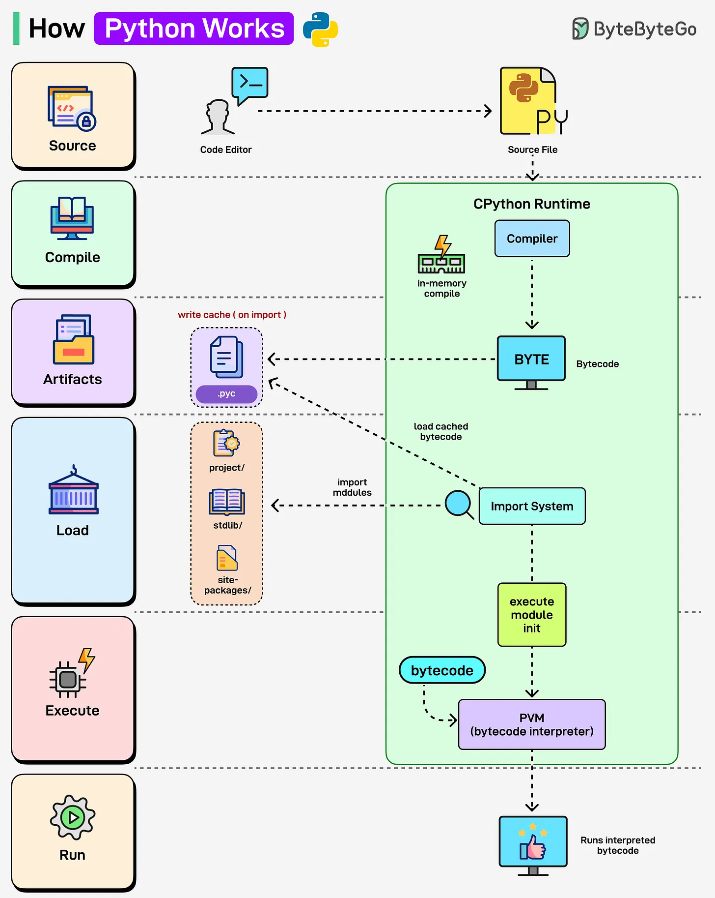

# 164 - Python hoạt động như thế nào?

- Nguồn: ByteByteGo Big Archive System Design 2025
- Trang PDF: 337-338
- Ảnh minh họa: `../assets/164/figure-01.png`

## Hình minh họa

## Dịch sát

Bạn từng tự hỏi điều gì xảy ra phía sau khi chạy một Python script chưa? Hãy cùng tìm hiểu:

Python (CPython Runtime):

- Python source code (`.py`) được compile tự động thành bytecode trong memory.
- Bytecode cũng có thể được cache trong file `.pyc`, làm re-run nhanh hơn bằng cached version.
- Import System load module và dependency.
- Python Virtual Machine (PVM) interpret bytecode từng dòng, làm Python flexible nhưng tương đối chậm hơn.

## Dịch nội dung trong hình

- Source `.py` đi từ code editor vào CPython runtime compiler.
- Compiler tạo bytecode trong memory, có thể write cache `.pyc` khi import.
- Import system load cached bytecode/module từ project/stdlib/site-packages.
- PVM bytecode interpreter execute module init và run interpreted bytecode.

## Tóm tắt & giải thích dễ hiểu

Python CPython không chạy text `.py` trực tiếp. Nó compile source thành bytecode, load module qua import system, rồi PVM interpret bytecode. Cách này giúp Python linh hoạt và dễ phát triển, nhưng thường chậm hơn language có JIT/native compilation mạnh.

## Ví dụ thực tế - không nằm trong tài liệu gốc

Khi import một module lần đầu, Python có thể tạo file `.pyc` trong `__pycache__`. Lần chạy sau, nếu source không đổi, Python dùng bytecode cache để giảm thời gian compile, nhưng runtime vẫn interpret bytecode.

## Thuật ngữ chính

- `CPython`: runtime Python phổ biến nhất.
- `Bytecode`: mã trung gian của Python.
- `.pyc`: file cache bytecode.
- `Import System`: hệ thống load module.
- `PVM`: Python Virtual Machine.
- `stdlib`: standard library.
- `site-packages`: nơi package Python được cài.

## Câu hỏi ôn tập + trả lời + thinking học tập + liên hệ

> Đây là phần học tập thêm ở cuối file. Câu hỏi ưu tiên lấy từ tài liệu gốc và được trả lời trực tiếp; nếu bài không có câu hỏi riêng thì dùng tiêu đề/nội dung chính để tạo câu hỏi tự kiểm tra.

### Câu hỏi 1

**Nguồn câu hỏi:** Suy ra từ tiêu đề/nội dung chính vì bài gốc không có câu hỏi riêng.

**Câu hỏi:** Python hoạt động như thế nào?

**Trả lời:** Hãy tách flow thành các bước có state rõ ràng: request/dữ liệu đi vào đâu, qua thành phần nào, state đổi ở đâu và kết quả trả ra thế nào. Với `Python hoạt động như thế nào?`, ý chính là: Python CPython không chạy text `.py` trực tiếp. Nó compile source thành bytecode, load module qua import system, rồi PVM interpret bytecode. Cách này giúp Python linh hoạt và dễ phát triển, nhưng thường chậm hơn language có JIT/native compilation mạnh.

**Thinking học tập + liên hệ:** Luồng trong `Python hoạt động như thế nào?` nên được vẽ từ input tới output, kèm owner của từng bước và failure mode ở mỗi boundary. Lens chính là DNS, transport, TLS, HTTP, proxy/CDN, application timeout và observability theo từng layer. Khi debug production, hãy tách latency theo DNS lookup, TCP connect, TLS handshake, TTFB và download để không đoán mò. Khi ghi chú lại, hãy giải thích được các keyword: `CPython`, `Bytecode`, `.pyc`, `Import System`, `PVM`.
