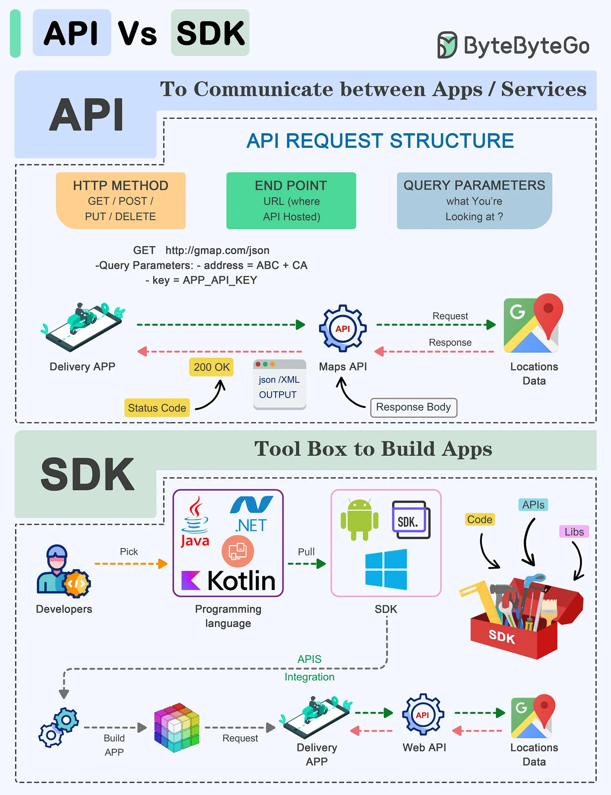

# 165 - API vs SDK

- Nguồn: ByteByteGo Big Archive System Design 2025
- Trang PDF: 339-340
- Ảnh minh họa: `../assets/165/figure-01.png`

## Hình minh họa

## Dịch sát

API (Application Programming Interface) và SDK (Software Development Kit) là các tool thiết yếu trong thế giới software development, nhưng chúng phục vụ mục đích khác nhau:

API:
API là một tập rule và protocol cho phép các software application và service khác nhau communicate với nhau.

1. Nó define cách software component nên interact.

2. Facilitate data exchange và functionality access giữa software component.

3. Thường gồm endpoint, request và response.

SDK:
SDK là một package toàn diện gồm tool, library, sample code và documentation hỗ trợ developer build application cho một platform, framework hoặc hardware cụ thể.

1. Cung cấp higher-level abstraction, đơn giản hóa development cho một platform cụ thể.

2. Tailored cho platform hoặc framework cụ thể, bảo đảm compatibility và optimal performance trên platform đó.

3. Cung cấp access tới advanced feature và capability đặc thù của platform, những thứ có thể khó implement từ đầu.

Lựa chọn giữa API và SDK phụ thuộc vào development goal và requirement của project.

## Dịch nội dung trong hình

- `API`: để communication giữa app/service; request structure gồm HTTP method, endpoint URL, query parameters, status code, response body.
- Ví dụ Delivery App gọi Maps API để lấy Locations Data.
- `SDK`: toolbox để build app; developer chọn programming language/platform SDK, dùng code/API/library trong SDK để build app và integrate API.

## Tóm tắt & giải thích dễ hiểu

API là contract/giao diện để gọi capability. SDK là bộ dụng cụ giúp dùng API/platform dễ hơn. API thường độc lập ngôn ngữ qua HTTP/gRPC. SDK thường là library theo ngôn ngữ như JavaScript/Python/Java, bọc API thành function/class tiện dùng.

## Ví dụ thực tế - không nằm trong tài liệu gốc

Stripe có REST API để tạo payment intent. Stripe SDK cho Node.js/PHP/Python bọc API đó thành hàm như `stripe.paymentIntents.create(...)`, xử lý auth, serialization, retry và error object tiện hơn.

## Thuật ngữ chính

- `API`: Application Programming Interface.
- `SDK`: Software Development Kit.
- `Endpoint`: URL/cổng gọi API.
- `Request`: yêu cầu gửi tới API.
- `Response`: phản hồi từ API.
- `Library`: thư viện code.
- `Abstraction`: lớp che bớt chi tiết phức tạp.

## Câu hỏi ôn tập + trả lời + thinking học tập + liên hệ

> Đây là phần học tập thêm ở cuối file. Câu hỏi ưu tiên lấy từ tài liệu gốc và được trả lời trực tiếp; nếu bài không có câu hỏi riêng thì dùng tiêu đề/nội dung chính để tạo câu hỏi tự kiểm tra.

### Câu hỏi 1

**Nguồn câu hỏi:** Suy ra từ tiêu đề/nội dung chính vì bài gốc không có câu hỏi riêng.

**Câu hỏi:** Sau khi đọc bài “API Vs SDK!”, ý chính cần trả lời và áp dụng vào system design là gì?

**Trả lời:** Điểm khác nhau nên nhìn từ boundary và trách nhiệm chính. Với `API vs SDK`, hãy tách rõ mỗi bên giải quyết vấn đề gì, dữ liệu đi qua đâu, ai sở hữu state và lỗi sẽ lan như thế nào. Ý chính để giữ lại là: API là contract/giao diện để gọi capability. SDK là bộ dụng cụ giúp dùng API/platform dễ hơn. API thường độc lập ngôn ngữ qua HTTP/gRPC. SDK thường là library theo ngôn ngữ như JavaScript/Python/Java, bọc API thành function/class tiện dùng.

**Thinking học tập + liên hệ:** Khi so sánh trong `API vs SDK`, hãy tách responsibility, boundary, state, failure mode và cost vận hành thay vì chỉ so tên công nghệ. Lens chính là actor, trust boundary, dữ liệu nhạy cảm, lifetime của token/key, quyền truy cập và cơ chế revoke. Khi làm API thật, một endpoint chạy được chưa đủ; phải kiểm thêm abuse, audit log, error leakage, rate limit và quyền ở service chứa dữ liệu. Khi ghi chú lại, hãy giải thích được các keyword: `API`, `SDK`, `Endpoint`, `Request`, `Response`.
