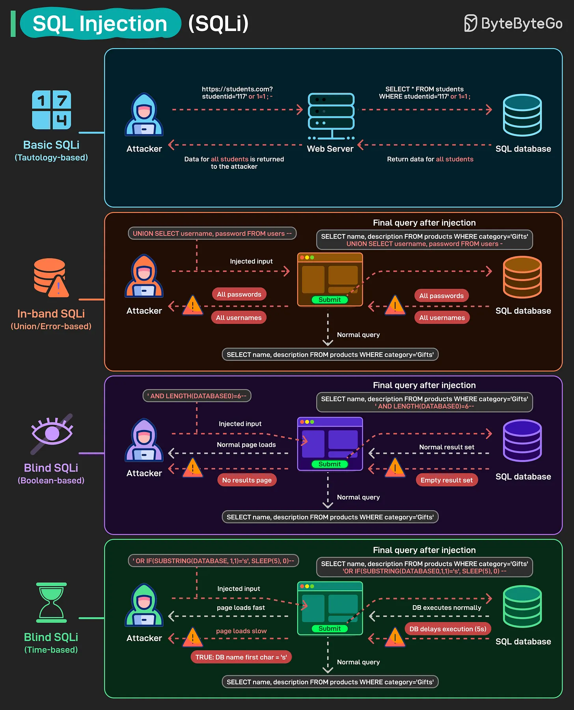

# 166 - SQL Injection (SQLi)

- Nguồn: ByteByteGo Big Archive System Design 2025
- Trang PDF: 341-342
- Ảnh minh họa: `../assets/166/figure-01.png`

## Hình minh họa

## Dịch sát

SQL Injection là một trong những web vulnerability lâu đời nhất và nguy hiểm nhất. Chỉ với vài input được craft, attacker có thể manipulate database query và gain access tới sensitive data.

Basic SQLi (Tautology-based): Attacker inject condition như `1=1` để bypass authentication và retrieve tất cả record.

In-band SQLi (Union/Error-based): Attacker dùng `UNION SELECT` hoặc tận dụng error message để extract username, password hoặc sensitive data khác trực tiếp.

Blind SQLi (Boolean-based): Không có direct output được hiển thị, nhưng attacker infer database information dựa trên việc page có trả result hay không.

Blind SQLi (Time-based): Attacker dùng command như `SLEEP(5)` để đo server response delay và extract data dần dần.

## Dịch nội dung trong hình

- `Basic SQLi`: attacker gửi input làm query luôn đúng, web server trả data ngoài ý muốn từ SQL database.
- `In-band SQLi`: injected input dùng union/error path để lộ dữ liệu trong normal query response hoặc error message.
- `Blind SQLi Boolean-based`: attacker quan sát response normal/empty để suy luận dữ liệu.
- `Blind SQLi Time-based`: attacker quan sát thời gian response delayed/normal để suy luận dữ liệu.

## Tóm tắt & giải thích dễ hiểu

SQLi xảy ra khi input của user bị nối trực tiếp vào câu SQL thay vì được parameterize. Database hiểu một phần input là code SQL, khiến attacker thay đổi logic query. Phòng chống cốt lõi là dùng prepared statement/parameterized query, ORM đúng cách, validate input, least privilege DB user và không lộ error SQL chi tiết.

## Ví dụ thực tế - không nằm trong tài liệu gốc

Thay vì viết query bằng string interpolation như `WHERE email = '${email}'`, dùng parameter binding như `WHERE email = ?`. DB driver sẽ gửi input như dữ liệu, không phải SQL code. Ngoài ra, account DB của app không nên có quyền `DROP TABLE` nếu chỉ cần đọc/ghi nghiệp vụ.

## Thuật ngữ chính

- `SQL Injection`: chèn SQL độc hại qua input.
- `Tautology`: điều kiện luôn đúng.
- `UNION SELECT`: gộp kết quả query trong SQL.
- `Blind SQLi`: suy luận dữ liệu không thấy output trực tiếp.
- `Prepared statement`: câu SQL có parameter.
- `Parameterized query`: query bind tham số an toàn.
- `Least privilege`: cấp quyền tối thiểu.

## Câu hỏi ôn tập + trả lời + thinking học tập + liên hệ

> Đây là phần học tập thêm ở cuối file. Câu hỏi ưu tiên lấy từ tài liệu gốc và được trả lời trực tiếp; nếu bài không có câu hỏi riêng thì dùng tiêu đề/nội dung chính để tạo câu hỏi tự kiểm tra.

### Câu hỏi 1

**Nguồn câu hỏi:** Suy ra từ tiêu đề/nội dung chính vì bài gốc không có câu hỏi riêng.

**Câu hỏi:** Sau khi đọc bài “SQL Injection (SQLi)”, ý chính cần trả lời và áp dụng vào system design là gì?

**Trả lời:** Trọng tâm cần đem vào thực tế là: SQLi xảy ra khi input của user bị nối trực tiếp vào câu SQL thay vì được parameterize. Database hiểu một phần input là code SQL, khiến attacker thay đổi logic query. Phòng chống cốt lõi là dùng prepared statement/parameterized query, ORM đúng cách, validate input, least privilege DB user và không lộ error SQL chi tiết. Khi áp dụng vào hệ thống thật, hãy kiểm thêm read/write ratio, consistency, cardinality, query pattern, growth rate và recovery requirement.

**Thinking học tập + liên hệ:** Liên hệ `SQL Injection (SQLi)` bằng một scenario thật sẽ giúp thấy trade-off rõ hơn so với chỉ đọc định nghĩa. Lens chính là read/write ratio, consistency, cardinality, query pattern, growth rate và recovery requirement. Khi gặp bài toán dữ liệu, hãy nối bài học với truy vấn nóng nhất, index thật sự được dùng, cache nào có thể stale và thời gian restore sau sự cố. Khi ghi chú lại, hãy giải thích được các keyword: `SQL Injection`, `Tautology`, `UNION SELECT`, `Blind SQLi`, `Prepared statement`.
