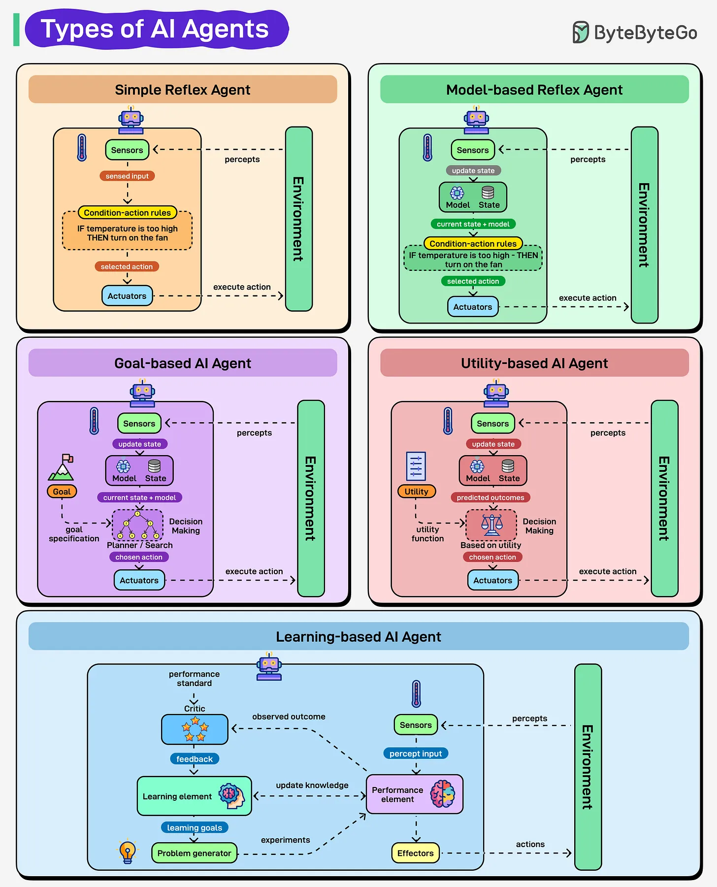

# 167 - Các loại AI Agent

- Nguồn: ByteByteGo Big Archive System Design 2025
- Trang PDF: 343-344
- Ảnh minh họa: `../assets/167/figure-01.png`

## Hình minh họa

## Dịch sát

AI agent không phải tất cả đều think và act theo cùng một cách. Chúng trải dài từ những system follow rule đơn giản tới system có thể learn và adapt. Mỗi loại đánh dấu một bước tiến trong cách machine perceive, decide và act.

1. Simple Reflex Agents: Chúng follow condition-action rule. Ví dụ, nếu temperature cao, bật fan. Không memory, không thinking, chỉ phản ứng tức thì. Chúng nhanh và đơn giản.

2. Model-based Reflex Agents: Chúng duy trì internal understanding về environment. Chúng không chỉ react với input ngay lập tức; chúng có một model giúp hiểu điều đang xảy ra ngoài những gì có thể thấy ngay bây giờ.

3. Goal-based Agents: Ở đây, focus chuyển sang goal. Decision được đưa ra dựa trên việc một action có đưa agent tiến gần hơn tới objective hay không.

4. Utility-based Agents: Chúng đi xa hơn bằng cách cân nhắc các outcome khác nhau. Chúng chọn action mang lại overall result tốt nhất, balance trade-off trên đường đi.

5. Learning Agents: Đây là loại advanced nhất. Chúng cải thiện liên tục, dùng feedback để adapt và perform tốt hơn theo thời gian.

## Dịch nội dung trong hình

- `Simple Reflex Agent`: sensor nhận environment, condition-action rule tạo action qua actuator.
- `Model-based Reflex Agent`: có model/internal state để interpret environment trước khi action.
- `Goal-based AI Agent`: dùng model/state và goal để ra decision-making path.
- `Utility-based AI Agent`: thêm utility function để cân nhắc outcome/trade-off.
- `Learning-based AI Agent`: có learning element, performance element, critic và problem generator để cải thiện qua feedback/outcome.

## Tóm tắt & giải thích dễ hiểu

Agent càng cao cấp càng có nhiều khả năng nội tại. Simple reflex chỉ phản ứng. Model-based có trạng thái/hiểu biết môi trường. Goal-based chọn hành động theo mục tiêu. Utility-based tối ưu kết quả theo điểm utility. Learning agent tự cải thiện qua feedback.

## Ví dụ thực tế - không nằm trong tài liệu gốc

Thermostat bật/tắt theo nhiệt độ là simple reflex. Robot hút bụi nhớ bản đồ phòng là model-based. Agent tìm đường tới điểm đích là goal-based. Agent chọn route cân bằng thời gian, phí và rủi ro là utility-based. Agent học từ lần đi trước để chọn route tốt hơn là learning agent.

## Thuật ngữ chính

- `Agent`: thực thể quan sát và hành động.
- `Reflex agent`: agent phản xạ theo rule.
- `Internal model`: mô hình nội bộ về môi trường.
- `Goal`: mục tiêu cần đạt.
- `Utility`: điểm lợi ích/kết quả.
- `Feedback`: tín hiệu phản hồi.
- `Learning agent`: agent cải thiện qua kinh nghiệm.

