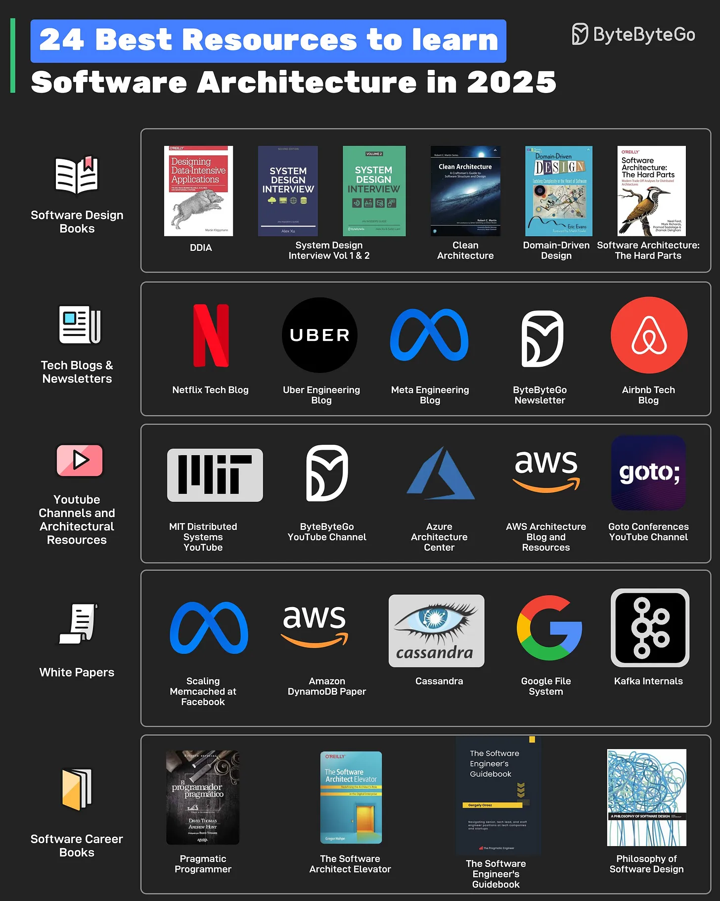

# 168 - 24 nguồn tốt để học Software Architecture trong năm 2025

- Nguồn: ByteByteGo Big Archive System Design 2025
- Trang PDF: 345-346
- Ảnh minh họa: `../assets/168/figure-01.png`

## Hình minh họa

## Dịch sát

Các resource có thể được chia thành nhiều type khác nhau như:

1. Software Design Books
   Một số book có thể giúp là DDIA, System Design Volume 1 & 2, Clean Architecture, Domain-Driven Design và Software Architecture: the Hard Parts.

2. Tech Blogs and Newsletters
   Đọc technical blog của các công ty như Netflix, Uber, Meta và Airbnb. Ngoài ra, ByteByteGo newsletter cung cấp insight về software design mỗi tuần.

3. YouTube Channels and Architectural Resources
   YouTube channel như MIT Distributed Systems, Goto Conferences và ByteByteGo có thể giúp học software architecture và system design. Azure Architecture Center và AWS Architecture Blog là các resource quan trọng khác.

4. WhitePapers
   Để có insight sâu hơn, đọc whitepaper như Facebook Memcache Scaling, Cassandra, Amazon DynamoDB, Kafka và Google File System.

5. Software Career Books
   Một Software Architect cũng cần phát triển holistic skill. Book về khía cạnh software career như Pragmatic Programmer, The Software Architect Elevator, The Software Engineer's Guidebook và Philosophy of Software Design có thể giúp.

## Dịch nội dung trong hình

- `Software Design Books`: DDIA, System Design Interview Vol 1 & 2, Clean Architecture, Domain-Driven Design, Software Architecture: The Hard Parts.
- `Tech Blogs & Newsletters`: Netflix Tech Blog, Uber Engineering Blog, Meta Engineering Blog, ByteByteGo Newsletter, Airbnb Tech Blog.
- `YouTube Channels and Architectural Resources`: MIT Distributed Systems, ByteByteGo YouTube Channel, Azure Architecture Center, AWS Architecture Blog and Resources, Goto Conferences YouTube Channel.
- `White Papers`: Facebook Memcached at Facebook, Amazon DynamoDB Paper, Cassandra, Google File System, Kafka Internals.
- `Software Career Books`: Pragmatic Programmer, The Software Architect Elevator, The Software Engineer's Guidebook, Philosophy of Software Design.

## Tóm tắt & giải thích dễ hiểu

Bài này lặp lại chủ đề nguồn học architecture đã xuất hiện ở bài 105, nhưng vẫn được dịch thành file riêng theo archive. Các nguồn nên kết hợp: sách cho nền tảng, blog/whitepaper cho bài học production, video/resource center cho ví dụ trực quan và sách career để phát triển kỹ năng architect ngoài code.

## Ví dụ thực tế - không nằm trong tài liệu gốc

Một kế hoạch học 8 tuần có thể là: đọc DDIA các chương storage/replication, xem MIT Distributed Systems, đọc DynamoDB/Cassandra/Kafka paper, follow Netflix/Uber blog, rồi tự viết design doc cho hệ thống notification hoặc payment.

## Thuật ngữ chính

- `Software Architecture`: kiến trúc phần mềm.
- `DDIA`: Designing Data-Intensive Applications.
- `Whitepaper`: tài liệu kỹ thuật chuyên sâu.
- `Tech blog`: blog kỹ thuật của công ty/team.
- `System design`: thiết kế hệ thống.
- `Holistic skills`: kỹ năng toàn diện gồm giao tiếp, trade-off, lãnh đạo kỹ thuật.
- `Design doc`: tài liệu thiết kế kỹ thuật.

## Câu hỏi ôn tập + trả lời + thinking học tập + liên hệ

> Đây là phần học tập thêm ở cuối file. Câu hỏi ưu tiên lấy từ tài liệu gốc và được trả lời trực tiếp; nếu bài không có câu hỏi riêng thì dùng tiêu đề/nội dung chính để tạo câu hỏi tự kiểm tra.

### Câu hỏi 1

**Nguồn câu hỏi:** Suy ra từ tiêu đề/nội dung chính vì bài gốc không có câu hỏi riêng.

**Câu hỏi:** Sau khi đọc bài “24 Good Resources to Learn Software Architecture in 2025”, ý chính cần trả lời và áp dụng vào system design là gì?

**Trả lời:** Trọng tâm cần đem vào thực tế là: Bài này lặp lại chủ đề nguồn học architecture đã xuất hiện ở bài 105, nhưng vẫn được dịch thành file riêng theo archive. Các nguồn nên kết hợp: sách cho nền tảng, blog/whitepaper cho bài học production, video/resource center cho ví dụ trực quan và sách career để phát triển kỹ năng architect ngoài code. Khi áp dụng vào hệ thống thật, hãy kiểm thêm requirement, constraint, traffic, dữ liệu, failure mode và khả năng vận hành của team.

**Thinking học tập + liên hệ:** Khi học `24 nguồn tốt để học Software Architecture trong năm 2025`, hãy thử viết một checklist áp dụng vào project: input, output, owner, rủi ro và metric kiểm chứng. Lens chính là requirement, constraint, traffic, dữ liệu, failure mode và khả năng vận hành của team. Khi gặp system design thật, hãy biến khái niệm thành quyết định: boundary ở đâu, data flow thế nào, bottleneck nào đến trước và rollback ra sao. Khi ghi chú lại, hãy giải thích được các keyword: `Software Architecture`, `DDIA`, `Whitepaper`, `Tech blog`, `System design`.
