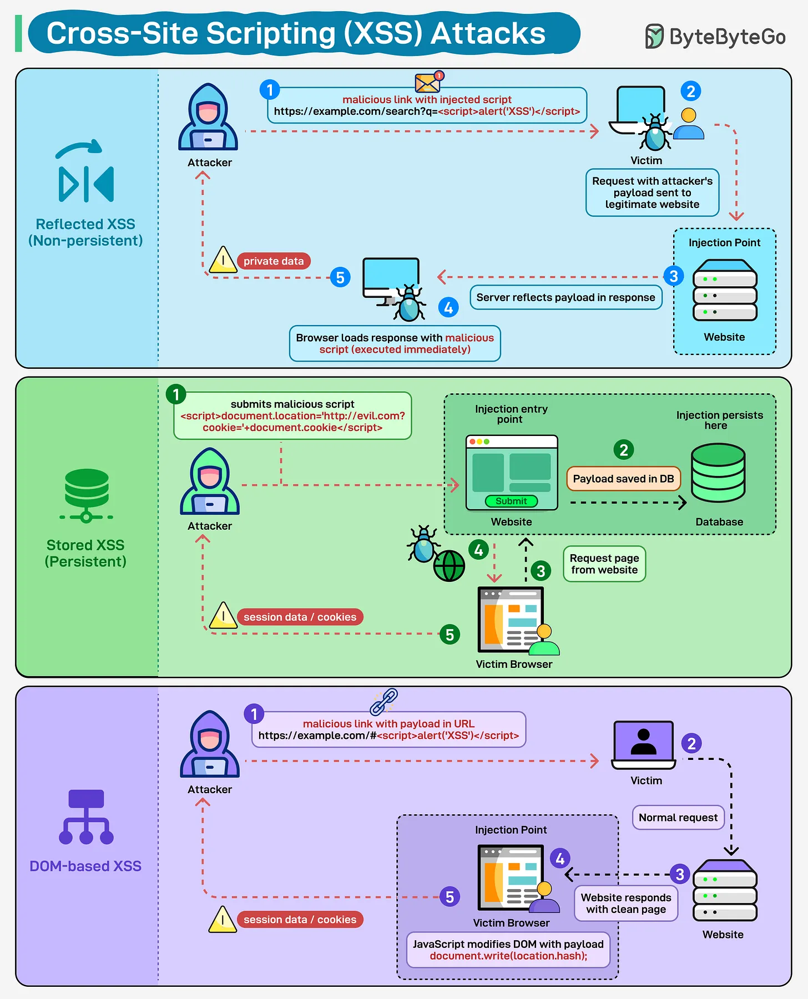

# 169 - Tấn công Cross-Site Scripting (XSS)

- Nguồn: ByteByteGo Big Archive System Design 2025
- Trang PDF: 347-348
- Ảnh minh họa: `../assets/169/figure-01.png`

## Hình minh họa

## Dịch sát

Một đoạn script nhỏ có thể gây ra thiệt hại lớn. XSS cho phép attacker chèn mã độc vào các trang web và chiếm quyền phiên đăng nhập của user, đánh cắp cookie, hoặc thao túng browser.

Reflected XSS: Kiểu tấn công này xảy ra khi ai đó bấm vào một malicious link. Payload nằm trong URL, được phản chiếu lại trong response, rồi được thực thi. Nó thường được dùng trong các chiến dịch phishing vì cần lừa ai đó bấm vào link.

Stored XSS: Mã độc được lưu vào database của bạn, có thể trong comment field hoặc user profile. Sau đó nó tự động chạy mỗi khi ai đó load trang đó.

DOM-based XSS: Payload thao túng trực tiếp DOM trong browser mà không cần đi qua server của bạn. Điều này khiến nó khó bị bắt hơn bằng các cơ chế validate truyền thống ở server-side.

## Dịch nội dung trong hình

- `Reflected XSS (Non-persistent)`: attacker tạo URL độc hại có kèm payload, victim gửi request chứa payload tới website dễ bị tấn công, server trả response có script độc hại, browser của victim thực thi script.
- `Stored XSS (Persistent)`: attacker submit script độc hại qua form/comment, application lưu input chưa được sanitize vào database, user bình thường mở trang, payload được trả về và chạy trong browser của user.
- `DOM-based XSS`: attacker thao túng URL hoặc input ở phía client, server có thể chỉ trả trang bình thường, JavaScript trong browser đọc dữ liệu đó rồi cập nhật DOM khiến script độc hại được inject và thực thi.
- Các vai trò chính trong hình: `Attacker`, `Victim`, `Vulnerable Website`, `Database`, `Web Browser`, `HTTP request/response`.

## Tóm tắt & giải thích dễ hiểu

XSS là lỗi xảy ra khi dữ liệu không đáng tin cậy bị đưa vào HTML/JavaScript mà không escape hoặc sanitize đúng cách. Reflected XSS thường cần user bấm link, Stored XSS nguy hiểm hơn vì payload nằm sẵn trong hệ thống, còn DOM-based XSS nằm nhiều ở logic frontend khi đọc URL, fragment, query string hoặc local state rồi ghi thẳng vào DOM.

## Ví dụ thực tế - không nằm trong tài liệu gốc

Trong một trang comment, nếu backend lưu nội dung comment và frontend render bằng `innerHTML` thay vì text an toàn, attacker có thể đăng comment chứa script. Khi admin mở trang moderation, script đó có thể chạy trong session của admin. Cách phòng thủ thường là escape output theo context, sanitize HTML nếu bắt buộc cho phép rich text, bật CSP, dùng `HttpOnly` cookie và tránh đưa dữ liệu user-controlled vào `innerHTML`.

## Thuật ngữ chính

- `XSS`: Cross-Site Scripting, lỗi chèn script vào trang web.
- `Payload`: đoạn dữ liệu/mã độc được gửi vào hệ thống.
- `Reflected XSS`: payload được phản chiếu trong response ngay tại request đó.
- `Stored XSS`: payload được lưu lâu dài trong database/storage.
- `DOM-based XSS`: payload chạy do logic DOM ở client-side.
- `Sanitize`: làm sạch input, loại bỏ nội dung nguy hiểm.
- `Escape output`: mã hóa ký tự đặc biệt khi render ra HTML/JS/CSS/URL.
- `CSP`: Content Security Policy, chính sách giảm rủi ro chạy script trái phép.

## Câu hỏi ôn tập + trả lời + thinking học tập + liên hệ

> Đây là phần học tập thêm ở cuối file. Câu hỏi ưu tiên lấy từ tài liệu gốc và được trả lời trực tiếp; nếu bài không có câu hỏi riêng thì dùng tiêu đề/nội dung chính để tạo câu hỏi tự kiểm tra.

### Câu hỏi 1

**Nguồn câu hỏi:** Suy ra từ tiêu đề/nội dung chính vì bài gốc không có câu hỏi riêng.

**Câu hỏi:** Sau khi đọc bài “Cross-Site Scripting (XSS) Attacks”, ý chính cần trả lời và áp dụng vào system design là gì?

**Trả lời:** Trọng tâm cần đem vào thực tế là: XSS là lỗi xảy ra khi dữ liệu không đáng tin cậy bị đưa vào HTML/JavaScript mà không escape hoặc sanitize đúng cách. Reflected XSS thường cần user bấm link, Stored XSS nguy hiểm hơn vì payload nằm sẵn trong hệ thống, còn DOM-based XSS nằm nhiều ở logic frontend khi đọc URL, fragment, query string hoặc local state rồi ghi thẳng vào DOM. Khi áp dụng vào hệ thống thật, hãy kiểm thêm UX, bundle size, build time, maintainability, accessibility và tốc độ release.

**Thinking học tập + liên hệ:** Ôn tập `Tấn công Cross-Site Scripting (XSS)` bằng cách biến khái niệm thành quyết định thiết kế cụ thể: chọn gì, bỏ gì, đo gì và ai chịu trách nhiệm. Lens chính là UX, bundle size, build time, maintainability, accessibility và tốc độ release. Khi làm frontend production, hãy nối code với người dùng thật: load có nhanh không, lỗi có thấy được không, component có tái dùng được không và build có scale với team không. Khi ghi chú lại, hãy giải thích được các keyword: `XSS`, `Payload`, `Reflected XSS`, `Stored XSS`, `DOM-based XSS`.
