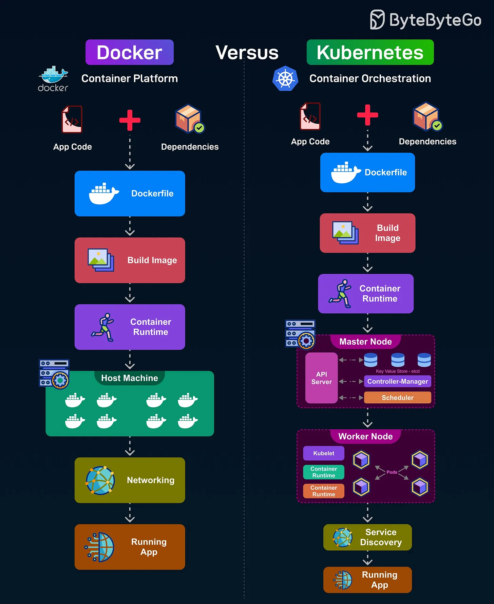

# 170 - Docker vs Kubernetes

- Nguồn: ByteByteGo Big Archive System Design 2025
- Trang PDF: 349-350
- Ảnh minh họa: `../assets/170/figure-01.png`

## Hình minh họa

## Dịch sát

Docker là một container platform cho phép bạn đóng gói application cùng dependencies của nó và chạy trên một máy đơn lẻ. Cách nó hoạt động như sau:

1. Bắt đầu với app code và dependencies được viết vào một Dockerfile.

2. Bước build image tạo ra một container image có tính portable.

3. Container runtime chạy image trực tiếp trên host machine.

4. Networking kết nối các container và external services, rồi tạo ra final running app.

Kubernetes là một container orchestration platform quản lý các containerized application trên một cluster gồm nhiều máy để tăng scalability và resilience. Cách nó hoạt động như sau:

1. Bắt đầu với app code và dependencies trong Dockerfile.

2. Build image được đưa cho một container runtime được Kubernetes hỗ trợ.

3. Master node chạy API server, etcd (key-value store), controller manager và scheduler để điều phối cluster.

4. Worker nodes chạy các container thật bên trong Pod, được quản lý bởi Kubelet và kube-proxy cho networking.

5. Kết quả là một running app có tính distributed, scalable và self-healing.

## Dịch nội dung trong hình

- `Docker - Container Platform`: app code cộng dependencies tạo thành `Dockerfile`, sau đó `Build Image`, chạy bằng `Container Runtime` trên `Host Machine`, kết nối qua `Networking`, cuối cùng thành `Running App`.
- `Kubernetes - Container Orchestration`: app code cộng dependencies tạo thành `Dockerfile`, `Build Image`, chạy bằng `Container Runtime`, được `Master Node` điều phối với `API Server`, `etcd`, `Controller Manager`, `Scheduler`.
- `Worker Node`: chạy `Pod`, bên trong có `Container`; `Kubelet` quản lý node/container, `Kube-proxy` xử lý network routing.
- `Service Discovery`: giúp các service/container tìm thấy nhau trong cluster trước khi tạo thành `Running App`.

## Tóm tắt & giải thích dễ hiểu

Docker giải quyết bài toán “đóng gói và chạy app nhất quán”. Kubernetes giải quyết bài toán “vận hành nhiều container trên nhiều máy”: deploy, scale, restart khi lỗi, service discovery, rolling update và phân bổ workload. Có thể hiểu Docker giống cách đóng gói container, còn Kubernetes giống hệ thống điều phối cả cảng container.

## Ví dụ thực tế - không nằm trong tài liệu gốc

Một API nhỏ chạy nội bộ có thể chỉ cần Docker Compose trên một server. Nhưng nếu API đó cần chạy 30 replicas, auto-scale theo traffic, rolling deployment không downtime, health check và tự khởi động lại khi node chết, Kubernetes sẽ phù hợp hơn.

## Thuật ngữ chính

- `Dockerfile`: file mô tả cách build container image.
- `Image`: gói bất biến chứa code, runtime và dependencies.
- `Container`: instance đang chạy từ image.
- `Container runtime`: runtime chạy container, ví dụ containerd.
- `Kubernetes`: nền tảng orchestration container.
- `Pod`: đơn vị deploy nhỏ nhất trong Kubernetes.
- `etcd`: key-value store lưu state của cluster.
- `Kubelet`: agent chạy trên worker node.
- `Self-healing`: tự khôi phục khi container/node lỗi.

## Câu hỏi ôn tập + trả lời + thinking học tập + liên hệ

> Đây là phần học tập thêm ở cuối file. Câu hỏi ưu tiên lấy từ tài liệu gốc và được trả lời trực tiếp; nếu bài không có câu hỏi riêng thì dùng tiêu đề/nội dung chính để tạo câu hỏi tự kiểm tra.

### Câu hỏi 1

**Nguồn câu hỏi:** Suy ra từ tiêu đề/nội dung chính vì bài gốc không có câu hỏi riêng.

**Câu hỏi:** Sau khi đọc bài “Docker vs Kubernetes”, ý chính cần trả lời và áp dụng vào system design là gì?

**Trả lời:** Điểm khác nhau nên nhìn từ boundary và trách nhiệm chính. Với `Docker vs Kubernetes`, hãy tách rõ mỗi bên giải quyết vấn đề gì, dữ liệu đi qua đâu, ai sở hữu state và lỗi sẽ lan như thế nào. Ý chính để giữ lại là: Docker giải quyết bài toán “đóng gói và chạy app nhất quán”. Kubernetes giải quyết bài toán “vận hành nhiều container trên nhiều máy”: deploy, scale, restart khi lỗi, service discovery, rolling update và phân bổ workload. Có thể hiểu Docker giống cách đóng gói container, còn Kubernetes giống hệ thống điều phối cả cảng container.

**Thinking học tập + liên hệ:** Khi so sánh trong `Docker vs Kubernetes`, hãy tách responsibility, boundary, state, failure mode và cost vận hành thay vì chỉ so tên công nghệ. Lens chính là độ phức tạp vận hành, rollback, cost, kỹ năng team, observability và blast radius khi hỏng. Khi đưa lên production, hãy map từng thành phần vào deploy, rollback, monitoring, alerting, secret, cost và ownership rõ ràng. Khi ghi chú lại, hãy giải thích được các keyword: `Dockerfile`, `Image`, `Container`, `Container runtime`, `Kubernetes`.
