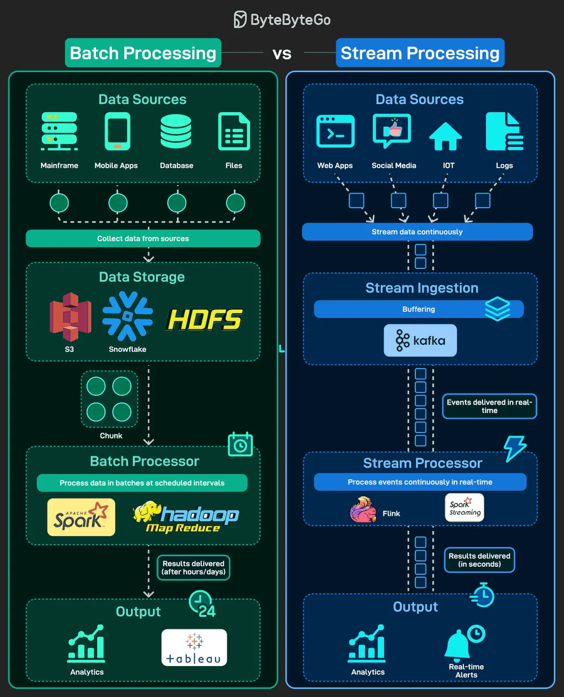

# 171 - Batch Processing vs Stream Processing

- Nguồn: ByteByteGo Big Archive System Design 2025
- Trang PDF: 351-352
- Ảnh minh họa: `../assets/171/figure-01.png`

## Hình minh họa

## Dịch sát

Dữ liệu không bao giờ ngừng chảy, nhưng cách chúng ta xử lý nó tạo ra khác biệt rất lớn. Khi xây dựng data system, có hai hướng chính xuất hiện: batch processing và stream processing. Cả hai đều có chỗ dùng riêng, tùy vào việc bạn cần độ chính xác theo thời gian hay insight tức thời.

Batch Processing: Thu thập dữ liệu theo từng khối và xử lý ở các khoảng thời gian đã lên lịch, rất tốt cho report và historical analysis.

Stream Processing: Xử lý event liên tục theo real-time, phục vụ dashboard, alert và recommendation.

Batch = high-volume, historical accuracy.
Stream = low-latency, real-time action.

## Dịch nội dung trong hình

- `Batch Processing`: data source như machine, mobile app, database, file được gom lại; dữ liệu được collect từ các source; lưu vào data storage như `S3`, `Snowflake`, `HDFS`; batch processor như `Spark`, `Hadoop MapReduce` xử lý dữ liệu theo batch ở interval đã lên lịch; output thường là analytics/report như `Tableau`.
- `Stream Processing`: data source như web app, social media, IoT và log gửi event liên tục; stream ingestion qua `Pub/Sub`, `Kafka`; stream processor như `Flink`, `Spark Streaming` xử lý event liên tục theo real-time; output là analytics hoặc real-time alert.
- Hình nhấn mạnh: batch thường chấp nhận trễ để xử lý khối dữ liệu lớn; stream ưu tiên event được xử lý ngay với latency thấp.

## Tóm tắt & giải thích dễ hiểu

Batch giống “cuối ngày gom sổ rồi tính toán”, còn stream giống “có giao dịch nào đến thì xử lý ngay”. Batch phù hợp khi dữ liệu lớn, cần kết quả ổn định và có thể chờ. Stream phù hợp khi hành động phải xảy ra gần như tức thì, ví dụ phát hiện fraud, cập nhật dashboard live hoặc gửi alert.

## Ví dụ thực tế - không nằm trong tài liệu gốc

Một sàn thương mại điện tử có thể dùng stream processing để phát hiện đơn hàng bất thường trong vài giây, nhưng dùng batch processing hằng đêm để tính doanh thu, cohort analysis và báo cáo tài chính.

## Thuật ngữ chính

- `Batch processing`: xử lý dữ liệu theo lô.
- `Stream processing`: xử lý event liên tục.
- `Latency`: độ trễ từ lúc event phát sinh đến lúc có kết quả.
- `Historical analysis`: phân tích dữ liệu lịch sử.
- `Data ingestion`: quá trình nạp dữ liệu vào hệ thống.
- `Kafka`: distributed event streaming platform.
- `Flink`: engine xử lý stream theo real-time.
- `HDFS`: Hadoop Distributed File System.

## Câu hỏi ôn tập + trả lời + thinking học tập + liên hệ

> Đây là phần học tập thêm ở cuối file. Câu hỏi ưu tiên lấy từ tài liệu gốc và được trả lời trực tiếp; nếu bài không có câu hỏi riêng thì dùng tiêu đề/nội dung chính để tạo câu hỏi tự kiểm tra.

### Câu hỏi 1

**Nguồn câu hỏi:** Suy ra từ tiêu đề/nội dung chính vì bài gốc không có câu hỏi riêng.

**Câu hỏi:** Sau khi đọc bài “Batch vs Stream Processing”, ý chính cần trả lời và áp dụng vào system design là gì?

**Trả lời:** Điểm khác nhau nên nhìn từ boundary và trách nhiệm chính. Với `Batch Processing vs Stream Processing`, hãy tách rõ mỗi bên giải quyết vấn đề gì, dữ liệu đi qua đâu, ai sở hữu state và lỗi sẽ lan như thế nào. Ý chính để giữ lại là: Batch giống “cuối ngày gom sổ rồi tính toán”, còn stream giống “có giao dịch nào đến thì xử lý ngay”. Batch phù hợp khi dữ liệu lớn, cần kết quả ổn định và có thể chờ. Stream phù hợp khi hành động phải xảy ra gần như tức thì, ví dụ phát hiện fraud, cập nhật dashboard live hoặc gửi alert.

**Thinking học tập + liên hệ:** Khi so sánh trong `Batch Processing vs Stream Processing`, hãy tách responsibility, boundary, state, failure mode và cost vận hành thay vì chỉ so tên công nghệ. Lens chính là requirement, constraint, traffic, dữ liệu, failure mode và khả năng vận hành của team. Khi gặp system design thật, hãy biến khái niệm thành quyết định: boundary ở đâu, data flow thế nào, bottleneck nào đến trước và rollback ra sao. Khi ghi chú lại, hãy giải thích được các keyword: `Batch processing`, `Stream processing`, `Latency`, `Historical analysis`, `Data ingestion`.
