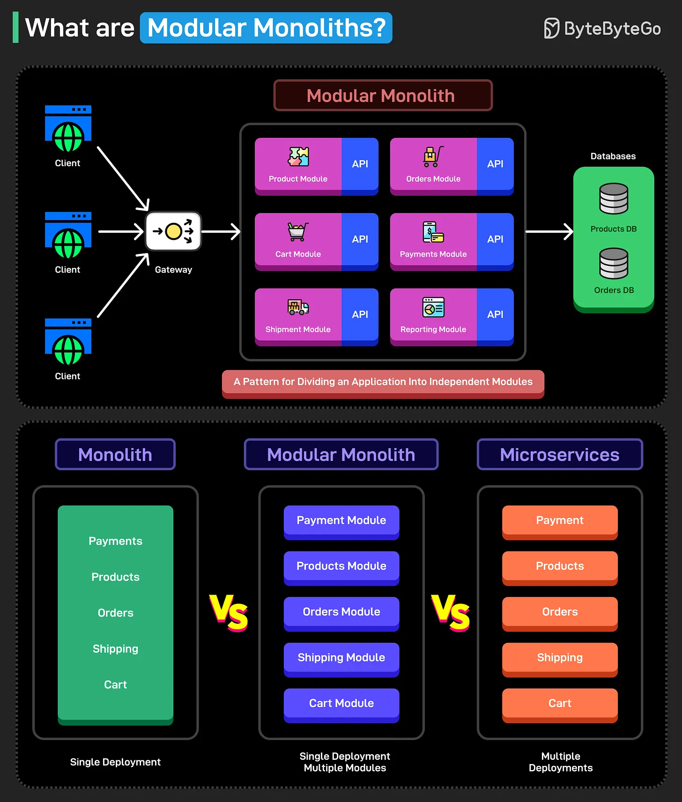

# 172 - Modular Monolith là gì?

- Nguồn: ByteByteGo Big Archive System Design 2025
- Trang PDF: 353-354
- Ảnh minh họa: `../assets/172/figure-01.png`

## Hình minh họa

## Dịch sát

Modular monolith là một architectural pattern chia application thành các module hoặc component độc lập. Mỗi module có boundary được định nghĩa rõ ràng để nhóm các functionality liên quan với nhau. Làm như vậy tạo ra cohesion tốt hơn.

Đây là các đặc điểm chính của modular monolith:

1. Các module độc lập.

2. Mỗi module cung cấp một functionality cụ thể.

3. Mỗi module nên expose một interface được định nghĩa rõ ràng.

Lợi thế chính của modular monolith là gì?

Một monolith gộp tất cả functionality vào một deployment unit lớn. Điều này làm monolith đơn giản để hiểu.

Microservices phân tán các functionality thành những unit có thể deploy riêng. Điều này khiến chúng scalable hơn.

Tuy nhiên, modular monolith chia application thành các module nhưng vẫn thuộc cùng một deployment unit. Chúng kết hợp sự đơn giản của traditional monolithic application với sự linh hoạt của microservices.

Nói cách khác, bạn có thể có phần tốt nhất của cả hai thế giới với modular monolith.

Vậy bạn đã từng dùng modular monolith để xây dựng application chưa?

## Dịch nội dung trong hình

- Phần trên: nhiều client đi qua `Gateway` vào một `Modular Monolith`. Bên trong có các module như `Product Module`, `Orders Module`, `Cart Module`, `Payments Module`, `Reporting Module`; database được chia theo boundary/module liên quan. Một pattern được nêu là có database phân tách hoặc quản lý độc lập cho từng module.
- `Monolith`: `Payments`, `Products`, `Orders`, `Shipping`, `Cart` nằm chung trong một khối và deploy một lần.
- `Modular Monolith`: các module `Payment`, `Products`, `Orders`, `Shipping`, `Cart` vẫn deploy chung nhưng code được tách theo module rõ ràng.
- `Microservices`: `Payment`, `Products`, `Orders`, `Shipping`, `Cart` trở thành nhiều service deploy độc lập.
- So sánh trong hình: monolith là single deployment; modular monolith là single deployment nhưng có multiple modules; microservices là multiple deployments.

## Tóm tắt & giải thích dễ hiểu

Modular monolith phù hợp khi team muốn codebase gọn, boundary rõ, nhưng chưa muốn chịu độ phức tạp vận hành của microservices. Nó vẫn deploy như một app duy nhất, nhưng bên trong tách module theo domain để giảm coupling. Nếu làm tốt, sau này có thể tách một module nóng thành service riêng dễ hơn.

## Ví dụ thực tế - không nằm trong tài liệu gốc

Một hệ thống bán hàng có thể bắt đầu bằng modular monolith gồm `Catalog`, `Cart`, `Order`, `Payment`, `Shipping`. Mỗi module có API/service nội bộ và schema riêng hoặc ít nhất boundary dữ liệu rõ. Khi `Payment` cần scale hoặc compliance riêng, team có thể tách module đó thành microservice sau.

## Thuật ngữ chính

- `Monolith`: ứng dụng deploy như một khối lớn.
- `Modular monolith`: monolith được chia module theo boundary rõ ràng.
- `Microservices`: nhiều service nhỏ deploy độc lập.
- `Deployment unit`: đơn vị được build/deploy lên môi trường chạy.
- `Cohesion`: mức độ các phần liên quan được gom đúng chỗ.
- `Boundary`: ranh giới trách nhiệm của module/domain.
- `Interface`: cách module expose capability cho phần khác dùng.

## Câu hỏi ôn tập + trả lời + thinking học tập + liên hệ

> Đây là phần học tập thêm ở cuối file. Câu hỏi ưu tiên lấy từ tài liệu gốc và được trả lời trực tiếp; nếu bài không có câu hỏi riêng thì dùng tiêu đề/nội dung chính để tạo câu hỏi tự kiểm tra.

### Câu hỏi 1

**Nguồn câu hỏi:** Suy ra từ tiêu đề/nội dung chính vì bài gốc không có câu hỏi riêng.

**Câu hỏi:** What are Modular Monoliths?

**Trả lời:** Bài này muốn người đọc nắm: Modular monolith phù hợp khi team muốn codebase gọn, boundary rõ, nhưng chưa muốn chịu độ phức tạp vận hành của microservices. Nó vẫn deploy như một app duy nhất, nhưng bên trong tách module theo domain để giảm coupling. Nếu làm tốt, sau này có thể tách một module nóng thành service riêng dễ hơn. Khi áp dụng vào hệ thống thật, hãy kiểm thêm requirement, constraint, traffic, dữ liệu, failure mode và khả năng vận hành của team.

**Thinking học tập + liên hệ:** Liên hệ `Modular Monolith là gì?` bằng một scenario thật sẽ giúp thấy trade-off rõ hơn so với chỉ đọc định nghĩa. Lens chính là requirement, constraint, traffic, dữ liệu, failure mode và khả năng vận hành của team. Khi gặp system design thật, hãy biến khái niệm thành quyết định: boundary ở đâu, data flow thế nào, bottleneck nào đến trước và rollback ra sao. Khi ghi chú lại, hãy giải thích được các keyword: `Monolith`, `Modular monolith`, `Microservices`, `Deployment unit`, `Cohesion`.
