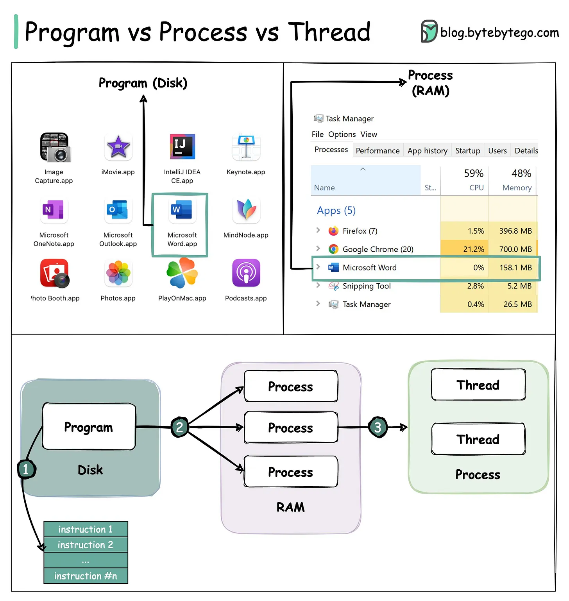

# 173 - Câu hỏi phỏng vấn phổ biến: Process và Thread khác nhau thế nào?

- Nguồn: ByteByteGo Big Archive System Design 2025
- Trang PDF: 355-355
- Ảnh minh họa: `../assets/173/figure-01.png`

## Hình minh họa

## Dịch sát

Các khác biệt chính giữa process và thread:

- Process thường độc lập, trong khi thread tồn tại như các phần con của process.

- Mỗi process có memory space riêng. Các thread thuộc cùng một process chia sẻ cùng memory.

- Process là một operation nặng hơn. Việc tạo và kết thúc process mất nhiều thời gian hơn.

- Context switching giữa các process tốn kém hơn.

- Inter-thread communication nhanh hơn đối với thread.

## Dịch nội dung trong hình

- `Program (Disk)`: program là file/app nằm trên disk, ví dụ image capture app, movie app, UWP app, keynote app hoặc Microsoft Office app.
- `Process (RAM)`: khi program chạy, OS tạo process trong RAM. Task Manager hiển thị các process đang chạy, CPU, memory, disk, network và GPU usage.
- Luồng minh họa: `Program` nằm trên `Disk`, khi được chạy sẽ tạo ra một hoặc nhiều `Process` trong `RAM`.
- Bên trong process có `Thread`. Thread là execution path nhẹ hơn, chạy trong memory space của process.
- Một process có thể có nhiều thread; các thread trong cùng process chia sẻ memory nhưng có stack/execution context riêng.

## Tóm tắt & giải thích dễ hiểu

Process giống một ứng dụng đang chạy có vùng nhớ riêng. Thread giống các luồng công việc bên trong ứng dụng đó. Vì process tách memory nên an toàn hơn nhưng nặng hơn. Thread nhẹ và giao tiếp nhanh vì dùng chung memory, nhưng cũng dễ gây race condition nếu nhiều thread cùng sửa dữ liệu.

## Ví dụ thực tế - không nằm trong tài liệu gốc

Chrome có thể chạy nhiều tab/site trong các process khác nhau để tăng isolation. Trong một backend service, một process Node.js hoặc Java có thể dùng nhiều thread hoặc worker để xử lý I/O, background job hoặc CPU-heavy task. Nếu một thread trong cùng process ghi sai dữ liệu shared state, bug có thể ảnh hưởng cả process.

## Thuật ngữ chính

- `Process`: instance của chương trình đang chạy, có memory space riêng.
- `Thread`: luồng thực thi bên trong process.
- `Memory space`: vùng nhớ mà process/thread truy cập.
- `Context switching`: chuyển CPU context giữa process/thread.
- `Inter-thread communication`: giao tiếp giữa các thread.
- `Race condition`: lỗi do nhiều luồng truy cập/sửa dữ liệu cùng lúc không kiểm soát.

