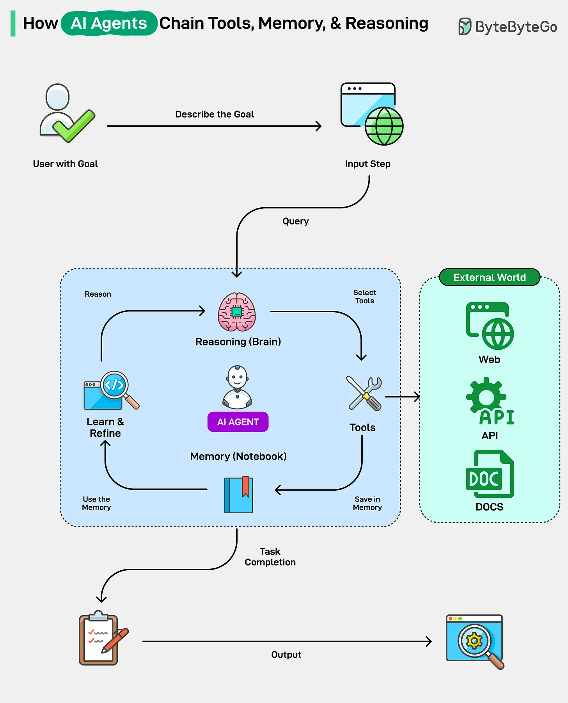

# 174 - AI Agent kết nối Tool, Memory và Reasoning như thế nào?

- Nguồn: ByteByteGo Big Archive System Design 2025
- Trang PDF: 356-357
- Ảnh minh họa: `../assets/174/figure-01.png`

## Hình minh họa

## Dịch sát

1. Reasoning: Đây là bộ não của AI agent. Nó nhận goal của user dưới dạng query và dùng reasoning agent của nó (sử dụng framework như ReAct) để chia goal thành một chuỗi các bước nhỏ hơn, logic hơn.

2. Tools: Với mỗi bước, agent chọn một tool phù hợp. Những tool này có thể là external program hoặc API mà nó có thể gọi, chẳng hạn web search, calculator, code interpreter hoặc documents.

3. Memory: Đây giống như notebook. Agent ghi lại kết quả của mỗi lần dùng tool vào memory của nó. Notebook này cho phép agent học từ kết quả, duy trì context qua các cuộc hội thoại dài, và tinh chỉnh plan dựa trên phát hiện mới.

Vòng lặp liên tục gồm reasoning, hành động với tool và ghi nhớ outcome tạo thành một chain. Cuối cùng, khi agent thấy rằng nó đã hoàn thành query của user, nó phản hồi lại user.

## Dịch nội dung trong hình

- `User with Goal`: user đưa mục tiêu cho agent.
- `Describe the Goal` và `Input Step`: goal được mô tả và chuyển thành bước đầu vào/query.
- `Reasoning (Brain)`: phần suy luận của AI agent, quyết định cần làm gì tiếp theo.
- `Tools`: các công cụ agent có thể gọi để hành động hoặc lấy dữ liệu.
- `Memory (Notebook)`: nơi lưu kết quả, context và ghi chú trong quá trình làm việc.
- `Learn & Refine`: agent học từ kết quả tool và điều chỉnh plan.
- `External World`: agent có thể gọi `Web`, `API`, `Docs`.
- `Task Completion` và `Output`: khi đủ thông tin/kết quả, agent hoàn thành task và trả output.

## Tóm tắt & giải thích dễ hiểu

AI agent không chỉ trả lời một lần như chatbot đơn giản. Nó có thể lập kế hoạch, gọi tool, đọc kết quả, lưu context rồi tiếp tục bước sau. Ba phần quan trọng là reasoning để quyết định, tools để tác động ra thế giới ngoài, và memory để không mất mạch công việc.

## Ví dụ thực tế - không nằm trong tài liệu gốc

Khi bạn yêu cầu agent “phân tích lỗi API chậm”, agent có thể: đọc log, chạy query thống kê latency, kiểm tra code hot path, ghi kết quả từng bước vào memory, rồi đề xuất bottleneck chính. Nếu thiếu dữ liệu, nó tiếp tục gọi tool khác thay vì đoán ngay.

## Thuật ngữ chính

- `AI Agent`: hệ thống AI có thể lập kế hoạch và hành động qua tool.
- `Reasoning`: quá trình suy luận/chia nhỏ mục tiêu.
- `Tool`: công cụ ngoài như API, shell, browser, database query.
- `Memory`: nơi lưu context, kết quả và trạng thái làm việc.
- `ReAct`: pattern kết hợp Reasoning và Acting.
- `Chain`: chuỗi bước suy luận - hành động - ghi nhớ.

