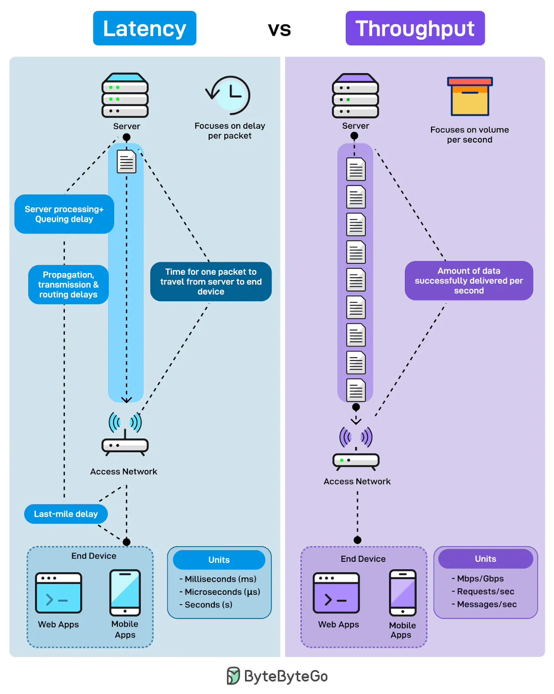

# 175 - Latency vs Throughput

- Nguồn: ByteByteGo Big Archive System Design 2025
- Trang PDF: 358-359
- Ảnh minh họa: `../assets/175/figure-01.png`

## Hình minh họa

## Dịch sát

Bạn từng thắc mắc vì sao app của mình có cảm giác chậm dù bandwidth nhìn vẫn ổn chưa? Latency và throughput giải thích hai câu chuyện hiệu năng rất khác nhau.

Latency đo độ trễ trên mỗi packet. Nó là thứ user cảm nhận khi họ bấm một button. Nó là responsiveness. Nó là thời gian để một request đi từ server tới end device. Điều này bao gồm server processing time, queuing delays, propagation qua network, transmission delays và last-mile connection tới thiết bị của user.

Throughput đo volume mỗi giây. Nó là lượng dữ liệu được deliver thành công trong một khoảng thời gian nhất định. Không phải mỗi packet di chuyển nhanh thế nào, mà là có bao nhiêu packet chảy qua đường ống.

Throughput là capacity. Throughput cao nghĩa là system xử lý load mà không bị nghẽn.

## Dịch nội dung trong hình

- `Latency`: tập trung vào delay trên mỗi packet. Các thành phần gồm `Server processing + Queuing delay`, `Transmission & routing delays`, `Time for one packet to travel from server to end device`, `Last-mile delay`, rồi tới `End Device` như web app hoặc mobile app. Đơn vị thường là milliseconds, microseconds hoặc seconds.
- `Throughput`: tập trung vào volume mỗi giây. Hình minh họa nhiều packet đi qua network tới end device. Chỉ số là lượng data deliver thành công mỗi giây. Đơn vị thường là Mbps/Gbps, requests/sec hoặc messages/sec.

## Tóm tắt & giải thích dễ hiểu

Latency trả lời câu hỏi “một request mất bao lâu?”. Throughput trả lời câu hỏi “mỗi giây xử lý được bao nhiêu?”. Một hệ thống có throughput cao vẫn có thể khiến user thấy chậm nếu latency cao. Ngược lại, latency thấp nhưng throughput thấp thì khi traffic tăng, hệ thống dễ nghẽn.

## Ví dụ thực tế - không nằm trong tài liệu gốc

Một API thanh toán cần latency thấp vì user đang chờ kết quả từng request. Một pipeline upload video cần throughput cao vì phải đẩy nhiều GB dữ liệu. Với chat app, latency thấp giúp tin nhắn đến nhanh; với data warehouse, throughput cao giúp xử lý khối dữ liệu lớn hiệu quả.

## Thuật ngữ chính

- `Latency`: độ trễ của một request/packet.
- `Throughput`: lượng công việc/dữ liệu xử lý trên mỗi đơn vị thời gian.
- `Bandwidth`: băng thông tối đa của đường truyền.
- `Queuing delay`: độ trễ do phải xếp hàng chờ xử lý.
- `Last-mile`: đoạn mạng cuối tới thiết bị của user.
- `Responsiveness`: cảm giác phản hồi nhanh/chậm của hệ thống.

## Câu hỏi ôn tập + trả lời + thinking học tập + liên hệ

> Đây là phần học tập thêm ở cuối file. Câu hỏi ưu tiên lấy từ tài liệu gốc và được trả lời trực tiếp; nếu bài không có câu hỏi riêng thì dùng tiêu đề/nội dung chính để tạo câu hỏi tự kiểm tra.

### Câu hỏi 1

**Nguồn câu hỏi:** Suy ra từ tiêu đề/nội dung chính vì bài gốc không có câu hỏi riêng.

**Câu hỏi:** Sau khi đọc bài “Latency vs. Throughput”, ý chính cần trả lời và áp dụng vào system design là gì?

**Trả lời:** Nếu rút thành checklist thiết kế thì ý chính là: Latency trả lời câu hỏi “một request mất bao lâu?”. Throughput trả lời câu hỏi “mỗi giây xử lý được bao nhiêu?”. Một hệ thống có throughput cao vẫn có thể khiến user thấy chậm nếu latency cao. Ngược lại, latency thấp nhưng throughput thấp thì khi traffic tăng, hệ thống dễ nghẽn. Khi áp dụng vào hệ thống thật, hãy kiểm thêm requirement, constraint, traffic, dữ liệu, failure mode và khả năng vận hành của team.

**Thinking học tập + liên hệ:** Ôn tập `Latency vs Throughput` bằng cách biến khái niệm thành quyết định thiết kế cụ thể: chọn gì, bỏ gì, đo gì và ai chịu trách nhiệm. Lens chính là requirement, constraint, traffic, dữ liệu, failure mode và khả năng vận hành của team. Khi gặp system design thật, hãy biến khái niệm thành quyết định: boundary ở đâu, data flow thế nào, bottleneck nào đến trước và rollback ra sao. Khi ghi chú lại, hãy giải thích được các keyword: `Latency`, `Throughput`, `Bandwidth`, `Queuing delay`, `Last-mile`.
