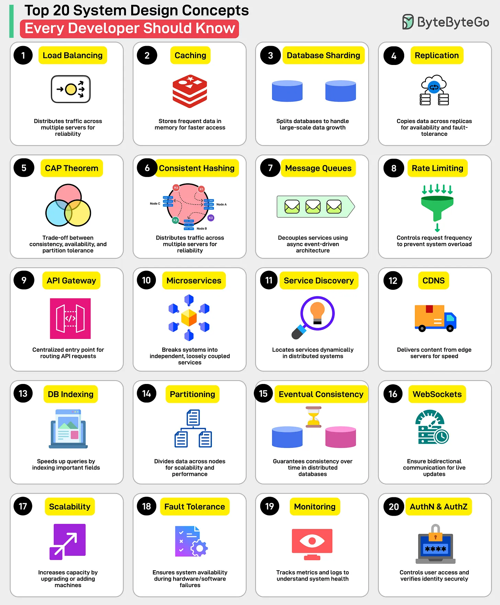

# 176 - 20 khái niệm System Design bạn nên biết

- Nguồn: ByteByteGo Big Archive System Design 2025
- Trang PDF: 360-361
- Ảnh minh họa: `../assets/176/figure-01.png`

## Hình minh họa

## Dịch sát

1. Load Balancing: Phân phối traffic qua nhiều server để tăng reliability và availability.

2. Caching: Lưu dữ liệu được truy cập thường xuyên trong memory để truy cập nhanh hơn.

3. Database Sharding: Chia database để xử lý tăng trưởng dữ liệu quy mô lớn.

4. Replication: Sao chép dữ liệu qua các replica để tăng availability và fault tolerance.

5. CAP Theorem: Trade-off giữa consistency, availability và partition tolerance.

6. Consistent Hashing: Phân phối load đều trong môi trường server thay đổi động.

7. Message Queues: Decouple các service bằng kiến trúc asynchronous event-driven.

8. Rate Limiting: Kiểm soát tần suất request để ngăn system overload.

9. API Gateway: Điểm vào tập trung để route các API request.

10. Microservices: Chia system thành các service độc lập, loosely coupled.

11. Service Discovery: Định vị service một cách động trong distributed system.

12. CDN: Deliver content từ edge server để tăng tốc.

13. Database Indexing: Tăng tốc query bằng cách index các field quan trọng.

14. Data Partitioning: Chia dữ liệu qua nhiều node để tăng scalability và performance.

15. Eventual Consistency: Đảm bảo dữ liệu sẽ consistent theo thời gian trong distributed database.

16. WebSockets: Cho phép giao tiếp hai chiều để cập nhật live.

17. Scalability: Tăng capacity bằng cách nâng cấp hoặc thêm máy.

18. Fault Tolerance: Đảm bảo system availability khi có lỗi hardware/software.

19. Monitoring: Theo dõi metrics và logs để hiểu sức khỏe system.

20. Authentication & Authorization: Kiểm soát truy cập của user và xác minh identity một cách an toàn.

## Dịch nội dung trong hình

- Hình liệt kê 20 khái niệm tương ứng: `Load Balancing`, `Caching`, `Database Sharding`, `Replication`, `CAP Theorem`, `Consistent Hashing`, `Message Queues`, `Rate Limiting`, `API Gateway`, `Microservices`, `Service Discovery`, `CDN`, `DB Indexing`, `Partitioning`, `Eventual Consistency`, `WebSockets`, `Scalability`, `Fault Tolerance`, `Monitoring`, `AuthN & AuthZ`.
- Mỗi ô minh họa một concept cốt lõi mà developer nên biết khi thiết kế hệ thống production.

## Tóm tắt & giải thích dễ hiểu

Đây là checklist nền tảng cho system design. Các concept này chia thành vài nhóm: scale traffic (`Load Balancing`, `CDN`, `Rate Limiting`), scale dữ liệu (`Sharding`, `Partitioning`, `Indexing`, `Replication`), kiến trúc service (`Microservices`, `API Gateway`, `Message Queues`, `Service Discovery`), reliability (`Fault Tolerance`, `Monitoring`) và security (`Authentication`, `Authorization`).

## Ví dụ thực tế - không nằm trong tài liệu gốc

Khi thiết kế news feed, bạn có thể dùng CDN cho static assets, cache feed gần nhất, message queue để xử lý fanout async, sharding user/feed data theo user ID, monitoring latency/error rate, và rate limiting để chống bot hoặc abuse.

## Thuật ngữ chính

- `Load Balancing`: cân bằng tải.
- `Caching`: lưu tạm dữ liệu để đọc nhanh.
- `Sharding`: chia database theo shard.
- `Replication`: nhân bản dữ liệu.
- `CAP Theorem`: định lý CAP trong distributed system.
- `Message Queue`: hàng đợi message để xử lý async.
- `CDN`: Content Delivery Network.
- `AuthN/AuthZ`: xác thực và phân quyền.

