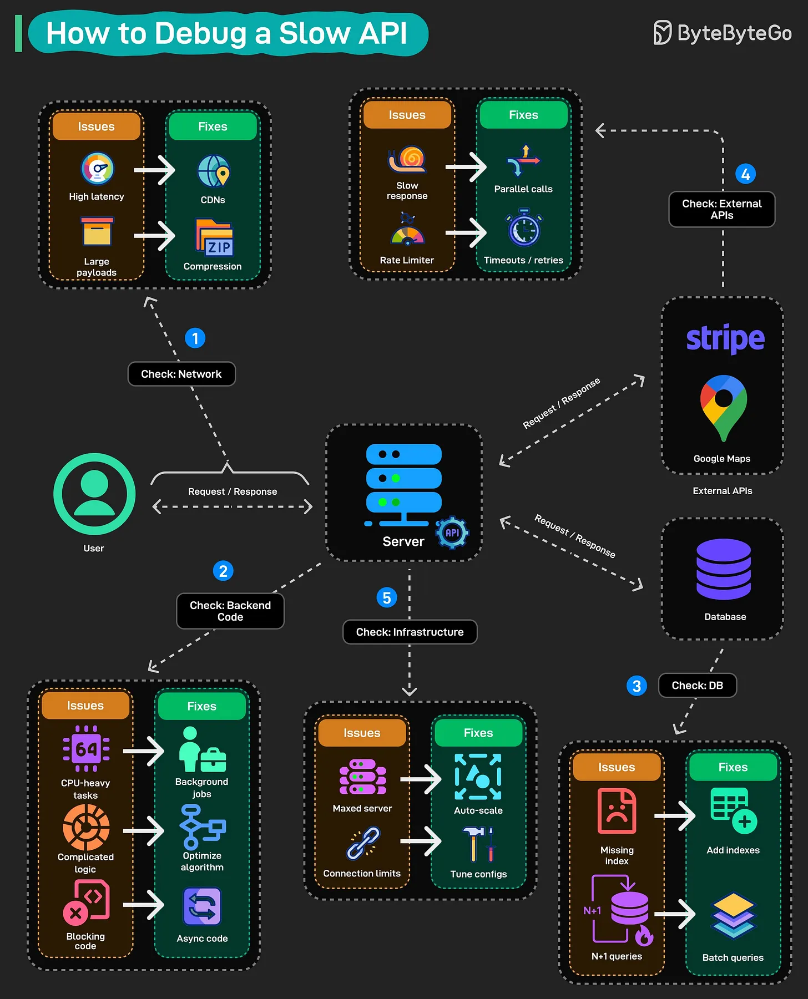

# 177 - Cách debug một API chậm

- Nguồn: ByteByteGo Big Archive System Design 2025
- Trang PDF: 362-363
- Ảnh minh họa: `../assets/177/figure-01.png`

## Hình minh họa

## Dịch sát

API của bạn chậm. User đang phàn nàn. Và bạn không biết phải bắt đầu tìm từ đâu. Đây là cách tiếp cận có hệ thống để truy ra thứ đang làm API của bạn chậm.

Bắt đầu với network: Latency cao? Đặt CDN phía trước static assets. Payload lớn? Compress response. Đây là các quick win không cần đụng vào code.

Tiếp theo kiểm tra backend code: Đây là nơi phần lớn slowdown ẩn náu. Các operation nặng CPU nên chạy ở background. Business logic phức tạp cần được đơn giản hóa. Blocking synchronous call nên chuyển sang async. Profile nó, tìm hot path, rồi fix.

Kiểm tra database: Missing index là thủ phạm kinh điển. Cũng cần chú ý N+1 query, nơi bạn đang đập database hàng trăm lần trong khi một batch query là đủ.

Đừng quên external API: Lệnh gọi Stripe đó, request Google Maps đó, chúng nằm ngoài tầm kiểm soát của bạn. Hãy gọi song song khi có thể. Đặt timeout và retry quyết liệt để một third-party chậm không làm sập cả response.

Cuối cùng, kiểm tra infrastructure: Server đã max tải cần auto-scaling. Connection pool limit cần tuning. Đôi khi vấn đề không nằm ở code của bạn, mà là bạn đang cố phục vụ 10.000 request bằng resource được thiết kế cho 100 request.

Điểm mấu chốt là phải methodical. Đừng ném bừa solution vào tường. Đo trước, xác định bottleneck thật, rồi sửa nó.

## Dịch nội dung trong hình

- User gửi `Request + Response` tới `Server`; từ server cần kiểm tra nhiều lớp.
- `Check Network`: kiểm tra high latency, large payload và compression.
- `Check Backend Code`: tìm slow code, synchronous I/O, CPU-heavy operation, business logic phức tạp.
- `Check Database`: kiểm tra missing indexes, N+1 queries, slow query và caching/database bottleneck.
- `Check External APIs`: kiểm tra API ngoài như Stripe, Google Maps; dùng timeout, retry, parallel calls khi phù hợp.
- `Check Infrastructure`: kiểm tra server capacity, auto-scaling, connection limits, load balancer, CDN hoặc resource bottleneck.

## Tóm tắt & giải thích dễ hiểu

Debug API chậm nên đi từ ngoài vào trong: network -> backend code -> database -> external API -> infrastructure. Quan trọng nhất là đo đạc bằng metric/tracing/profiling trước khi sửa. Nếu không có số liệu, rất dễ tối ưu sai chỗ.

## Ví dụ thực tế - không nằm trong tài liệu gốc

Một endpoint `/orders` chậm 2 giây. Trace cho thấy 50ms ở network, 100ms ở app code, nhưng 1.6s ở database do N+1 query lấy từng order item. Fix đúng là đổi sang batch query hoặc join/preload, không phải tăng server hay thêm CDN.

## Thuật ngữ chính

- `Bottleneck`: nút thắt làm chậm toàn hệ thống.
- `Payload`: dữ liệu request/response truyền qua mạng.
- `Hot path`: đoạn code chạy nhiều hoặc tốn nhiều thời gian nhất.
- `N+1 query`: lỗi query lặp nhiều lần thay vì gom batch.
- `Timeout`: giới hạn thời gian chờ external call.
- `Connection pool`: pool kết nối tới database/service.
- `Profiling`: đo hiệu năng chi tiết để tìm điểm chậm.

## Câu hỏi ôn tập + trả lời + thinking học tập + liên hệ

> Đây là phần học tập thêm ở cuối file. Câu hỏi ưu tiên lấy từ tài liệu gốc và được trả lời trực tiếp; nếu bài không có câu hỏi riêng thì dùng tiêu đề/nội dung chính để tạo câu hỏi tự kiểm tra.

### Câu hỏi 1

**Nguồn câu hỏi:** Suy ra từ tiêu đề/nội dung chính vì bài gốc không có câu hỏi riêng.

**Câu hỏi:** How to Debug a Slow API?

**Trả lời:** Hãy tách flow thành các bước có state rõ ràng: request/dữ liệu đi vào đâu, qua thành phần nào, state đổi ở đâu và kết quả trả ra thế nào. Với `Cách debug một API chậm`, ý chính là: Debug API chậm nên đi từ ngoài vào trong: network -> backend code -> database -> external API -> infrastructure. Quan trọng nhất là đo đạc bằng metric/tracing/profiling trước khi sửa. Nếu không có số liệu, rất dễ tối ưu sai chỗ.

**Thinking học tập + liên hệ:** Luồng trong `Cách debug một API chậm` nên được vẽ từ input tới output, kèm owner của từng bước và failure mode ở mỗi boundary. Lens chính là actor, trust boundary, dữ liệu nhạy cảm, lifetime của token/key, quyền truy cập và cơ chế revoke. Khi làm API thật, một endpoint chạy được chưa đủ; phải kiểm thêm abuse, audit log, error leakage, rate limit và quyền ở service chứa dữ liệu. Khi ghi chú lại, hãy giải thích được các keyword: `Bottleneck`, `Payload`, `Hot path`, `N+1 query`, `Timeout`.
