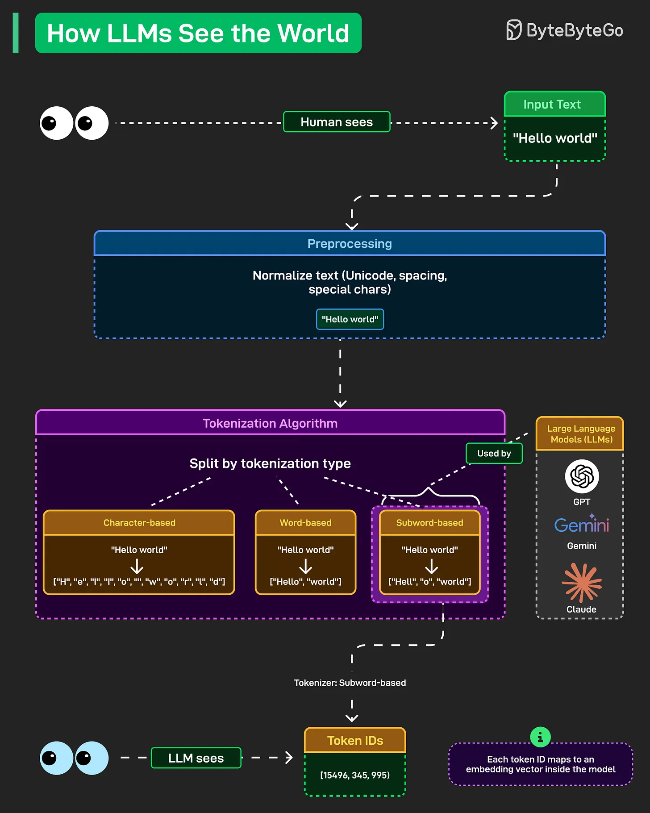

# 178 - LLM nhìn thế giới như thế nào?

- Nguồn: ByteByteGo Big Archive System Design 2025
- Trang PDF: 364-365
- Ảnh minh họa: `../assets/178/figure-01.png`

## Hình minh họa

## Dịch sát

Khi bạn gõ “Hello world” vào ChatGPT hoặc Claude, model không xử lý các chữ cái và khoảng trắng đó giống như cách bạn đang đọc bài này. Nó chuyển mọi thứ thành số thông qua một quá trình mà phần lớn mọi người không bao giờ nghĩ tới.

Preprocessing đến trước. Text được normalize. Unicode character, spacing quirks và special symbol đều được làm sạch và chuẩn hóa. “Hello world” trở thành một format nhất quán mà model thật sự có thể làm việc.

Sau đó là tokenization. Đây là nơi mọi thứ trở nên thú vị. Model chia text thành token, và có nhiều cách tiếp cận khác nhau.

1. Character-based tokenization chia mọi thứ thành từng ký tự riêng lẻ. “Hello world” trở thành `["H", "e", "l", "l", "o", " ", "w", "o", "r", "l", "d"]`. Đơn giản nhưng kém hiệu quả.

2. Word-based tách theo nguyên từ. `["Hello", "world"]`. Sạch hơn nhưng gặp khó với từ hiếm và tạo ra vocabulary rất lớn.

3. Subword-based là cách các LLM hiện đại thật sự dùng. GPT, Gemini, Claude đều dựa vào cách này. “Hello world” trở thành đại loại như `["Hell", "o", "world"]`. Nó cân bằng efficiency với flexibility, xử lý từ hiếm bằng cách chia chúng thành các mảnh subword đã biết.

Bước cuối là Token IDs. Các subword đó được map thành những con số như `[15496, 345, 995]`. Mỗi token ID tương ứng với một embedding vector bên trong model. Đó mới là thứ neural network thật sự xử lý.

## Dịch nội dung trong hình

- `Input Text`: “Hello world”. Con người nhìn thấy text, còn LLM cần chuyển text thành representation dạng số.
- `Preprocessing`: normalize text như Unicode, spacing và special character để tạo format chuẩn.
- `Tokenization Algorithm`: chia text thành token theo các kiểu `Character-based`, `Word-based`, `Subword-based`.
- `Subword-based`: được các LLM như GPT, Gemini, Claude sử dụng phổ biến.
- `Token IDs`: token được map thành ID số, ví dụ `[15496, 345, 995]`.
- `LLM sees`: LLM nhìn thấy token ID/embedding vector, không nhìn text thô như con người.

## Tóm tắt & giải thích dễ hiểu

LLM không hiểu trực tiếp chữ cái theo kiểu con người. Pipeline cơ bản là text -> normalize -> token -> token ID -> embedding vector -> neural network xử lý. Tokenization ảnh hưởng mạnh đến chi phí, độ dài context và cách model xử lý ngôn ngữ hiếm, code, emoji hoặc tiếng Việt có dấu.

## Ví dụ thực tế - không nằm trong tài liệu gốc

Một câu tiếng Việt như “thiết kế hệ thống” có thể bị tokenizer chia thành nhiều subword khác nhau tùy model. Nếu văn bản có nhiều ký tự lạ, dấu cách bất thường hoặc code xen kẽ, số token có thể tăng, làm prompt tốn context và chi phí hơn.

## Thuật ngữ chính

- `LLM`: Large Language Model.
- `Preprocessing`: tiền xử lý text trước khi đưa vào model.
- `Tokenization`: chia text thành token.
- `Token`: đơn vị text mà model xử lý.
- `Token ID`: số đại diện cho token trong vocabulary.
- `Embedding vector`: vector số biểu diễn token trong không gian model.
- `Vocabulary`: tập token mà tokenizer biết.

## Câu hỏi ôn tập + trả lời + thinking học tập + liên hệ

> Đây là phần học tập thêm ở cuối file. Câu hỏi ưu tiên lấy từ tài liệu gốc và được trả lời trực tiếp; nếu bài không có câu hỏi riêng thì dùng tiêu đề/nội dung chính để tạo câu hỏi tự kiểm tra.

### Câu hỏi 1

**Nguồn câu hỏi:** Suy ra từ tiêu đề/nội dung chính vì bài gốc không có câu hỏi riêng.

**Câu hỏi:** LLM nhìn thế giới như thế nào?

**Trả lời:** Luồng tốt nhất là lần theo input tới output: request/dữ liệu đi vào đâu, qua thành phần nào, state đổi ở đâu và kết quả trả ra thế nào. Với `LLM nhìn thế giới như thế nào?`, ý chính là: LLM không hiểu trực tiếp chữ cái theo kiểu con người. Pipeline cơ bản là text -> normalize -> token -> token ID -> embedding vector -> neural network xử lý. Tokenization ảnh hưởng mạnh đến chi phí, độ dài context và cách model xử lý ngôn ngữ hiếm, code, emoji hoặc tiếng Việt có dấu.

**Thinking học tập + liên hệ:** Luồng trong `LLM nhìn thế giới như thế nào?` nên được vẽ từ input tới output, kèm owner của từng bước và failure mode ở mỗi boundary. Lens chính là quality, latency, cost/token, privacy, cập nhật tri thức và rủi ro hallucination. Khi build AI app, hãy nối model với pipeline thật: data vào đâu, context lấy từ đâu, output được kiểm thế nào và chi phí tăng theo traffic ra sao. Khi ghi chú lại, hãy giải thích được các keyword: `LLM`, `Preprocessing`, `Tokenization`, `Token`, `Token ID`.
