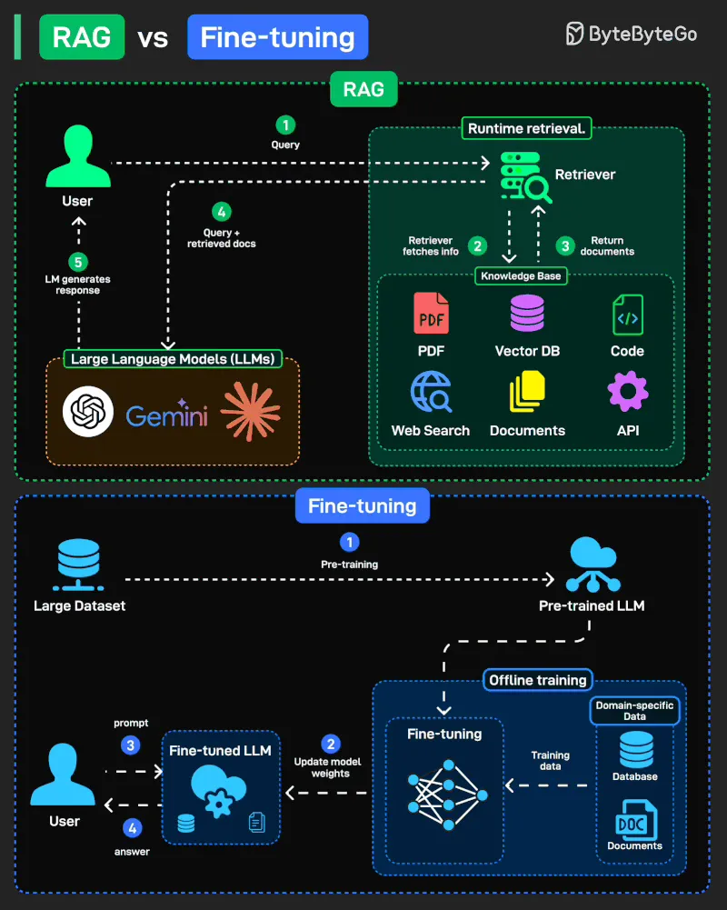
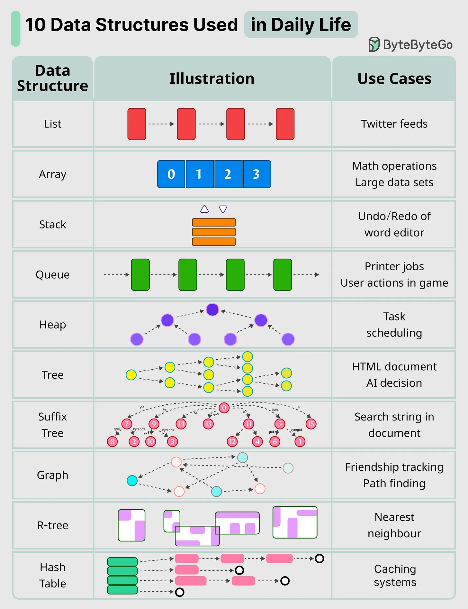

# 179 - RAG vs Fine-tuning: nên dùng cái nào?

- Nguồn: ByteByteGo Big Archive System Design 2025
- Trang PDF: 366-368
- Ảnh minh họa: `../assets/179/figure-01.png`, `../assets/179/figure-02.png`

## Hình minh họa

## Dịch sát

Khi nói đến việc điều chỉnh Large Language Model (LLM) cho các task mới, có hai hướng phổ biến nổi bật: Retrieval-Augmented Generation (RAG) và Fine-tuning. Chúng giải quyết cùng một vấn đề, làm model hữu ích hơn, nhưng theo hai cách rất khác nhau.

RAG (Retrieval-Augmented Generation): Lấy knowledge tại runtime từ nguồn bên ngoài như docs, DB, API. Linh hoạt, luôn mới.

Fine-tuning: Offline training cập nhật model weights bằng domain-specific data, biến model thành chuyên gia trong lĩnh vực của bạn.

10 cấu trúc dữ liệu chính chúng ta dùng hằng ngày

- list: giữ Twitter feeds của bạn

- stack: hỗ trợ undo/redo trong word editor

- queue: giữ printer jobs, hoặc gửi user actions trong game

- hash table: caching systems

- Array: math operations

- heap: task scheduling

- tree: giữ HTML document, hoặc dùng cho AI decision

- suffix tree: dùng để tìm kiếm string trong document

- graph: dùng để theo dõi friendship, hoặc path finding

- r-tree: dùng để tìm nearest neighbor

- vertex buffer: dùng để gửi data tới GPU để rendering

## Dịch nội dung trong hình

- `RAG`: user gửi query tới LLM, LLM/agent tạo query để retrieval; `Retriever` lấy thông tin ở runtime từ `Knowledge Base` như PDF, vector DB, code, web search, documents, API; retrieved docs được đưa lại vào prompt để LLM trả lời.
- `Fine-tuning`: bắt đầu từ `Large Dataset` và pre-training để tạo pre-trained LLM; sau đó offline training trên `Domain-specific Training Dataset` để cập nhật model weights và tạo fine-tuned LLM.
- Hình thứ hai - `10 Data Structures Used in Daily Life`: `List` cho Twitter feeds; `Array` cho math operations và large data sets; `Stack` cho undo/redo của word editor; `Queue` cho printer jobs và user actions trong game; `Heap` cho task scheduling; `Tree` cho HTML document và AI decision; `Suffix Tree` cho search string trong document; `Graph` cho friendship tracking và path finding; `R-tree` cho nearest neighbor; `Hash Table` cho caching systems.

## Tóm tắt & giải thích dễ hiểu

RAG phù hợp khi tri thức thay đổi thường xuyên, cần trích dẫn nguồn, hoặc muốn model đọc tài liệu nội bộ mà không train lại. Fine-tuning phù hợp khi muốn model thay đổi style, format output, kỹ năng chuyên biệt hoặc hành vi lặp lại ổn định. Nhiều hệ thống production dùng cả hai: fine-tune để model trả lời đúng format, rồi dùng RAG để lấy knowledge mới nhất.

## Ví dụ thực tế - không nằm trong tài liệu gốc

Nếu xây chatbot hỏi đáp chính sách công ty, RAG thường là lựa chọn đầu tiên vì policy thay đổi liên tục và cần truy nguồn từ tài liệu. Nếu xây model phân loại ticket support theo taxonomy riêng với format rất ổn định, fine-tuning có thể hiệu quả hơn. Nếu chatbot vừa cần đọc policy mới vừa phải trả lời đúng giọng thương hiệu, có thể kết hợp RAG và fine-tuning.

## Ghi chú kỹ thuật - không nằm trong tài liệu gốc

Phần extract của bài này ghép thêm nội dung “10 Key Data Structures” vào cùng file với RAG vs Fine-tuning. Trong ảnh thứ hai có 10 cấu trúc dữ liệu, nhưng text extract liệt kê thêm `vertex buffer`, thành 11 mục. Ngoài ra `cashing systems` trong nguồn nhiều khả năng là typo của `caching systems`.

## Thuật ngữ chính

- `RAG`: Retrieval-Augmented Generation, sinh câu trả lời có bổ sung retrieval từ nguồn ngoài.
- `Fine-tuning`: huấn luyện tiếp model trên dữ liệu chuyên biệt.
- `Model weights`: trọng số của neural network.
- `Runtime retrieval`: truy xuất thông tin lúc đang xử lý request.
- `Vector DB`: database lưu embedding để semantic search.
- `Embedding`: vector biểu diễn semantic meaning của text/data.
- `Data structure`: cấu trúc dữ liệu phục vụ lưu trữ và truy cập hiệu quả.

