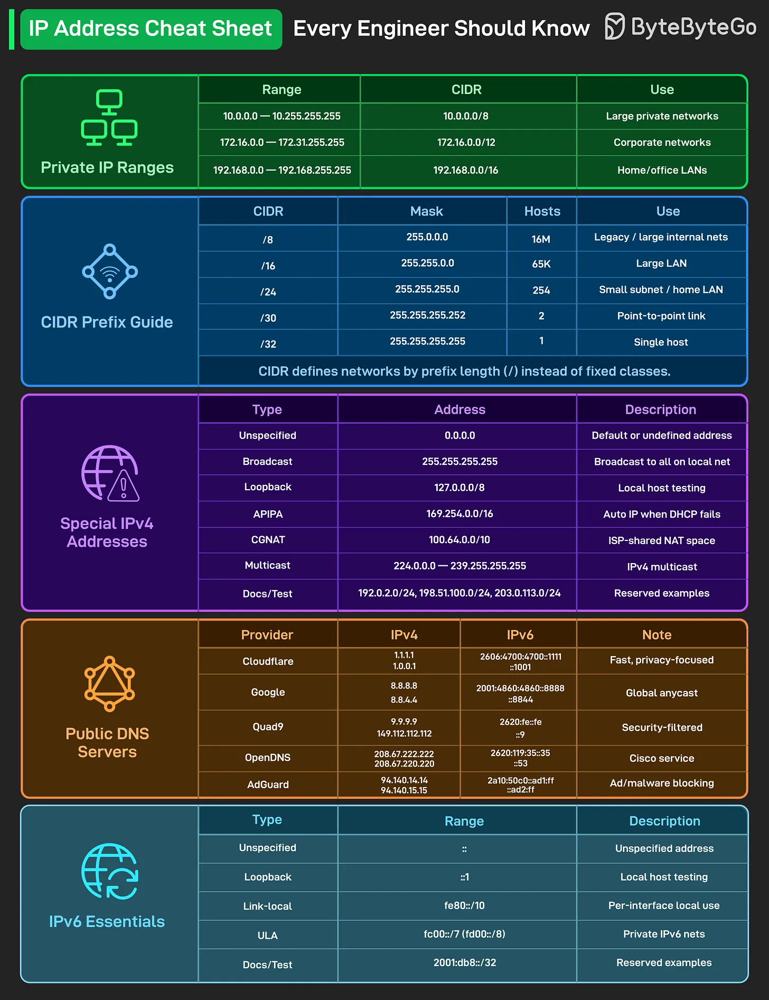

# 180 - Cheat Sheet địa chỉ IP mà mọi engineer nên biết

- Nguồn: ByteByteGo Big Archive System Design 2025
- Trang PDF: 369-370
- Ảnh minh họa: `../assets/180/figure-01.png`

## Hình minh họa

## Dịch sát

Phần text extract của bài này không có nội dung chữ riêng ngoài hình. Nội dung chính nằm trong cheat sheet về dải IP private, CIDR prefix, địa chỉ IPv4 đặc biệt, public DNS server và các dải IPv6 quan trọng.

## Dịch nội dung trong hình

### Private IP Ranges

| Range | CIDR | Use |
| --- | --- | --- |
| `10.0.0.0 - 10.255.255.255` | `10.0.0.0/8` | Mạng private lớn |
| `172.16.0.0 - 172.31.255.255` | `172.16.0.0/12` | Mạng doanh nghiệp |
| `192.168.0.0 - 192.168.255.255` | `192.168.0.0/16` | LAN gia đình/văn phòng |

### CIDR Prefix Guide

| CIDR | Mask | Hosts | Use |
| --- | --- | --- | --- |
| `/8` | `255.0.0.0` | `16M` | Legacy / mạng nội bộ lớn |
| `/16` | `255.255.0.0` | `65K` | LAN lớn |
| `/24` | `255.255.255.0` | `254` | Subnet nhỏ / home LAN |
| `/30` | `255.255.255.252` | `2` | Link point-to-point |
| `/32` | `255.255.255.255` | `1` | Một host duy nhất |

CIDR định nghĩa network bằng prefix length (`/`) thay vì fixed classes.

### Special IPv4 Addresses

| Type | Address | Description |
| --- | --- | --- |
| `Unspecified` | `0.0.0.0` | Địa chỉ mặc định hoặc chưa xác định |
| `Broadcast` | `255.255.255.255` | Broadcast tới tất cả host trong local net |
| `Loopback` | `127.0.0.0/8` | Test local host |
| `APIPA` | `169.254.0.0/16` | Tự cấp IP khi DHCP fail |
| `CGNAT` | `100.64.0.0/10` | Không gian NAT dùng chung của ISP |
| `Multicast` | `224.0.0.0 - 239.255.255.255` | IPv4 multicast |
| `Docs/Test` | `192.0.2.0/24`, `198.51.100.0/24`, `203.0.113.0/24` | Ví dụ dành riêng cho tài liệu |

### Public DNS Servers

| Provider | IPv4 | IPv6 | Note |
| --- | --- | --- | --- |
| `Cloudflare` | `1.1.1.1`, `1.0.0.1` | `2606:4700:4700::1111`, `::1001` | Nhanh, tập trung vào privacy |
| `Google` | `8.8.8.8`, `8.8.4.4` | `2001:4860:4860::8888`, `::8844` | Global anycast |
| `Quad9` | `9.9.9.9`, `149.112.112.112` | `2620:fe::fe`, `::9` | Lọc bảo mật |
| `OpenDNS` | `208.67.222.222`, `208.67.220.220` | `2620:119:35::35`, `::53` | Dịch vụ Cisco |
| `AdGuard` | `94.140.14.14`, `94.140.15.15` | `2a10:50c0::ad1:ff`, `::ad2:ff` | Chặn quảng cáo/malware |

### IPv6 Essentials

| Type | Range | Description |
| --- | --- | --- |
| `Unspecified` | `::` | Địa chỉ chưa xác định |
| `Loopback` | `::1` | Test local host |
| `Link-local` | `fe80::/10` | Dùng local trên từng interface |
| `ULA` | `fc00::/7` (`fd00::/8`) | Mạng IPv6 private |
| `Docs/Test` | `2001:db8::/32` | Ví dụ dành riêng cho tài liệu |

## Tóm tắt & giải thích dễ hiểu

Cheat sheet này gom các dải IP hay gặp khi cấu hình network, Docker/Kubernetes, VPC, firewall, DNS và troubleshooting. Private IP dùng trong mạng nội bộ và không route trực tiếp trên Internet. CIDR giúp biểu diễn network theo prefix. Các địa chỉ đặc biệt như loopback, broadcast, APIPA, CGNAT và multicast rất quan trọng khi debug network.

## Ví dụ thực tế - không nằm trong tài liệu gốc

Khi dựng VPC cho production, bạn có thể chọn `10.0.0.0/16`, chia public subnet `10.0.1.0/24`, private subnet `10.0.2.0/24`, rồi dùng security group/firewall để kiểm soát traffic. Khi máy nhận IP `169.254.x.x`, đó thường là dấu hiệu DHCP không cấp được IP.

## Thuật ngữ chính

- `IP address`: địa chỉ định danh host/interface trên network.
- `Private IP`: IP dùng trong mạng nội bộ, không public route trên Internet.
- `CIDR`: Classless Inter-Domain Routing, biểu diễn network bằng prefix.
- `Subnet mask`: mask xác định phần network và host.
- `Loopback`: địa chỉ quay về chính máy local.
- `APIPA`: địa chỉ tự động khi DHCP fail.
- `CGNAT`: Carrier-Grade NAT, NAT chia sẻ ở phía ISP.
- `DNS`: Domain Name System, phân giải domain sang IP.

## Câu hỏi ôn tập + trả lời + thinking học tập + liên hệ

> Đây là phần học tập thêm ở cuối file. Câu hỏi ưu tiên lấy từ tài liệu gốc và được trả lời trực tiếp; nếu bài không có câu hỏi riêng thì dùng tiêu đề/nội dung chính để tạo câu hỏi tự kiểm tra.

### Câu hỏi 1

**Nguồn câu hỏi:** Suy ra từ tiêu đề/nội dung chính vì bài gốc không có câu hỏi riêng.

**Câu hỏi:** Sau khi đọc bài “IP Address Cheat Sheet Every Engineer Should Know”, ý chính cần trả lời và áp dụng vào system design là gì?

**Trả lời:** Nếu rút thành checklist thiết kế thì ý chính là: Cheat sheet này gom các dải IP hay gặp khi cấu hình network, Docker/Kubernetes, VPC, firewall, DNS và troubleshooting. Private IP dùng trong mạng nội bộ và không route trực tiếp trên Internet. CIDR giúp biểu diễn network theo prefix. Các địa chỉ đặc biệt như loopback, broadcast, APIPA, CGNAT và multicast rất quan trọng khi debug network. Khi áp dụng vào hệ thống thật, hãy kiểm thêm DNS, transport, TLS, HTTP, proxy/CDN, application timeout và observability theo từng layer.

**Thinking học tập + liên hệ:** Khi học `Cheat Sheet địa chỉ IP mà mọi engineer nên biết`, hãy thử viết một checklist áp dụng vào project: input, output, owner, rủi ro và metric kiểm chứng. Lens chính là DNS, transport, TLS, HTTP, proxy/CDN, application timeout và observability theo từng layer. Khi debug production, hãy tách latency theo DNS lookup, TCP connect, TLS handshake, TTFB và download để không đoán mò. Khi ghi chú lại, hãy giải thích được các keyword: `IP address`, `Private IP`, `CIDR`, `Subnet mask`, `Loopback`.
