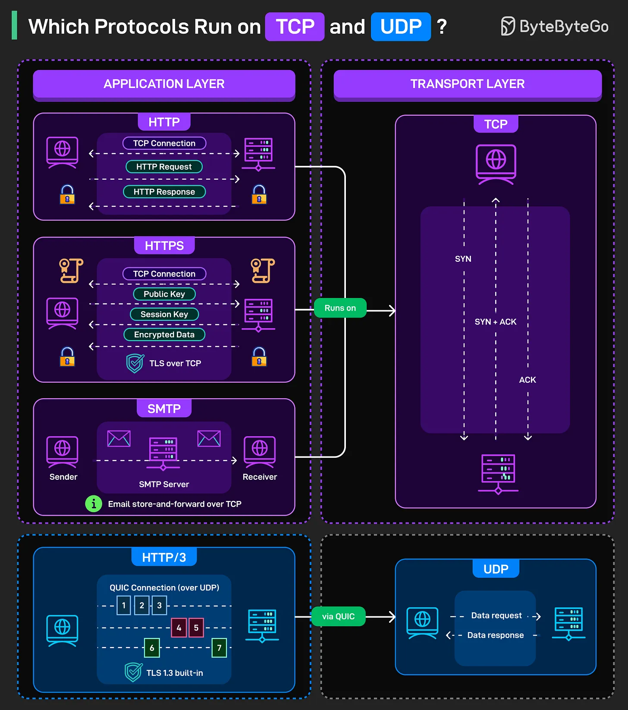

# 181 - Những protocol nào chạy trên TCP và UDP?

- Nguồn: ByteByteGo Big Archive System Design 2025
- Trang PDF: 371-372
- Ảnh minh họa: `../assets/181/figure-01.png`

## Hình minh họa

## Dịch sát

Mọi message gửi qua Internet có hai lớp giao tiếp: một lớp mang dữ liệu (transport) và một lớp định nghĩa dữ liệu đó có ý nghĩa gì (application). TCP và UDP nằm ở transport layer, nhưng chúng phục vụ các mục đích hoàn toàn khác nhau.

TCP là connection-oriented. Nó guarantee delivery, duy trì order, và xử lý retransmission khi packet bị mất.

- HTTP chạy trên TCP. Browser mở một TCP connection, gửi HTTP request, chờ HTTP response, rồi đóng connection (hoặc giữ alive cho các request tiếp theo). Mọi web page bạn từng load đều dùng pattern này.

- HTTPS thêm TLS lên trên TCP. TCP connection xảy ra trước. Sau đó là TLS handshake với public key exchange, session key negotiation, và cuối cùng là encrypted data transfer.

- SMTP dùng TCP cho email. Message đi từ sender tới SMTP server rồi tới receiver qua các TCP connection. Email không thể chấp nhận mất data giữa chừng khi truyền, nên reliability của TCP là thiết yếu.

UDP là connectionless. Không handshake. Không guaranteed delivery. Không đảm bảo giữ order. Chỉ bắn data request và response vào network rồi hy vọng chúng tới nơi. Nghe có vẻ hỗn loạn, nhưng nó nhanh.

- HTTP/3 chạy trên QUIC, mà QUIC dùng UDP. Điều này nghe có vẻ ngược đời cho đến khi bạn nhận ra QUIC tái triển khai các reliability feature của TCP bên trong UDP, nhưng với performance tốt hơn. Nhiều stream trên một connection. Tích hợp sẵn TLS 1.3. Thiết lập connection nhanh hơn. Các stream được đánh số trong sơ đồ cho thấy những luồng dữ liệu song song không block nhau.

## Dịch nội dung trong hình

- `Application Layer`: gồm `HTTP`, `HTTPS`, `SMTP`, `HTTP/3`.
- `HTTP`: tạo `TCP Connection`, gửi `HTTP Request`, nhận `HTTP Response`.
- `HTTPS`: tạo `TCP Connection`, trao đổi `Public Key`, tạo `Session Key`, sau đó truyền `Encrypted Data`; TLS chạy trên TCP.
- `SMTP`: email đi từ `Sender` qua `SMTP Server` tới `Receiver`; email dùng kiểu store-and-forward trên TCP.
- `Transport Layer - TCP`: minh họa handshake `SYN`, `SYN + ACK`, `ACK`.
- `HTTP/3`: dùng `QUIC Connection (over UDP)`, có nhiều stream song song và `TLS 1.3 built-in`.
- `UDP`: gửi `Data request` và nhận `Data response` không cần connection handshake như TCP.

## Tóm tắt & giải thích dễ hiểu

TCP phù hợp khi dữ liệu phải đến đủ và đúng thứ tự, ví dụ web truyền thống, HTTPS và email. UDP phù hợp khi cần nhanh, ít overhead, hoặc application tự xử lý reliability. HTTP/3 dùng QUIC trên UDP để vừa giảm latency vừa tránh một số vấn đề blocking của TCP.

## Ví dụ thực tế - không nằm trong tài liệu gốc

Khi gọi REST API thanh toán, bạn thường dùng HTTPS trên TCP vì không được mất dữ liệu. Khi xem video call hoặc chơi game realtime, UDP/QUIC thường phù hợp hơn vì bỏ qua hoặc xử lý riêng một vài packet trễ có thể tốt hơn chờ retransmission làm đứng toàn luồng.

## Thuật ngữ chính

- `Transport layer`: lớp vận chuyển dữ liệu giữa host.
- `Application layer`: lớp protocol cấp ứng dụng như HTTP, SMTP, DNS.
- `TCP`: protocol connection-oriented, reliable và ordered.
- `UDP`: protocol connectionless, ít overhead, không guarantee delivery.
- `TLS`: lớp mã hóa bảo mật cho connection.
- `QUIC`: transport protocol chạy trên UDP, tích hợp TLS 1.3 và multiplexing.
- `Handshake`: quá trình thiết lập connection/khóa bảo mật ban đầu.

## Câu hỏi ôn tập + trả lời + thinking học tập + liên hệ

> Đây là phần học tập thêm ở cuối file. Câu hỏi ưu tiên lấy từ tài liệu gốc và được trả lời trực tiếp; nếu bài không có câu hỏi riêng thì dùng tiêu đề/nội dung chính để tạo câu hỏi tự kiểm tra.

### Câu hỏi 1

**Nguồn câu hỏi:** Suy ra từ tiêu đề/nội dung chính vì bài gốc không có câu hỏi riêng.

**Câu hỏi:** Những protocol nào chạy trên TCP và UDP?

**Trả lời:** Sau bài này, phần đáng nhớ nhất là: TCP phù hợp khi dữ liệu phải đến đủ và đúng thứ tự, ví dụ web truyền thống, HTTPS và email. UDP phù hợp khi cần nhanh, ít overhead, hoặc application tự xử lý reliability. HTTP/3 dùng QUIC trên UDP để vừa giảm latency vừa tránh một số vấn đề blocking của TCP. Khi áp dụng vào hệ thống thật, hãy kiểm thêm DNS, transport, TLS, HTTP, proxy/CDN, application timeout và observability theo từng layer.

**Thinking học tập + liên hệ:** Ôn tập `Những protocol nào chạy trên TCP và UDP?` bằng cách biến khái niệm thành quyết định thiết kế cụ thể: chọn gì, bỏ gì, đo gì và ai chịu trách nhiệm. Lens chính là DNS, transport, TLS, HTTP, proxy/CDN, application timeout và observability theo từng layer. Khi debug production, hãy tách latency theo DNS lookup, TCP connect, TLS handshake, TTFB và download để không đoán mò. Khi ghi chú lại, hãy giải thích được các keyword: `Transport layer`, `Application layer`, `TCP`, `UDP`, `TLS`.
