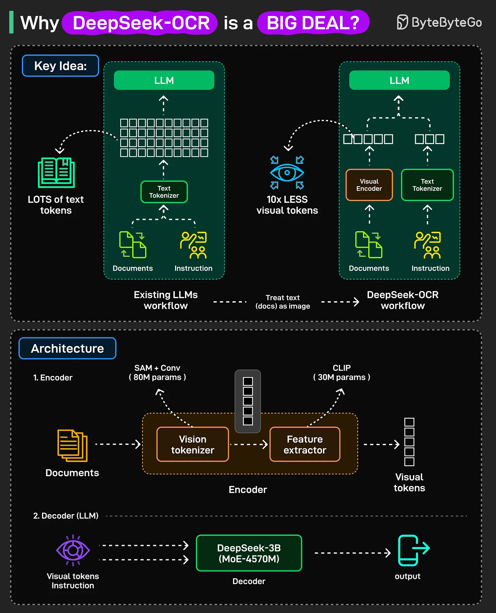

# 182 - Vì sao DeepSeek-OCR là một chuyện lớn?

- Nguồn: ByteByteGo Big Archive System Design 2025
- Trang PDF: 373-374
- Ảnh minh họa: `../assets/182/figure-01.png`

## Hình minh họa

## Dịch sát

Các LLM hiện có gặp khó với input dài vì chúng chỉ xử lý được một số token cố định, gọi là context window, và attention cost tăng rất nhanh khi input dài hơn.

DeepSeek-OCR dùng một cách tiếp cận mới.

Thay vì gửi long context trực tiếp tới LLM, nó biến context đó thành một image, nén image đó thành visual tokens, rồi truyền các token đó tới LLM.

Ít token hơn dẫn đến computational cost thấp hơn từ attention và effective context window lớn hơn. Điều này làm chatbot và document model mạnh hơn và hiệu quả hơn.

DeepSeek-OCR được xây như thế nào? System có hai phần chính:

1. Encoder: Nó xử lý image của text, trích xuất visual features, và nén chúng thành một số lượng nhỏ vision tokens.

2. Decoder: Một Mixture of Experts language model đọc các token đó và generate text từng token một, tương tự một standard decoder-only transformer.

Khi nào dùng nó?

DeepSeek-OCR cho thấy text có thể được nén hiệu quả bằng visual representations.

Nó đặc biệt hữu ích để xử lý document rất dài vượt quá context limit tiêu chuẩn. Bạn có thể dùng nó cho context compression, tác vụ OCR tiêu chuẩn, hoặc deep parsing, chẳng hạn chuyển table và layout phức tạp thành text.

## Dịch nội dung trong hình

- `Key Idea`: workflow LLM hiện tại đưa nhiều `text tokens` từ documents/instruction qua `Text Tokenizer` vào LLM. DeepSeek-OCR coi text/document như image để tạo `10x less visual tokens`.
- `Existing LLMs workflow`: documents và instruction đi qua text tokenizer, tạo rất nhiều token cho LLM.
- `DeepSeek-OCR workflow`: documents đi qua `Visual Encoder`, instruction vẫn qua `Text Tokenizer`, sau đó LLM nhận ít visual token hơn.
- `Architecture - Encoder`: documents đi vào `Vision tokenizer`, dùng `SAM + Conv (80M params)` và `Feature extractor`, có `CLIP (30M params)`, rồi tạo `Visual tokens`.
- `Architecture - Decoder (LLM)`: `Visual tokens` và instruction đi vào `DeepSeek-3B (MoE-4570M)` decoder để tạo output.

## Tóm tắt & giải thích dễ hiểu

Ý tưởng chính là dùng hình ảnh như một dạng nén context. Văn bản dài nếu token hóa trực tiếp có thể tạo rất nhiều text token, làm attention tốn chi phí. Nếu biến trang tài liệu thành representation thị giác cô đọng, model có thể xử lý nhiều nội dung hơn với ít token hơn, đặc biệt hữu ích cho PDF, bảng và layout phức tạp.

## Ví dụ thực tế - không nằm trong tài liệu gốc

Với một báo cáo PDF 200 trang có nhiều bảng, biểu đồ và layout chia cột, RAG truyền thống phải OCR rồi chunk text rất dài. Một hướng như DeepSeek-OCR có thể nén từng trang thành visual token, sau đó decoder đọc token để trích xuất nội dung hoặc trả lời câu hỏi về tài liệu với context hiệu quả hơn.

## Thuật ngữ chính

- `OCR`: Optical Character Recognition, nhận dạng chữ từ hình ảnh/tài liệu scan.
- `Context window`: số token tối đa model xử lý trong một lượt.
- `Attention cost`: chi phí tính attention, tăng mạnh khi sequence dài.
- `Visual token`: token biểu diễn thông tin thị giác.
- `Encoder`: phần nén/trích xuất feature từ input.
- `Decoder`: phần sinh output từng token.
- `MoE`: Mixture of Experts, kiến trúc dùng nhiều expert và chọn một phần khi inference.
- `Deep parsing`: phân tích sâu layout/table/document thành cấu trúc text.

