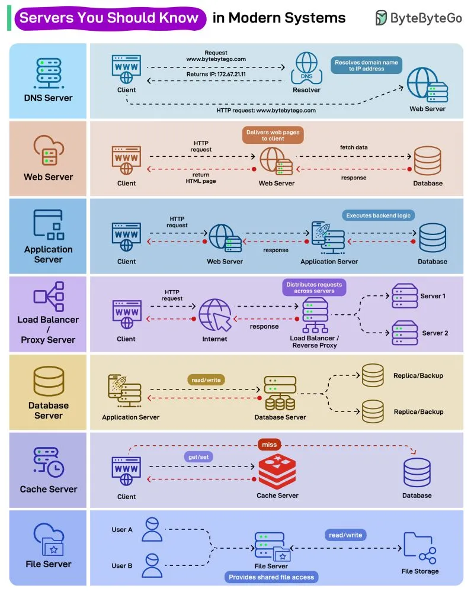

# 183 - Những loại server bạn nên biết trong hệ thống hiện đại

- Nguồn: ByteByteGo Big Archive System Design 2025
- Trang PDF: 375-375
- Ảnh minh họa: `../assets/183/figure-01.png`

## Hình minh họa

## Dịch sát

Phần text extract của bài này không có nội dung chữ riêng ngoài hình. Nội dung chính là sơ đồ các loại server phổ biến trong modern systems: DNS server, web server, application server, load balancer/proxy server, database server, cache server và file server.

## Dịch nội dung trong hình

- `DNS Server`: client request domain `www.bytebytego.com`; resolver phân giải domain name thành IP address, ví dụ trả về IP `172.67.21.11`; sau đó client gửi HTTP request tới web server.
- `Web Server`: nhận HTTP request từ client, trả HTML page/web page cho client; khi cần data thì fetch từ database và nhận response.
- `Application Server`: web server chuyển request tới application server; application server thực thi backend logic và làm việc với database.
- `Load Balancer / Proxy Server`: client gửi HTTP request qua Internet tới load balancer/reverse proxy; nó phân phối request qua các server như `Server 1`, `Server 2` và trả response.
- `Database Server`: application server đọc/ghi (`read/write`) vào database server; database có replica/backup để tăng availability và durability.
- `Cache Server`: client hoặc application dùng cache để `get/set`; nếu `miss` thì phải đọc từ database.
- `File Server`: cung cấp shared file access cho nhiều user; file server đọc/ghi vào file storage.

## Tóm tắt & giải thích dễ hiểu

Các server trong hình đại diện cho từng trách nhiệm riêng: DNS tìm địa chỉ, web server phục vụ HTTP/static content, application server chạy business logic, load balancer chia tải, database lưu dữ liệu bền vững, cache tăng tốc truy cập, file server chia sẻ file. Tách trách nhiệm giúp hệ thống dễ scale và debug hơn.

## Ví dụ thực tế - không nằm trong tài liệu gốc

Một request mở trang sản phẩm có thể đi qua DNS -> load balancer -> web server -> application server -> cache. Nếu cache miss, application server đọc database, sau đó trả response về client. Khi traffic tăng, team có thể scale web/app server ngang, thêm cache, hoặc tối ưu database riêng từng lớp.

## Thuật ngữ chính

- `DNS Server`: server phân giải domain sang IP.
- `Web Server`: server phục vụ HTTP response/static page.
- `Application Server`: server chạy backend/business logic.
- `Load Balancer`: bộ cân bằng tải request qua nhiều server.
- `Reverse Proxy`: proxy đứng trước backend server.
- `Database Server`: server lưu trữ và truy vấn dữ liệu.
- `Cache Server`: server lưu dữ liệu tạm để truy cập nhanh.
- `File Server`: server cung cấp truy cập file dùng chung.

