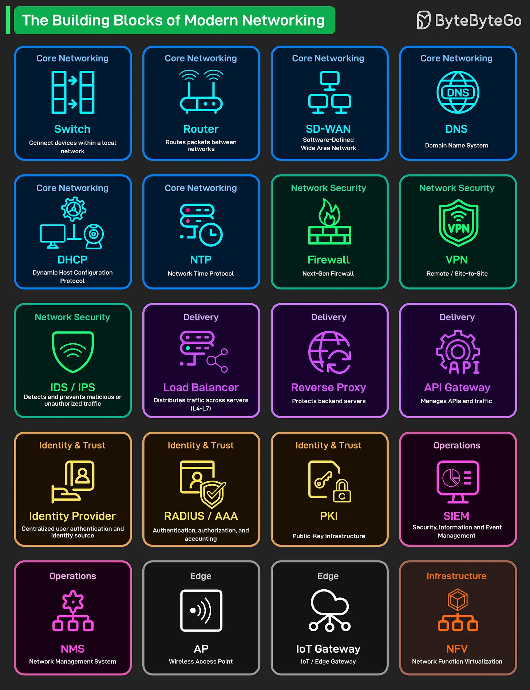

# 184 - Các building block của modern networking

- Nguồn: ByteByteGo Big Archive System Design 2025
- Trang PDF: 376-377
- Ảnh minh họa: `../assets/184/figure-01.png`

## Hình minh họa

## Dịch sát

Mọi modern network, từ Wi-Fi gia đình đến global cloud infrastructure, đều được xây trên một vài component thiết yếu. Đây là overview nhanh về các Building Blocks của Modern Networking:

- Core Networking: Switch kết nối device trong local network. Mỗi văn phòng có hàng chục switch như vậy. Router di chuyển packet giữa các network khác nhau. Đó là gateway của bạn ra Internet và xa hơn. SD-WAN là cách các công ty hiện đại kết nối branch office. Software-defined, linh hoạt, rẻ hơn nhiều. DNS dịch domain name thành IP address. DHCP tự động cấp IP address. NTP giữ clock đồng bộ trên tất cả system.

- Network Security: Firewall là tuyến phòng thủ đầu tiên. Phiên bản next-gen có thể inspect traffic ở application level. VPN tạo encrypted tunnel cho remote access và site-to-site connection. Remote work chạy dựa trên điều này. IDS/IPS phát hiện và chặn malicious traffic trước khi nó tới server của bạn.

- Delivery (Traffic management): Load Balancer phân phối request qua nhiều server. Một server down? User không hề nhận ra. Reverse Proxy đứng trước backend server của bạn, xử lý SSL termination và caching. API Gateway quản lý toàn bộ API traffic.

- Identity & Trust: Identity Provider là single source of truth cho user authentication. Hãy nghĩ tới Okta, Azure AD, Auth0. RADIUS/AAA xử lý network device authentication. PKI quản lý digital certificate và encryption key. HTTPS sẽ không tồn tại nếu không có nó.

- Operations: SIEM thu thập và phân tích security event từ toàn bộ infrastructure. NMS monitor network health và performance. Nó alert bạn trước khi user bắt đầu phàn nàn.

- Edge: Access Point cung cấp Wi-Fi coverage. IoT Gateway kết nối sensor, camera và smart device vào network của bạn. Nó là cây cầu giữa operational tech và IT.

- Infrastructure: NFV chạy network function dưới dạng software thay vì dedicated hardware. Virtual firewall, virtual router, virtual everything.

## Dịch nội dung trong hình

- `Core Networking`: `Switch` kết nối device trong local network; `Router` route packet giữa các network; `SD-WAN` là Software-Defined Wide Area Network; `DNS` là Domain Name System; `DHCP` là Dynamic Host Configuration Protocol; `NTP` là Network Time Protocol.
- `Network Security`: `Firewall` hoặc next-gen firewall; `VPN` cho remote/site-to-site; `IDS/IPS` phát hiện và ngăn traffic độc hại hoặc trái phép.
- `Delivery`: `Load Balancer` phân phối traffic qua server từ L4-L7; `Reverse Proxy` bảo vệ backend server; `API Gateway` quản lý API và traffic.
- `Identity & Trust`: `Identity Provider` tập trung user authentication và identity source; `RADIUS/AAA` cho authentication, authorization, accounting; `PKI` là Public-Key Infrastructure.
- `Operations`: `SIEM` là Security Information and Event Management; `NMS` là Network Management System.
- `Edge`: `AP` là Wireless Access Point; `IoT Gateway` là IoT/Edge Gateway.
- `Infrastructure`: `NFV` là Network Function Virtualization.

## Tóm tắt & giải thích dễ hiểu

Networking production không chỉ có router và switch. Một hệ thống hiện đại cần lớp core connectivity, security, traffic delivery, identity/trust, operations monitoring, edge access và virtualized infrastructure. Hiểu từng building block giúp debug sự cố theo lớp: DNS sai, DHCP lỗi, firewall chặn, load balancer route sai, hoặc certificate/PKI hết hạn.

## Ví dụ thực tế - không nằm trong tài liệu gốc

Khi user không vào được app nội bộ, bạn có thể kiểm tra theo chuỗi: DNS có resolve không, VPN có kết nối không, firewall có allow port không, load balancer health check có pass không, app server có nhận request không, và SIEM/NMS có cảnh báo gì không.

## Thuật ngữ chính

- `Switch`: thiết bị kết nối trong LAN.
- `Router`: thiết bị route packet giữa các network.
- `SD-WAN`: WAN được điều khiển bằng software policy.
- `Firewall`: lớp chặn/lọc traffic.
- `VPN`: tunnel mã hóa qua network công cộng.
- `IDS/IPS`: phát hiện/ngăn xâm nhập.
- `PKI`: hạ tầng khóa công khai và certificate.
- `NFV`: ảo hóa network function bằng software.

