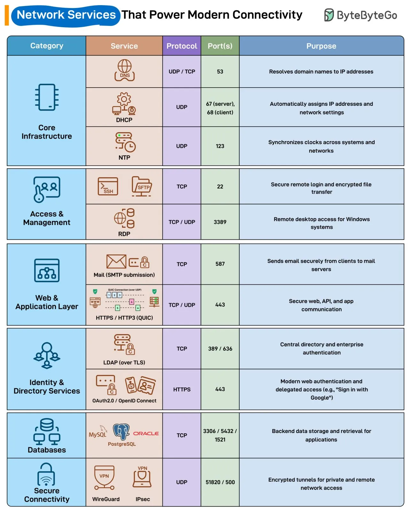

# 185 - Các network service vận hành kết nối hiện đại

- Nguồn: ByteByteGo Big Archive System Design 2025
- Trang PDF: 378-379
- Ảnh minh họa: `../assets/185/figure-01.png`

## Hình minh họa

## Dịch sát

Mỗi lần bạn mở browser, gửi email, hoặc kết nối tới VPN, các network service này âm thầm làm điều đó khả thi.

- DNS: Resolve domain name thành IP address để user truy cập website mà không cần nhớ số.

- DHCP: Tự động gán IP và network setting cho device khi tham gia network.

- NTP: Giữ clock đồng bộ giữa các system để đảm bảo log và authentication nhất quán.

- SSH: Cho phép secure remote login và encrypted file transfer qua port 22.

- RDP: Cho phép remote desktop access tới Windows system qua port 3389.

- Mail (SMTP submission): Gửi email an toàn từ client tới mail server.

- HTTPS / HTTP3 (QUIC): Bảo vệ web, API và app communication qua encrypted channel.

- LDAP (over TLS): Hoạt động như central directory cho enterprise login và access control.

- OAuth2.0 / OpenID Connect: Vận hành các modern authentication flow như “Sign in with Google”.

- MySQL / PostgreSQL / Oracle: Xử lý backend data storage và retrieval cho web/mobile application.

- WireGuard / IPsec: Tạo encrypted tunnel cho private và remote network access.

## Dịch nội dung trong hình

| Category | Service | Protocol | Port(s) | Purpose |
| --- | --- | --- | --- | --- |
| Core Infrastructure | `DNS` | UDP/TCP | `53` | Resolve domain name thành IP address |
| Core Infrastructure | `DHCP` | UDP | `67` server, `68` client | Tự động gán IP address và network settings |
| Core Infrastructure | `NTP` | UDP | `123` | Đồng bộ clock giữa system và network |
| Access & Management | `SSH/SFTP` | TCP | `22` | Remote login an toàn và encrypted file transfer |
| Access & Management | `RDP` | TCP/UDP | `3389` | Remote desktop access cho Windows system |
| Web & Application Layer | `Mail (SMTP submission)` | TCP | `587` | Gửi email an toàn từ client tới mail server |
| Web & Application Layer | `HTTPS / HTTP3 (QUIC)` | TCP/UDP | `443` | Web, API và app communication an toàn |
| Identity & Directory Services | `LDAP (over TLS)` | TCP | `389 / 636` | Central directory và enterprise authentication |
| Identity & Directory Services | `OAuth2.0 / OpenID Connect` | HTTPS | `443` | Modern web authentication và delegated access |
| Databases | `MySQL / PostgreSQL / Oracle` | TCP | `3306 / 5432 / 1521` | Backend data storage và retrieval cho application |
| Secure Connectivity | `WireGuard / IPsec` | UDP | `51820 / 500` | Encrypted tunnel cho private/remote network access |

## Tóm tắt & giải thích dễ hiểu

Network service là các dịch vụ nền mà application phụ thuộc nhưng user thường không nhìn thấy. DNS giúp tìm server, DHCP cấp địa chỉ, NTP giữ thời gian đúng, SSH/RDP cho admin access, HTTPS bảo mật app traffic, LDAP/OIDC xử lý identity, database protocol lưu dữ liệu và VPN tunnel bảo vệ kết nối từ xa.

## Ví dụ thực tế - không nằm trong tài liệu gốc

Nếu login SSO lúc được lúc không, nguyên nhân có thể không nằm ở app mà ở NTP lệch thời gian làm token hết hạn sai, DNS resolve nhầm IdP endpoint, hoặc firewall chặn port `443`. Khi debug production, biết port/protocol giúp khoanh vùng rất nhanh.

## Thuật ngữ chính

- `DNS`: phân giải tên miền sang IP.
- `DHCP`: tự động cấp IP/network config.
- `NTP`: đồng bộ thời gian.
- `SSH`: shell từ xa an toàn.
- `RDP`: remote desktop cho Windows.
- `LDAP`: directory service cho identity.
- `OAuth2/OIDC`: authorization/authentication hiện đại trên web.
- `WireGuard/IPsec`: VPN tunnel mã hóa.

## Câu hỏi ôn tập + trả lời + thinking học tập + liên hệ

> Đây là phần học tập thêm ở cuối file. Câu hỏi ưu tiên lấy từ tài liệu gốc và được trả lời trực tiếp; nếu bài không có câu hỏi riêng thì dùng tiêu đề/nội dung chính để tạo câu hỏi tự kiểm tra.

### Câu hỏi 1

**Nguồn câu hỏi:** Suy ra từ tiêu đề/nội dung chính vì bài gốc không có câu hỏi riêng.

**Câu hỏi:** Sau khi đọc bài “Network Services That Power Modern Connectivity”, ý chính cần trả lời và áp dụng vào system design là gì?

**Trả lời:** Nếu rút thành checklist thiết kế thì ý chính là: Network service là các dịch vụ nền mà application phụ thuộc nhưng user thường không nhìn thấy. DNS giúp tìm server, DHCP cấp địa chỉ, NTP giữ thời gian đúng, SSH/RDP cho admin access, HTTPS bảo mật app traffic, LDAP/OIDC xử lý identity, database protocol lưu dữ liệu và VPN tunnel bảo vệ kết nối từ xa. Khi áp dụng vào hệ thống thật, hãy kiểm thêm DNS, transport, TLS, HTTP, proxy/CDN, application timeout và observability theo từng layer.

**Thinking học tập + liên hệ:** Khi học `Các network service vận hành kết nối hiện đại`, hãy thử viết một checklist áp dụng vào project: input, output, owner, rủi ro và metric kiểm chứng. Lens chính là DNS, transport, TLS, HTTP, proxy/CDN, application timeout và observability theo từng layer. Khi debug production, hãy tách latency theo DNS lookup, TCP connect, TLS handshake, TTFB và download để không đoán mò. Khi ghi chú lại, hãy giải thích được các keyword: `DNS`, `DHCP`, `NTP`, `SSH`, `RDP`.
