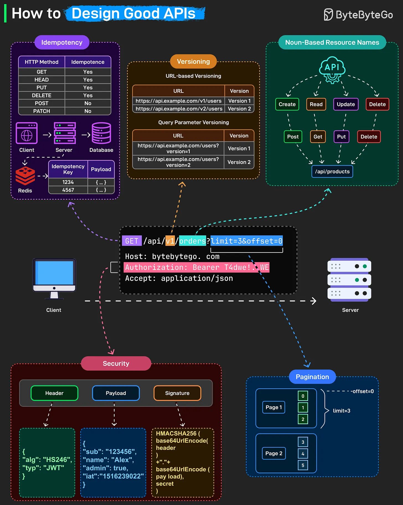

# 186 - Cách thiết kế API tốt

- Nguồn: ByteByteGo Big Archive System Design 2025
- Trang PDF: 380-381
- Ảnh minh họa: `../assets/186/figure-01.png`

## Hình minh họa

## Dịch sát

Một API được thiết kế tốt có cảm giác vô hình: nó cứ hoạt động. Đằng sau sự đơn giản đó là một tập nguyên tắc thiết kế nhất quán giúp API predictable, secure và scalable.

Đây là những điểm tách API tốt khỏi API tệ:

- Idempotency: GET, HEAD, PUT và DELETE nên idempotent. Gửi cùng một request hai lần, nhận cùng một kết quả. Không có side effect ngoài ý muốn. POST và PATCH không idempotent. Mỗi call tạo resource mới hoặc sửa state theo cách khác.

Dùng idempotency key lưu trong Redis hoặc database. Client gửi cùng key khi retry, server nhận ra key đó và trả original response thay vì xử lý lại.

- Versioning

- Noun-based resource names: Resource nên là noun, không phải verb. Dùng `/api/products`, không dùng `/api/getProducts`.

- Security: Bảo vệ mọi endpoint bằng authentication phù hợp. Bearer token như JWT gồm header, payload và signature để validate request. Luôn dùng HTTPS và verify token ở mọi call.

- Pagination: Khi trả về dataset lớn, dùng pagination parameter như `?limit=10&offset=20` để response hiệu quả và nhất quán.

## Dịch nội dung trong hình

- `Idempotency`: bảng HTTP method cho thấy `GET`, `HEAD`, `PUT`, `DELETE` là idempotent; `POST`, `PATCH` không idempotent theo mặc định. Client -> server -> database; Redis lưu `Idempotency Key` và payload để nhận diện retry.
- `Versioning`: có URL-based versioning như `https://api.example.com/v1/users`, `https://api.example.com/v2/users`; hoặc query parameter versioning như `https://api.example.com/users?version=1`.
- `Noun-Based Resource Names`: resource `/api/products` dùng method để biểu diễn action: `POST` create, `GET` read, `PUT` update, `DELETE` delete.
- Request ví dụ: `GET /api/v1/orders?limit=3&offset=0`, header `Authorization: Bearer ...`, `Accept: application/json`.
- `Security`: JWT gồm `Header`, `Payload`, `Signature`; signature dùng HMACSHA256 trên header/payload với secret.
- `Pagination`: `limit=3`, `offset=0` trả page đầu; page sau tiếp tục offset kế tiếp.

## Tóm tắt & giải thích dễ hiểu

API tốt cần predictable: tên resource rõ, method đúng nghĩa, versioning rõ ràng, pagination cho list lớn, security mặc định bật, và retry không tạo side effect nhờ idempotency key. Những nguyên tắc này làm client dễ dùng hơn và backend dễ vận hành hơn khi scale.

## Ví dụ thực tế - không nằm trong tài liệu gốc

Với API tạo payment, client có thể gửi `Idempotency-Key: order_123_payment_1`. Nếu network timeout và client retry, server thấy key đã xử lý rồi nên trả lại kết quả cũ thay vì charge tiền hai lần.

## Ghi chú kỹ thuật - không nằm trong tài liệu gốc

Nguồn nói `PATCH` không idempotent. Đây là cách hiểu thực dụng phổ biến, nhưng theo thiết kế cụ thể, một số `PATCH` operation vẫn có thể idempotent nếu cùng request lặp lại không làm state đổi thêm.

## Thuật ngữ chính

- `Idempotency`: gọi lặp cùng request không tạo thêm side effect.
- `Idempotency key`: key client gửi để server nhận diện retry.
- `Versioning`: quản lý nhiều version API.
- `Resource`: thực thể được API expose, ví dụ `orders`, `products`.
- `Bearer token`: token gửi trong `Authorization` header.
- `JWT`: JSON Web Token gồm header, payload, signature.
- `Pagination`: chia list lớn thành nhiều page.

## Câu hỏi ôn tập + trả lời + thinking học tập + liên hệ

> Đây là phần học tập thêm ở cuối file. Câu hỏi ưu tiên lấy từ tài liệu gốc và được trả lời trực tiếp; nếu bài không có câu hỏi riêng thì dùng tiêu đề/nội dung chính để tạo câu hỏi tự kiểm tra.

### Câu hỏi 1

**Nguồn câu hỏi:** Suy ra từ tiêu đề/nội dung chính vì bài gốc không có câu hỏi riêng.

**Câu hỏi:** Sau khi đọc bài “How to Design Good APIs”, ý chính cần trả lời và áp dụng vào system design là gì?

**Trả lời:** Nên trả lời theo flow end-to-end: request/dữ liệu đi vào đâu, qua thành phần nào, state đổi ở đâu và kết quả trả ra thế nào. Với `Cách thiết kế API tốt`, ý chính là: API tốt cần predictable: tên resource rõ, method đúng nghĩa, versioning rõ ràng, pagination cho list lớn, security mặc định bật, và retry không tạo side effect nhờ idempotency key. Những nguyên tắc này làm client dễ dùng hơn và backend dễ vận hành hơn khi scale.

**Thinking học tập + liên hệ:** Luồng trong `Cách thiết kế API tốt` nên được vẽ từ input tới output, kèm owner của từng bước và failure mode ở mỗi boundary. Lens chính là actor, trust boundary, dữ liệu nhạy cảm, lifetime của token/key, quyền truy cập và cơ chế revoke. Khi làm API thật, một endpoint chạy được chưa đủ; phải kiểm thêm abuse, audit log, error leakage, rate limit và quyền ở service chứa dữ liệu. Khi ghi chú lại, hãy giải thích được các keyword: `Idempotency`, `Idempotency key`, `Versioning`, `Resource`, `Bearer token`.
