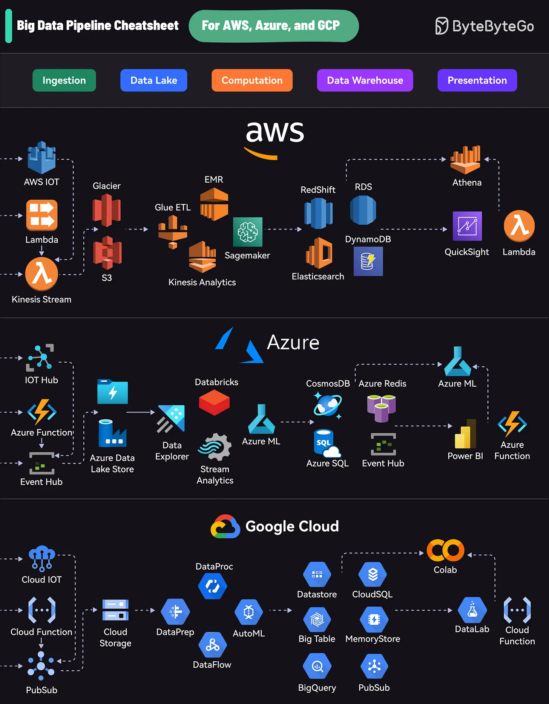

# 187 - Cheat sheet Big Data Pipeline cho AWS, Azure và Google Cloud

- Nguồn: ByteByteGo Big Archive System Design 2025
- Trang PDF: 382-383
- Ảnh minh họa: `../assets/187/figure-01.png`

## Hình minh họa

## Dịch sát

Mỗi platform cung cấp một bộ service toàn diện bao phủ toàn bộ lifecycle:

1. Ingestion: Thu thập dữ liệu từ nhiều nguồn khác nhau

2. Data Lake: Lưu raw data

3. Computation: Xử lý và phân tích dữ liệu

4. Data Warehouse: Lưu structured data

5. Presentation: Trực quan hóa và report insight

AWS dùng các service như Kinesis cho data streaming, S3 cho storage, EMR cho processing, RedShift cho warehousing, và QuickSight cho visualization.

Pipeline của Azure gồm Event Hubs cho ingestion, Data Lake Store cho storage, Databricks cho processing, Cosmos DB cho warehousing, và Power BI cho presentation.

GCP cung cấp PubSub cho data streaming, Cloud Storage cho data lake, DataProc và DataFlow cho processing, BigQuery cho warehousing, và Data Studio cho visualization.

## Dịch nội dung trong hình

- Các stage chính: `Ingestion`, `Data Lake`, `Computation`, `Data Warehouse`, `Presentation`.
- `AWS`: ingestion có `AWS IoT`, `Lambda`, `Kinesis Stream`; data lake/storage có `Glacier`, `S3`; computation có `Glue ETL`, `EMR`, `Kinesis Analytics`, `Sagemaker`; warehouse/data store có `RedShift`, `RDS`, `Elasticsearch`, `DynamoDB`; presentation có `Athena`, `QuickSight`, `Lambda`.
- `Azure`: ingestion có `IoT Hub`, `Azure Function`, `Event Hub`; data lake có `Azure Data Lake Store`; computation có `Data Explorer`, `Databricks`, `Stream Analytics`, `Azure ML`; warehouse/data store có `CosmosDB`, `Azure SQL`, `Azure Redis`, `Event Hub`; presentation có `Azure ML`, `Power BI`, `Azure Function`.
- `Google Cloud`: ingestion có `Cloud IoT`, `Cloud Function`, `PubSub`; data lake có `Cloud Storage`; computation có `DataPrep`, `DataProc`, `DataFlow`, `AutoML`; warehouse/data store có `Datastore`, `BigTable`, `BigQuery`, `CloudSQL`, `MemoryStore`, `PubSub`; presentation có `Colab`, `DataLab`, `Cloud Function`.

## Tóm tắt & giải thích dễ hiểu

Big data pipeline thường đi theo chuỗi: nạp dữ liệu -> lưu raw data -> xử lý/biến đổi -> lưu dạng phân tích -> trực quan hóa. Tên service khác nhau giữa cloud provider, nhưng pattern kiến trúc gần giống nhau. Khi đã hiểu stage, bạn có thể map service của AWS/Azure/GCP sang cùng một mental model.

## Ví dụ thực tế - không nằm trong tài liệu gốc

Một hệ thống clickstream có thể ingest event qua Kinesis/Event Hub/PubSub, lưu raw JSON vào S3/Data Lake/Cloud Storage, xử lý bằng Spark/Databricks/Dataflow, lưu aggregate vào Redshift/BigQuery/Azure SQL, rồi dashboard bằng QuickSight/Power BI/Looker Studio.

## Ghi chú kỹ thuật - không nằm trong tài liệu gốc

Tên dịch vụ cloud thay đổi theo thời gian; bài này nên được hiểu như mapping khái niệm ở thời điểm archive, không phải bảng giá/tính năng mới nhất.

## Thuật ngữ chính

- `Ingestion`: nạp dữ liệu từ source vào pipeline.
- `Data Lake`: nơi lưu dữ liệu raw/semi-structured quy mô lớn.
- `ETL`: Extract, Transform, Load.
- `Data Warehouse`: kho dữ liệu có cấu trúc cho analytics.
- `Streaming`: xử lý dữ liệu/event liên tục.
- `Visualization`: trực quan hóa/report insight.
- `AWS/Azure/GCP`: ba cloud provider lớn.

