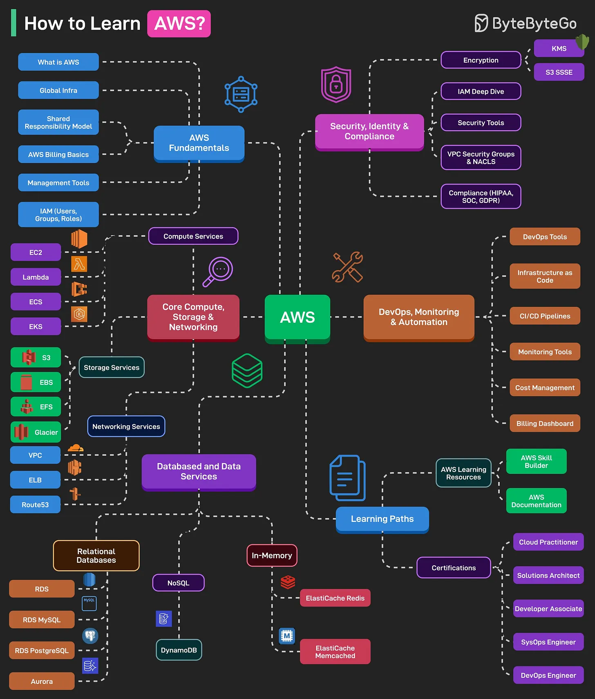

# 188 - Học AWS như thế nào?

- Nguồn: ByteByteGo Big Archive System Design 2025
- Trang PDF: 384-385
- Ảnh minh họa: `../assets/188/figure-01.png`

## Hình minh họa

## Dịch sát

AWS là một trong những cloud platform phổ biến nhất. Khi AWS sập, một phần lớn Internet cũng sập theo.

Đây là learning map có thể giúp bạn master AWS:

1. AWS Fundamentals
   Phần này gồm các topic như “AWS là gì?”, Global Infrastructure, AWS Billing, Management, và IAM basics.

2. Core Compute, Storage & Networking
   Phần này gồm compute service như EC2, Lambda, ECS, EKS; Storage Services như S3, EBS, EFS, Glacier; và Networking Services như VPC, ELB, Route 53.

3. Databases and Data Services
   Phần này gồm các topic như Relational Databases (RDS MySQL và PostgreSQL), NoSQL, và In-Memory Databases như ElastiCache (Redis và Memcached).

4. Security, Identity & Compliance
   Gồm các topic như IAM Deep Dive, Encryption (KMS, S3 SSE), Security Tools, VPC Security Groups, và các tool liên quan đến compliance cho HIPAA, SOC và GDPR.

5. DevOps, Monitoring & Automation
   Phần này gồm các topic như DevOps Tools (CodeCommit, CodeBuild, CodePipeline), Infrastructure as Code, CI/CD Pipelines, Monitoring Tools (CloudWatch, CloudTrail), và Cost Management and Billing Dashboard.

6. Learning Paths and Certifications
   Gồm các topic như AWS Learning Resources, chẳng hạn Skill Builder và documentation, và các certification path như Cloud Practitioner, Solutions Architect Associate, Developer Associate, SysOps và DevOps Engineer.

## Dịch nội dung trong hình

- `AWS Fundamentals`: `What is AWS`, `Global Infra`, `Shared Responsibility Model`, `AWS Billing Basics`, `Management Tools`, `IAM (Users, Groups, Roles)`.
- `Core Compute, Storage & Networking`: compute gồm `EC2`, `Lambda`, `ECS`, `EKS`; storage gồm `S3`, `EBS`, `EFS`, `Glacier`; networking gồm `VPC`, `ELB`, `Route53`.
- `Databased and Data Services`: relational databases gồm `RDS`, `RDS MySQL`, `RDS PostgreSQL`, `Aurora`; NoSQL gồm `DynamoDB`; in-memory gồm `ElastiCache Redis`, `ElastiCache Memcached`.
- `Security, Identity & Compliance`: encryption gồm `KMS`, `S3 SSE`; `IAM Deep Dive`, `Security Tools`, `VPC Security Groups & NACLs`, compliance như `HIPAA`, `SOC`, `GDPR`.
- `DevOps, Monitoring & Automation`: `DevOps Tools`, `Infrastructure as Code`, `CI/CD Pipelines`, `Monitoring Tools`, `Cost Management`, `Billing Dashboard`.
- `Learning Paths`: resources gồm `AWS Skill Builder`, `AWS Documentation`; certifications gồm `Cloud Practitioner`, `Solutions Architect`, `Developer Associate`, `SysOps Engineer`, `DevOps Engineer`.

## Tóm tắt & giải thích dễ hiểu

Học AWS nên đi từ nền tảng account/IAM/billing, sau đó học compute-storage-networking, rồi database, security/compliance, DevOps/monitoring và cuối cùng là certification. Đừng học service rời rạc; hãy học theo kiến trúc thực tế: một web app cần VPC, EC2/ECS/Lambda, S3, RDS/DynamoDB, IAM, CloudWatch và CI/CD.

## Ví dụ thực tế - không nằm trong tài liệu gốc

Một lộ trình 4 tuần: tuần 1 học IAM, billing, VPC; tuần 2 deploy app lên EC2/ECS/Lambda và lưu file S3; tuần 3 dùng RDS/DynamoDB, CloudWatch, security group; tuần 4 viết IaC bằng Terraform/CDK và dựng CI/CD pipeline đơn giản.

## Thuật ngữ chính

- `AWS`: Amazon Web Services.
- `IAM`: Identity and Access Management.
- `VPC`: Virtual Private Cloud.
- `EC2`: virtual machine service của AWS.
- `Lambda`: serverless function.
- `S3`: object storage.
- `RDS`: managed relational database.
- `CloudWatch`: monitoring/logging service.
- `IaC`: Infrastructure as Code.

