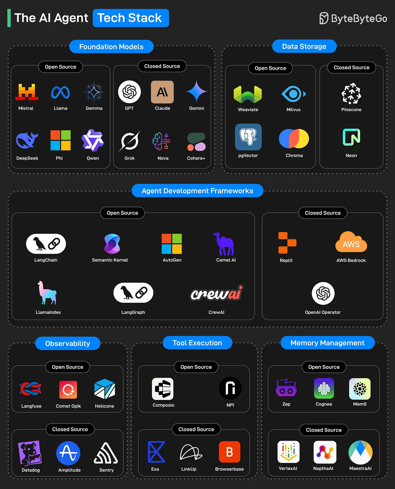

# 189 - Tech stack cho AI Agent

- Nguồn: ByteByteGo Big Archive System Design 2025
- Trang PDF: 386-387
- Ảnh minh họa: `../assets/189/figure-01.png`

## Hình minh họa

## Dịch sát

1. Foundation Models: Các large-scale pre-trained language model đóng vai trò “bộ não” của AI agent, cho phép capability như reasoning, text generation, coding và question answering.

2. Data Storage: Layer này xử lý vector database và memory storage system mà AI agent dùng để lưu và retrieve context, embeddings hoặc documents.

3. Agent Development Frameworks: Các framework này giúp developer build, orchestrate và manage multi-step AI agent cùng workflow của chúng.

4. Observability: Category này cho phép monitoring, debugging và logging behavior cũng như performance của AI agent theo real-time.

5. Tool Execution: Các platform này cho phép AI agent interface với real-world tools, ví dụ API, browser, external system, để hoàn thành complex task.

6. Memory Management: Các system này quản lý long-term và short-term memory cho agent, giúp chúng giữ context hữu ích và học từ past interactions.

## Dịch nội dung trong hình

- `Foundation Models`: open source gồm `Mistral`, `Llama`, `Gemma`, `DeepSeek`, `Phi`, `Qwen`; closed source gồm `GPT`, `Claude`, `Gemini`, `Grok`, `Nova`, `Cohere+`.
- `Data Storage`: open source gồm `Weaviate`, `Milvus`, `pgVector`, `Chroma`; closed source gồm `Pinecone`, `Neon`.
- `Agent Development Frameworks`: open source gồm `LangChain`, `Semantic Kernel`, `AutoGen`, `Camel AI`, `LlamaIndex`, `LangGraph`, `CrewAI`; closed source gồm `Replit`, `AWS Bedrock`, `OpenAI Operator`.
- `Observability`: open source gồm `Langfuse`, `Comet Opik`, `Helicone`; closed source gồm `Datadog`, `Amplitude`, `Sentry`.
- `Tool Execution`: open source gồm `Composio`, `NPI`; closed source gồm `Exa`, `LinkUp`, `Browserbase`.
- `Memory Management`: open source gồm `Zep`, `Cognee`, `Mem0`; closed source gồm `VertexAI`, `NapthaAI`, `MaestraAI`.

## Tóm tắt & giải thích dễ hiểu

Một AI agent production thường cần nhiều lớp: model để suy luận, storage để tìm/lưu context, framework để điều phối workflow, observability để debug, tool execution để hành động, và memory để giữ ngữ cảnh dài hạn/ngắn hạn. Thiếu observability hoặc memory management, agent rất dễ trả lời không ổn định và khó debug.

## Ví dụ thực tế - không nằm trong tài liệu gốc

Một coding agent có thể dùng GPT/Claude làm foundation model, Chroma hoặc pgVector để lưu tài liệu dự án, LangGraph để orchestrate workflow, Sentry/Langfuse để trace lỗi, Browserbase để thao tác web, và Zep/Mem0 để nhớ preference của user.

## Thuật ngữ chính

- `Foundation model`: model nền đã pre-train trên dữ liệu lớn.
- `Vector database`: database lưu embedding để semantic search.
- `Agent framework`: framework build workflow agent nhiều bước.
- `Observability`: logging, tracing, monitoring để hiểu behavior.
- `Tool execution`: lớp gọi tool/API/browser/external system.
- `Memory management`: quản lý memory ngắn hạn/dài hạn của agent.

## Câu hỏi ôn tập + trả lời + thinking học tập + liên hệ

> Đây là phần học tập thêm ở cuối file. Câu hỏi ưu tiên lấy từ tài liệu gốc và được trả lời trực tiếp; nếu bài không có câu hỏi riêng thì dùng tiêu đề/nội dung chính để tạo câu hỏi tự kiểm tra.

### Câu hỏi 1

**Nguồn câu hỏi:** Suy ra từ tiêu đề/nội dung chính vì bài gốc không có câu hỏi riêng.

**Câu hỏi:** Sau khi đọc bài “The AI Agent Tech Stack”, ý chính cần trả lời và áp dụng vào system design là gì?

**Trả lời:** Bài này muốn người đọc nắm: Một AI agent production thường cần nhiều lớp: model để suy luận, storage để tìm/lưu context, framework để điều phối workflow, observability để debug, tool execution để hành động, và memory để giữ ngữ cảnh dài hạn/ngắn hạn. Thiếu observability hoặc memory management, agent rất dễ trả lời không ổn định và khó debug. Khi áp dụng vào hệ thống thật, hãy kiểm thêm quality, latency, cost/token, privacy, cập nhật tri thức và rủi ro hallucination.

**Thinking học tập + liên hệ:** Liên hệ `Tech stack cho AI Agent` bằng một scenario thật sẽ giúp thấy trade-off rõ hơn so với chỉ đọc định nghĩa. Lens chính là quality, latency, cost/token, privacy, cập nhật tri thức và rủi ro hallucination. Khi build AI app, hãy nối model với pipeline thật: data vào đâu, context lấy từ đâu, output được kiểm thế nào và chi phí tăng theo traffic ra sao. Khi ghi chú lại, hãy giải thích được các keyword: `Foundation model`, `Vector database`, `Agent framework`, `Observability`, `Tool execution`.
