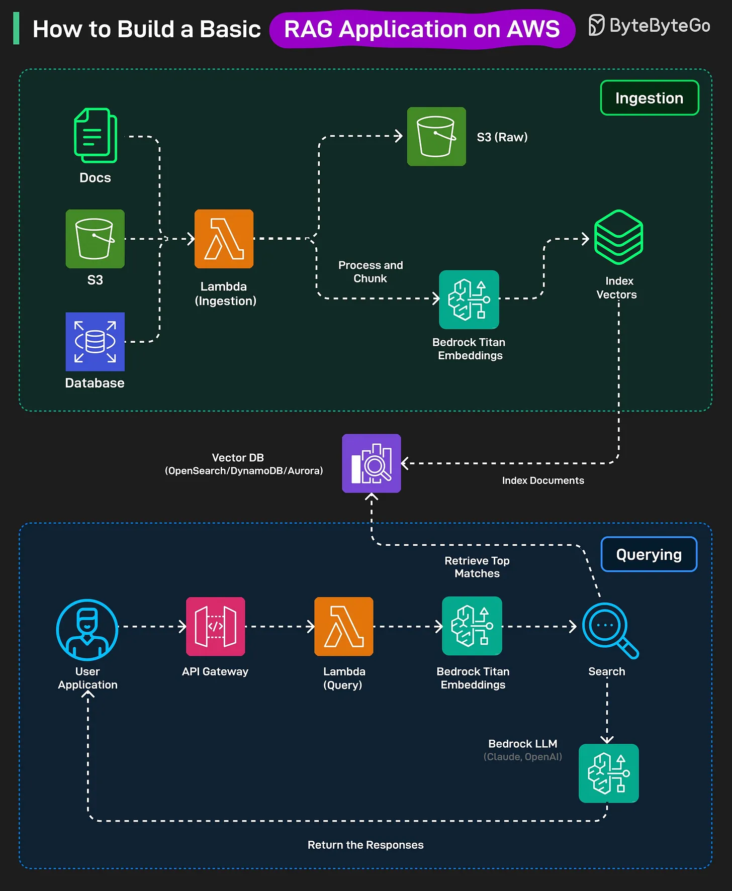

# 190 - Cách xây dựng một RAG application cơ bản trên AWS

- Nguồn: ByteByteGo Big Archive System Design 2025
- Trang PDF: 388-389
- Ảnh minh họa: `../assets/190/figure-01.png`

## Hình minh họa

## Dịch sát

RAG là một AI pattern kết hợp một bước search với text generation. Nó retrieve thông tin liên quan từ knowledge source như vector database, rồi dùng LLM để generate response chính xác và có context.

Ingestion Stage

1. Tất cả raw documents như PDF, text, v.v. đầu tiên được lưu trong Amazon S3.

2. Khi một file được thêm vào, AWS Lambda chạy một ingestion function. Function này clean và split document thành các chunk nhỏ hơn.

3. Mỗi chunk được gửi tới Titan embeddings model của Amazon Bedrock, model này chuyển chunk thành vector representations.

4. Các embedding này, cùng metadata, được lưu trong một vector database như OpenSearch serverless, DynamoDB.

Querying Stage:

1. User gửi question qua app frontend, question đi tới API Gateway rồi tới Lambda query function.

2. Question được chuyển thành embedding bằng Amazon Bedrock Titan Embeddings.

3. Embedding này được so sánh với document embeddings đã lưu trong vector database để tìm các chunk liên quan nhất.

4. Các chunk liên quan và question của user được gửi tới một LLM như Claude hoặc OpenAI trên Bedrock để generate answer.

5. Generated response được gửi lại cho user qua cùng API.

## Dịch nội dung trong hình

- `Ingestion`: docs, S3 và database đưa raw input vào `Lambda (Ingestion)`; dữ liệu được lưu `S3 (Raw)`, đồng thời `Process and Chunk`, gọi `Bedrock Titan Embeddings`, tạo `Index Vectors`, rồi `Index Documents` vào `Vector DB (OpenSearch/DynamoDB/Aurora)`.
- `Querying`: `User Application` gọi `API Gateway`, tới `Lambda (Query)`, dùng `Bedrock Titan Embeddings` để embed câu hỏi, thực hiện `Search`, `Retrieve Top Matches` từ vector DB, gửi context tới `Bedrock LLM (Claude, OpenAI)`, rồi `Return the Responses` về user.

## Tóm tắt & giải thích dễ hiểu

RAG có hai pipeline tách biệt. Ingestion chuẩn bị knowledge base: lưu tài liệu, chunk, tạo embedding và index vào vector DB. Querying xử lý câu hỏi: embed query, search chunk liên quan, đưa chunk vào prompt cho LLM, rồi trả lời. Tách hai stage giúp cập nhật tài liệu độc lập với request của user.

## Ví dụ thực tế - không nằm trong tài liệu gốc

Một chatbot hỏi đáp tài liệu nội bộ có thể upload PDF lên S3, Lambda tự chunk và index vào OpenSearch. Khi nhân viên hỏi “quy trình nghỉ phép thế nào?”, hệ thống retrieve các đoạn policy liên quan và đưa vào Claude để trả lời kèm context.

## Thuật ngữ chính

- `RAG`: Retrieval-Augmented Generation.
- `Ingestion`: pipeline nạp và index tài liệu.
- `Chunk`: đoạn nhỏ được cắt từ document.
- `Embedding`: vector biểu diễn semantic meaning.
- `Vector DB`: nơi lưu/search embedding.
- `Amazon Bedrock`: dịch vụ AWS để dùng foundation model/embedding model.
- `API Gateway`: cổng API nhận request từ frontend.
- `Lambda`: serverless function của AWS.

