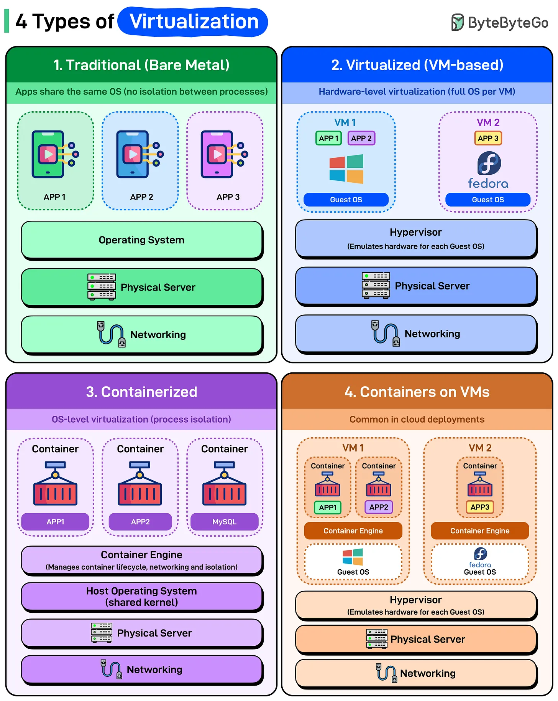

# 191 - Các loại Virtualization

- Nguồn: ByteByteGo Big Archive System Design 2025
- Trang PDF: 390-391
- Ảnh minh họa: `../assets/191/figure-01.png`

## Hình minh họa

## Dịch sát

Virtualization không chỉ làm server hiệu quả hơn, nó đã thay đổi cách chúng ta build, scale và deploy mọi thứ. Đây là breakdown nhanh về bốn loại virtualization chính bạn sẽ gặp trong modern systems:

1. Traditional (Bare Metal): Application chạy trực tiếp trên operating system. Không có virtualization layer, không có isolation giữa các process. Tất cả application chia sẻ cùng OS kernel, libraries và resources.

2. Virtualized (VM-based): Mỗi VM chạy operating system hoàn chỉnh của riêng nó. Hypervisor nằm trên physical hardware và emulate toàn bộ machine cho từng guest OS. Mỗi VM nghĩ rằng nó có dedicated hardware dù thật ra đang chia sẻ cùng physical server.

3. Containerized: Container chia sẻ kernel của host operating system nhưng có isolated runtime environment. Mỗi container có filesystem riêng, nhưng tất cả dùng cùng underlying OS. Container engine như Docker, containerd, Podman quản lý lifecycle, networking và isolation mà không cần operating system riêng cho từng application. Lightweight và nhanh. Container start trong milliseconds vì bạn không boot OS. Resource usage thấp hơn VM rất nhiều.

4. Containers on VMs: Đây là thứ thật sự chạy trong production cloud environment. Container bên trong VM, nhận lợi ích từ cả hai. Mỗi VM chạy guest OS riêng với container engine bên trong. Hypervisor cung cấp hardware-level isolation giữa các VM. Container engine cung cấp lightweight application isolation bên trong VM.

Đây là architecture phía sau Kubernetes cluster trên AWS, Azure và GCP. Pod của bạn là container, nhưng chúng chạy bên trong VM mà bạn không trực tiếp nhìn thấy hoặc quản lý.

## Dịch nội dung trong hình

- `Traditional (Bare Metal)`: app chia sẻ cùng OS, không có isolation giữa process; stack gồm app -> operating system -> physical server -> networking.
- `Virtualized (VM-based)`: hardware-level virtualization, mỗi VM có full OS riêng; hypervisor emulate hardware cho từng guest OS; bên dưới là physical server và networking.
- `Containerized`: OS-level virtualization/process isolation; container engine quản lý container lifecycle, networking và isolation; containers chia sẻ host operating system kernel.
- `Containers on VMs`: phổ biến trong cloud deployment; nhiều VM, mỗi VM có guest OS và container engine; container chạy bên trong VM; hypervisor nằm trên physical server.

## Tóm tắt & giải thích dễ hiểu

Bare metal đơn giản nhưng isolation kém. VM isolation mạnh vì mỗi workload có OS riêng, nhưng nặng. Container nhẹ và start nhanh vì chia sẻ kernel, nhưng isolation thấp hơn VM. Cloud production thường kết hợp container trên VM để vừa có isolation cấp hạ tầng vừa có tốc độ và mật độ triển khai của container.

## Ví dụ thực tế - không nằm trong tài liệu gốc

Khi chạy Kubernetes trên EKS/AKS/GKE, bạn deploy Pod/container, nhưng node phía dưới thường là EC2 VM, Azure VM hoặc GCE VM. Bạn quản lý container orchestration, còn cloud provider quản lý phần lớn VM/hardware bên dưới.

## Thuật ngữ chính

- `Virtualization`: ảo hóa tài nguyên compute/network/storage.
- `Bare metal`: chạy trực tiếp trên phần cứng/OS không có virtualization layer.
- `VM`: virtual machine có guest OS riêng.
- `Hypervisor`: lớp tạo và quản lý VM.
- `Container`: môi trường chạy app nhẹ, chia sẻ host kernel.
- `Container engine`: Docker/containerd/Podman quản lý container.
- `Guest OS`: OS chạy bên trong VM.
- `Host OS`: OS của máy chủ/container host.

## Câu hỏi ôn tập + trả lời + thinking học tập + liên hệ

> Đây là phần học tập thêm ở cuối file. Câu hỏi ưu tiên lấy từ tài liệu gốc và được trả lời trực tiếp; nếu bài không có câu hỏi riêng thì dùng tiêu đề/nội dung chính để tạo câu hỏi tự kiểm tra.

### Câu hỏi 1

**Nguồn câu hỏi:** Suy ra từ tiêu đề/nội dung chính vì bài gốc không có câu hỏi riêng.

**Câu hỏi:** Sau khi đọc bài “Types of Virtualization”, ý chính cần trả lời và áp dụng vào system design là gì?

**Trả lời:** Nếu rút thành checklist thiết kế thì ý chính là: Bare metal đơn giản nhưng isolation kém. VM isolation mạnh vì mỗi workload có OS riêng, nhưng nặng. Container nhẹ và start nhanh vì chia sẻ kernel, nhưng isolation thấp hơn VM. Cloud production thường kết hợp container trên VM để vừa có isolation cấp hạ tầng vừa có tốc độ và mật độ triển khai của container. Khi áp dụng vào hệ thống thật, hãy kiểm thêm độ phức tạp vận hành, rollback, cost, kỹ năng team, observability và blast radius khi hỏng.

**Thinking học tập + liên hệ:** Liên hệ `Các loại Virtualization` bằng một scenario thật sẽ giúp thấy trade-off rõ hơn so với chỉ đọc định nghĩa. Lens chính là độ phức tạp vận hành, rollback, cost, kỹ năng team, observability và blast radius khi hỏng. Khi đưa lên production, hãy map từng thành phần vào deploy, rollback, monitoring, alerting, secret, cost và ownership rõ ràng. Khi ghi chú lại, hãy giải thích được các keyword: `Virtualization`, `Bare metal`, `VM`, `Hypervisor`, `Container`.
