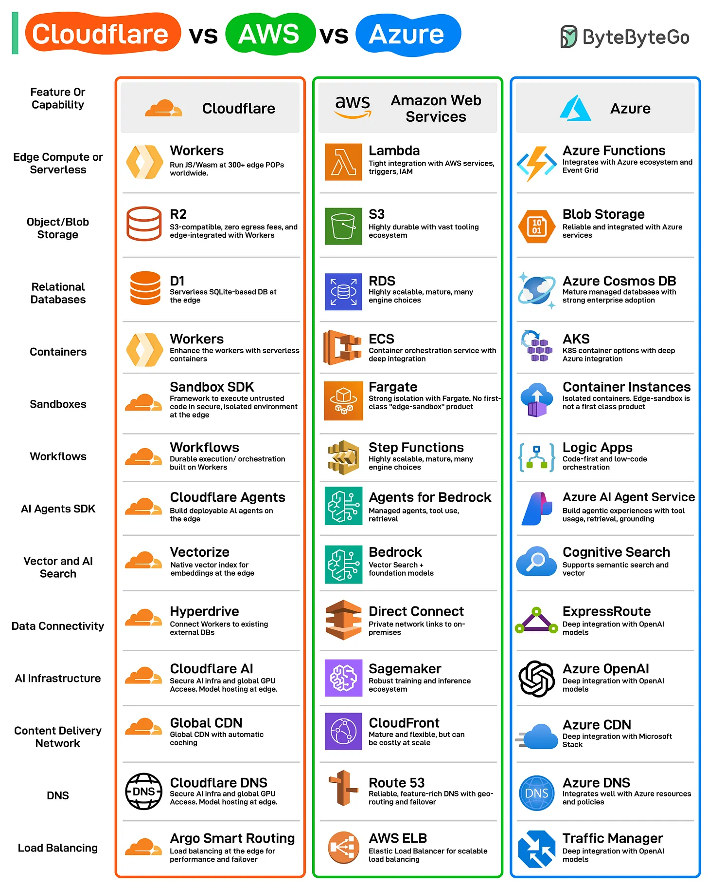

# 192 - Cloudflare vs AWS vs Azure

- Nguồn: ByteByteGo Big Archive System Design 2025
- Trang PDF: 392-393
- Ảnh minh họa: `../assets/192/figure-01.png`

## Hình minh họa

## Dịch sát

Cloudflare không chỉ là một dịch vụ CDN và DDoS protection. Hãy làm một so sánh nhanh giữa Cloudflare, AWS và Azure.

Cloudflare đã nhanh chóng mở rộng vượt khỏi gốc rễ CDN truyền thống, ra mắt một bộ modern developer-first services như Workers, R2, D1, v.v. Những offering này đặt Cloudflare vào vị trí một edge-native alternative nghiêm túc so với các cloud provider khác.

Đây là các cloud capability chính mà Cloudflare hỗ trợ:

1. Edge Compute and Serverless

2. Object and Blob Storage

3. Relational Databases

4. Containers

5. Sandboxes

6. Workflows

7. AI Agents SDK

8. Vector and AI search

9. Data Connectivity

10. AI Infrastructure

11. Content Delivery Network

12. DNS

13. Load Balancing

## Dịch nội dung trong hình

| Feature / Capability | Cloudflare | AWS | Azure |
| --- | --- | --- | --- |
| Edge Compute or Serverless | `Workers` - chạy JS/Wasm tại hơn 300 edge POP toàn cầu | `Lambda` - tích hợp chặt với AWS services, triggers, IAM | `Azure Functions` - tích hợp Azure ecosystem và Event Grid |
| Object/Blob Storage | `R2` - S3-compatible, zero egress fees, tích hợp edge với Workers | `S3` - durable, tooling ecosystem lớn | `Blob Storage` - reliable và tích hợp với Azure services |
| Relational Databases | `D1` - serverless SQLite-based DB tại edge | `RDS` - scalable, mature, nhiều engine | `Azure Cosmos DB` - managed database mature, adoption enterprise mạnh |
| Containers | `Workers` - tăng cường Workers với serverless containers | `ECS` - container orchestration tích hợp sâu | `AKS` - Kubernetes container option tích hợp sâu với Azure |
| Sandboxes | `Sandbox SDK` - framework chạy untrusted code trong môi trường isolated ở edge | `Fargate` - isolation mạnh với Fargate, không phải edge-sandbox first-class | `Container Instances` - isolated containers, edge-sandbox không phải first-class product |
| Workflows | `Workflows` - durable execution/orchestration xây trên Workers | `Step Functions` - scalable, mature, nhiều engine choice | `Logic Apps` - orchestration code-first và low-code |
| AI Agents SDK | `Cloudflare Agents` - build deployable AI agents on the edge | `Agents for Bedrock` - managed agents, tool use, retrieval | `Azure AI Agent Service` - build agentic experiences với tool usage, retrieval, grounding |
| Vector and AI Search | `Vectorize` - native vector index cho embeddings tại edge | `Bedrock` - vector search + foundation models | `Cognitive Search` - hỗ trợ semantic search và vector |
| Data Connectivity | `Hyperdrive` - kết nối Workers tới external DB hiện có | `Direct Connect` - private network links tới on-premises | `ExpressRoute` - private network connectivity tới Azure |
| AI Infrastructure | `Cloudflare AI` - AI infra an toàn, global GPU access, model hosting tại edge | `Sagemaker` - ecosystem training và inference mạnh | `Azure OpenAI` - tích hợp sâu với OpenAI models |
| Content Delivery Network | `Global CDN` - CDN toàn cầu với automatic caching | `CloudFront` - mature và flexible, nhưng có thể tốn kém ở scale lớn | `Azure CDN` - tích hợp sâu với Microsoft stack |
| DNS | `Cloudflare DNS` | `Route 53` - DNS reliable, feature-rich với geo-routing và failover | `Azure DNS` - tích hợp tốt với Azure resources và policies |
| Load Balancing | `Argo Smart Routing` - load balancing tại edge cho performance và failover | `AWS ELB` - Elastic Load Balancer cho scalable load balancing | `Traffic Manager` - DNS-based traffic management |

## Tóm tắt & giải thích dễ hiểu

Cloudflare đang đi theo hướng edge-native: compute, storage, workflow, vector search và agent chạy gần user. AWS và Azure là cloud platform rộng hơn, có ecosystem mature cho compute, database, networking, enterprise integration và AI platform. Khi chọn, cần nhìn workload: nếu cần edge latency thấp và đơn giản hóa egress/CDN, Cloudflare hấp dẫn; nếu cần hệ sinh thái cloud đầy đủ, AWS/Azure thường mạnh hơn.

## Ví dụ thực tế - không nằm trong tài liệu gốc

Một app toàn cầu có static content, API nhẹ và logic auth ở edge có thể dùng Cloudflare Workers + R2 + D1. Một enterprise app cần private networking, managed database phức tạp, data warehouse, IAM/compliance sâu có thể phù hợp hơn với AWS hoặc Azure.

## Ghi chú kỹ thuật - không nằm trong tài liệu gốc

Một số mô tả trong hình có dấu hiệu bị copy nhầm hoặc rút gọn quá mức, ví dụ dòng DNS/Traffic Manager/ExpressRoute. Bảng dịch ở trên giữ tinh thần so sánh của hình nhưng diễn giải lại các nhãn dễ nhầm theo ý nghĩa kỹ thuật phổ biến.

## Thuật ngữ chính

- `CDN`: Content Delivery Network.
- `DDoS protection`: bảo vệ trước tấn công từ chối dịch vụ phân tán.
- `Edge compute`: chạy compute gần user ở edge location.
- `Serverless`: chạy code không tự quản lý server.
- `Object storage`: storage cho object/file dạng blob.
- `Vector search`: tìm kiếm semantic bằng embedding vector.
- `Egress fee`: phí dữ liệu đi ra khỏi cloud.
- `Load balancing`: phân phối traffic qua nhiều endpoint/server.

