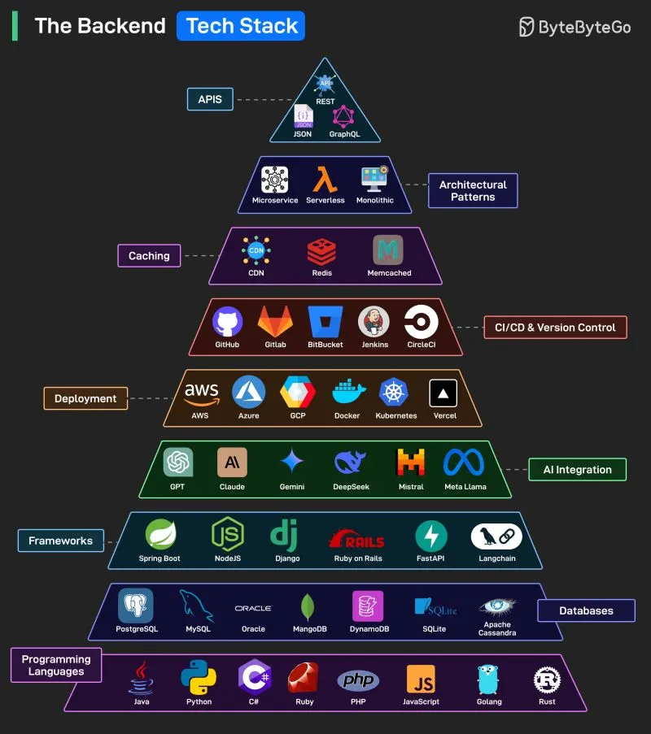

# 193 - Backend tech stack phổ biến

- Nguồn: ByteByteGo Big Archive System Design 2025
- Trang PDF: 394-394
- Ảnh minh họa: `../assets/193/figure-01.png`

## Hình minh họa

## Dịch sát

Phần text extract của bài này không có nội dung chữ riêng ngoài hình. Nội dung chính là một “kim tự tháp” backend tech stack, từ programming languages, databases, frameworks, AI integration, deployment, CI/CD, caching, architectural patterns đến APIs.

## Dịch nội dung trong hình

- `Programming Languages`: `Java`, `Python`, `C#`, `Ruby`, `PHP`, `JavaScript`, `Golang`, `Rust`.
- `Databases`: `PostgreSQL`, `MySQL`, `Oracle`, `MongoDB`, `DynamoDB`, `SQLite`, `Apache Cassandra`.
- `Frameworks`: `Spring Boot`, `NodeJS`, `Django`, `Ruby on Rails`, `FastAPI`, `LangChain`.
- `AI Integration`: `GPT`, `Claude`, `Gemini`, `DeepSeek`, `Mistral`, `Meta Llama`.
- `Deployment`: `AWS`, `Azure`, `GCP`, `Docker`, `Kubernetes`, `Vercel`.
- `CI/CD & Version Control`: `GitHub`, `GitLab`, `Bitbucket`, `Jenkins`, `CircleCI`.
- `Caching`: `CDN`, `Redis`, `Memcached`.
- `Architectural Patterns`: `Microservice`, `Serverless`, `Monolithic`.
- `APIs`: `REST`, `JSON`, `GraphQL`.

## Tóm tắt & giải thích dễ hiểu

Backend stack không chỉ là ngôn ngữ lập trình. Một hệ thống production thường cần database, framework, cache, deployment/runtime, CI/CD, API style, kiến trúc triển khai và đôi khi AI integration. Khi học backend, nên hiểu từng tầng giải quyết vấn đề gì thay vì chỉ học một framework.

## Ví dụ thực tế - không nằm trong tài liệu gốc

Một stack thực tế có thể là `TypeScript/Node.js + PostgreSQL + Redis + REST/GraphQL + Docker + Kubernetes + GitHub Actions + AWS`. Nếu thêm AI feature, backend có thể gọi GPT/Claude qua API, lưu embeddings trong PostgreSQL `pgvector` hoặc vector DB riêng.

## Thuật ngữ chính

- `Backend`: phần server xử lý business logic, data và API.
- `Framework`: khung phát triển ứng dụng.
- `Database`: nơi lưu trữ dữ liệu.
- `Caching`: lớp lưu tạm để tăng tốc.
- `CI/CD`: tự động build/test/deploy.
- `Deployment`: quá trình đưa app lên môi trường chạy.
- `Architectural pattern`: mẫu kiến trúc như monolith, microservice, serverless.
- `API`: interface để client/service giao tiếp với backend.

## Câu hỏi ôn tập + trả lời + thinking học tập + liên hệ

> Đây là phần học tập thêm ở cuối file. Câu hỏi ưu tiên lấy từ tài liệu gốc và được trả lời trực tiếp; nếu bài không có câu hỏi riêng thì dùng tiêu đề/nội dung chính để tạo câu hỏi tự kiểm tra.

### Câu hỏi 1

**Nguồn câu hỏi:** Suy ra từ tiêu đề/nội dung chính vì bài gốc không có câu hỏi riêng.

**Câu hỏi:** Sau khi đọc bài “Popular Backend Tech Stack”, ý chính cần trả lời và áp dụng vào system design là gì?

**Trả lời:** Nếu rút thành checklist thiết kế thì ý chính là: Backend stack không chỉ là ngôn ngữ lập trình. Một hệ thống production thường cần database, framework, cache, deployment/runtime, CI/CD, API style, kiến trúc triển khai và đôi khi AI integration. Khi học backend, nên hiểu từng tầng giải quyết vấn đề gì thay vì chỉ học một framework. Khi áp dụng vào hệ thống thật, hãy kiểm thêm read/write ratio, consistency, cardinality, query pattern, growth rate và recovery requirement.

**Thinking học tập + liên hệ:** Khi học `Backend tech stack phổ biến`, hãy thử viết một checklist áp dụng vào project: input, output, owner, rủi ro và metric kiểm chứng. Lens chính là read/write ratio, consistency, cardinality, query pattern, growth rate và recovery requirement. Khi gặp bài toán dữ liệu, hãy nối bài học với truy vấn nóng nhất, index thật sự được dùng, cache nào có thể stale và thời gian restore sau sự cố. Khi ghi chú lại, hãy giải thích được các keyword: `Backend`, `Framework`, `Database`, `Caching`, `CI/CD`.
