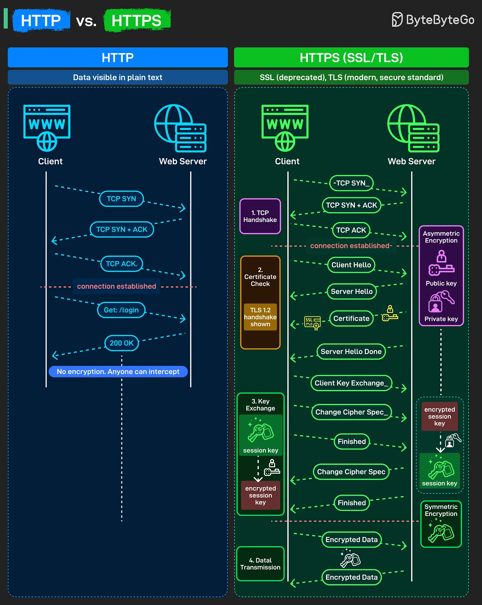

# 194 - HTTP vs HTTPS

- Nguồn: ByteByteGo Big Archive System Design 2025
- Trang PDF: 395-396
- Ảnh minh họa: `../assets/194/figure-01.png`

## Hình minh họa

## Dịch sát

Khi bạn mở một website, khác biệt giữa HTTP và HTTPS quyết định dữ liệu của bạn đi an toàn hay bị lộ dưới dạng plain sight. Đây là điều thật sự xảy ra bên dưới:

HTTP:

- Gửi data ở dạng plain text, bất kỳ ai trên network cũng có thể intercept.

- Client và server thực hiện một TCP handshake đơn giản: SYN, SYN-ACK, ACK.

- Nhanh nhưng hoàn toàn insecure. Password, token và form đều có thể bị đọc trong lúc truyền.

HTTPS (SSL/TLS):

- Step 1: TCP Handshake: Thiết lập connection tiêu chuẩn.

- Step 2: Certificate Check: Client nói hello. Server phản hồi hello và SSL/TLS certificate của nó. Certificate đó chứa public key của server và được ký bởi một Certificate Authority đáng tin cậy. Browser của bạn verify certificate này hợp lệ, chưa hết hạn, và thật sự thuộc về domain bạn đang cố truy cập. Điều này chứng minh bạn đang nói chuyện với server thật, không phải attacker giả mạo nó.

- Step 3: Key Exchange: Đây là nơi asymmetric encryption xảy ra. Server có public key và private key. Client tạo session key, encrypt nó bằng public key của server, rồi gửi qua. Chỉ server mới decrypt được bằng private key của nó. Hai phía bây giờ có cùng session key mà không ai khác có thể intercept. Key này trở thành symmetric encryption key cho phần còn lại của session.

- Step 4: Data Transmission: Bây giờ mọi request và response được encrypt bằng session key đó thông qua symmetric encryption.

## Dịch nội dung trong hình

- `HTTP`: data visible in plain text. Client và web server thực hiện `TCP SYN`, `TCP SYN + ACK`, `TCP ACK`; connection established; client gửi `GET /login`; server trả `200 OK`; không có encryption nên ai cũng có thể intercept.
- `HTTPS (SSL/TLS)`: SSL đã deprecated, TLS là standard hiện đại và an toàn.
- `1. TCP Handshake`: `TCP SYN`, `TCP SYN + ACK`, `TCP ACK` để thiết lập connection.
- `2. Certificate Check`: `Client Hello`, `Server Hello`, `Certificate`, `Server Hello Done`; hình minh họa TLS 1.2 handshake.
- `3. Key Exchange`: client/server tạo và trao đổi để có `session key`; dùng asymmetric encryption với `public key` và `private key`.
- `4. Data Transmission`: sau khi có session key, dữ liệu được truyền dưới dạng `Encrypted Data` bằng symmetric encryption.

## Tóm tắt & giải thích dễ hiểu

HTTP chỉ là request/response không mã hóa. HTTPS thêm TLS để xác minh server thật và mã hóa dữ liệu. Điểm quan trọng: asymmetric encryption thường dùng để thiết lập key an toàn, còn data thực tế được truyền bằng symmetric encryption vì nhanh hơn.

## Ví dụ thực tế - không nằm trong tài liệu gốc

Nếu bạn đăng nhập qua Wi-Fi công cộng bằng HTTP, người cùng mạng có thể đọc username/password hoặc session token. Với HTTPS, họ chỉ thấy bạn kết nối tới domain/IP nào đó, còn nội dung request/response đã bị mã hóa.

## Ghi chú kỹ thuật - không nằm trong tài liệu gốc

Sơ đồ minh họa TLS 1.2 theo kiểu đơn giản hóa. TLS 1.3 hiện đại rút gọn handshake và không hoạt động y hệt từng bước như hình, nhưng ý tưởng certificate verification và encrypted session vẫn giữ nguyên.

## Thuật ngữ chính

- `HTTP`: Hypertext Transfer Protocol.
- `HTTPS`: HTTP chạy qua TLS.
- `TLS`: Transport Layer Security.
- `SSL`: chuẩn cũ đã deprecated.
- `Certificate Authority`: tổ chức ký certificate đáng tin cậy.
- `Public key/private key`: cặp khóa bất đối xứng.
- `Session key`: khóa đối xứng dùng để mã hóa phiên.
- `Plain text`: dữ liệu không mã hóa.

