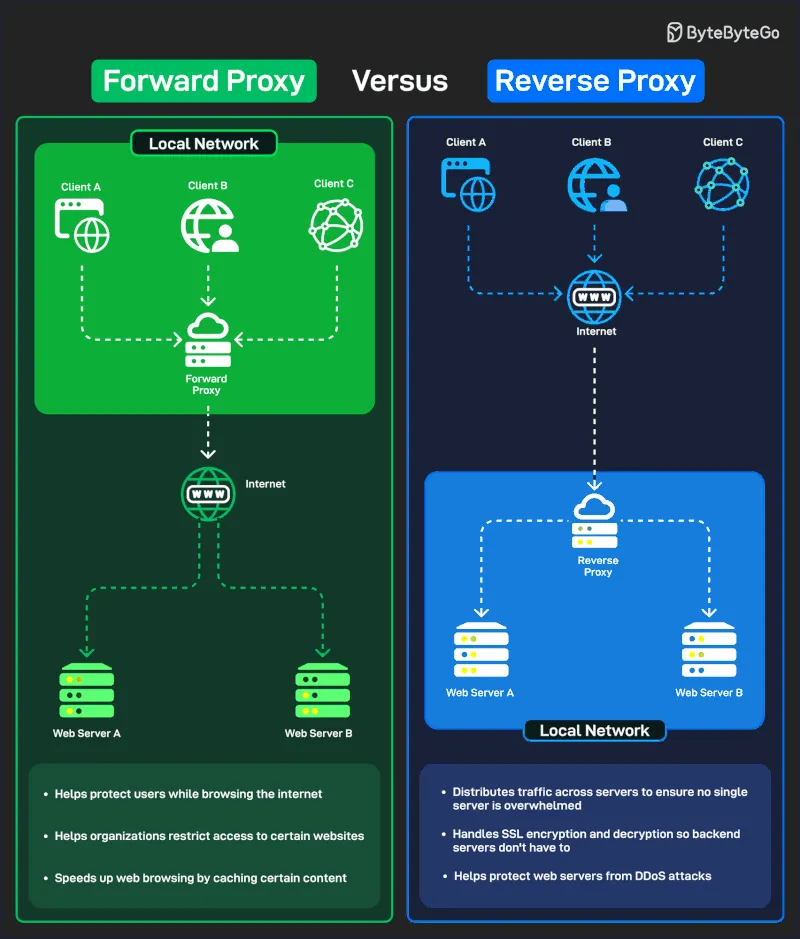

# 195 - Forward Proxy vs Reverse Proxy

- Nguồn: ByteByteGo Big Archive System Design 2025
- Trang PDF: 397-398
- Ảnh minh họa: `../assets/195/figure-01.png`

## Hình minh họa

## Dịch sát

Forward proxy nằm giữa client (user) và Internet. Nó hành động thay mặt user, che giấu identity của họ hoặc filter traffic trước khi traffic đi tới external web.

Một số ứng dụng của forward proxy là:

1. Bảo vệ user khi browse Internet.

2. Giúp organization hạn chế truy cập tới một số website.

3. Tăng tốc web browsing bằng cách cache content được truy cập thường xuyên.

Reverse proxy nằm giữa Internet (client) và backend servers. Nó hành động thay mặt server, xử lý incoming traffic.

Một số ứng dụng của reverse proxy là:

1. Phân phối traffic qua nhiều server để đảm bảo không server đơn lẻ nào bị quá tải.

2. Xử lý SSL encryption/decryption để backend server không phải làm.

3. Giúp bảo vệ backend server khỏi DDoS attack.

## Dịch nội dung trong hình

- `Forward Proxy`: nằm trong `Local Network`; `Client A`, `Client B`, `Client C` đi qua forward proxy rồi ra Internet tới `Web Server A/B`. Nó giúp bảo vệ user, hạn chế website được phép truy cập và cache một số content để duyệt nhanh hơn.
- `Reverse Proxy`: client từ Internet đi vào reverse proxy trước khi tới `Web Server A/B` trong local network. Nó phân phối traffic, xử lý SSL encryption/decryption thay backend server và bảo vệ web server khỏi DDoS.

## Tóm tắt & giải thích dễ hiểu

Forward proxy đại diện cho client; reverse proxy đại diện cho server. Forward proxy thường dùng ở phía người dùng hoặc công ty để kiểm soát outbound traffic. Reverse proxy thường dùng ở phía hệ thống backend để load balancing, TLS termination, caching, routing và bảo vệ origin server.

## Ví dụ thực tế - không nằm trong tài liệu gốc

Một công ty có thể dùng forward proxy để nhân viên chỉ truy cập website được allowlist. Một hệ thống web production có thể dùng Nginx/Envoy/Cloudflare làm reverse proxy trước nhiều backend instance để chia tải và terminate TLS.

## Thuật ngữ chính

- `Forward proxy`: proxy đại diện cho client.
- `Reverse proxy`: proxy đại diện cho server/backend.
- `TLS termination`: giải mã HTTPS tại proxy/load balancer.
- `DDoS`: Distributed Denial of Service.
- `Origin server`: server backend gốc phục vụ nội dung.
- `Outbound traffic`: traffic đi ra ngoài network.
- `Inbound traffic`: traffic đi vào hệ thống.

