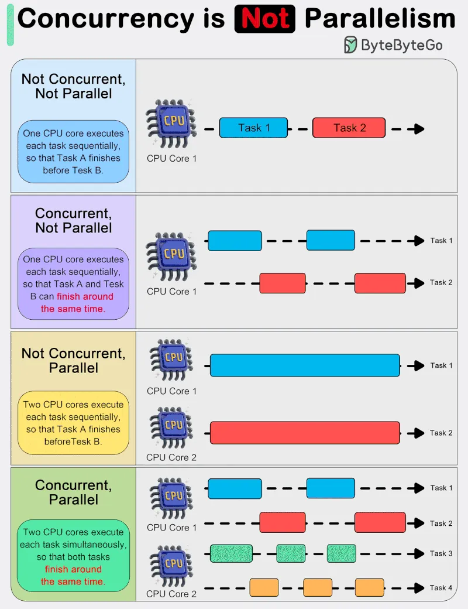

# 196 - Điều mọi developer nên biết: Concurrency không phải Parallelism

- Nguồn: ByteByteGo Big Archive System Design 2025
- Trang PDF: 399-400
- Ảnh minh họa: `../assets/196/figure-01.png`

## Hình minh họa

## Dịch sát

Trong system design, điều quan trọng là hiểu khác biệt giữa concurrency và parallelism.

Như Rob Pike (một trong những người tạo ra Go) đã nói: “Concurrency là về việc dealing with nhiều thứ cùng lúc. Parallelism là về việc doing nhiều thứ cùng lúc.” Sự phân biệt này nhấn mạnh rằng concurrency thiên về design của một program, còn parallelism thiên về execution.

Concurrency là xử lý nhiều thứ cùng lúc. Nó liên quan đến việc cấu trúc program để handle nhiều task đồng thời, nơi các task có thể start, run và complete trong các khoảng thời gian chồng lấp, nhưng không nhất thiết ở đúng cùng một instant.

Concurrency là composition của các process thực thi độc lập và mô tả khả năng của program trong việc quản lý nhiều task bằng cách tạo progress trên chúng mà không nhất thiết phải hoàn thành một task trước khi bắt đầu task khác.

Parallelism, mặt khác, nói tới việc thực thi đồng thời nhiều computation. Đây là kỹ thuật chạy hai hoặc nhiều task/computation cùng lúc, sử dụng nhiều processor hoặc core trong một computer để thực hiện nhiều operation concurrently. Parallelism cần hardware có nhiều processing unit, và mục tiêu chính của nó là tăng throughput và computational speed của system.

Trong thực tế, concurrency giúp program vẫn responsive với input, chạy background task, và xử lý nhiều operation theo cách có vẻ đồng thời, ngay cả trên single-core processor. Nó đặc biệt hữu ích trong I/O-bound và high-latency operation nơi program phải chờ external event như file, network hoặc user interaction.

Parallelism, với khả năng thực hiện nhiều operation cùng lúc, rất quan trọng trong CPU-bound task nơi computational speed và throughput là bottleneck. Application cần heavy mathematical computation, data analysis, image processing và real-time processing có thể hưởng lợi lớn từ parallel execution.

## Dịch nội dung trong hình

- `Not Concurrent, Not Parallel`: một CPU core chạy từng task tuần tự, Task A xong rồi mới tới Task B.
- `Concurrent, Not Parallel`: một CPU core xen kẽ xử lý nhiều task; Task A và Task B có thể hoàn thành gần cùng thời điểm nhưng không chạy đúng cùng lúc.
- `Not Concurrent, Parallel`: hai CPU core chạy các task riêng, nhưng task vẫn được tổ chức tuần tự theo từng luồng công việc; Task A xong trước Task B.
- `Concurrent, Parallel`: nhiều CPU core xử lý nhiều task xen kẽ và đồng thời; các task có thể hoàn thành quanh cùng thời điểm.

## Tóm tắt & giải thích dễ hiểu

Concurrency là cách tổ chức công việc để xử lý nhiều việc đang chờ nhau, còn parallelism là chạy thật sự cùng lúc trên nhiều core. Concurrency giúp hệ thống responsive khi có I/O chờ; parallelism giúp tăng tốc task nặng CPU.

## Ví dụ thực tế - không nằm trong tài liệu gốc

Một web server async xử lý 10.000 connection socket chủ yếu là concurrency: nhiều request đang chờ database/network nhưng không nhất thiết dùng 10.000 core. Một job resize 10.000 ảnh có thể dùng parallelism bằng worker pool chạy trên nhiều CPU core để tăng throughput.

## Ghi chú kỹ thuật - không nằm trong tài liệu gốc

Nguồn ghi “Rob Pyke”, nhưng tên đúng của người tạo Go và câu quote nổi tiếng này là `Rob Pike`.

## Thuật ngữ chính

- `Concurrency`: cấu trúc chương trình để xử lý nhiều task cùng giai đoạn thời gian.
- `Parallelism`: thực thi thật sự cùng lúc trên nhiều core/processor.
- `I/O-bound`: bottleneck nằm ở chờ I/O như network/disk.
- `CPU-bound`: bottleneck nằm ở tính toán CPU.
- `Throughput`: lượng công việc xử lý mỗi đơn vị thời gian.
- `Worker pool`: nhóm worker xử lý task song song.

