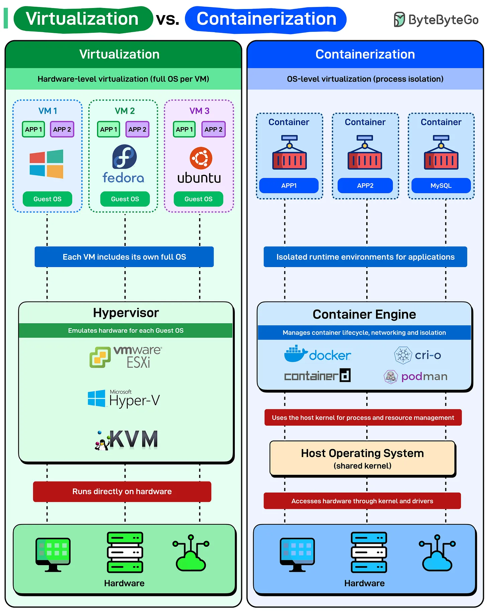

# 197 - Virtualization vs Containerization

- Nguồn: ByteByteGo Big Archive System Design 2025
- Trang PDF: 401-402
- Ảnh minh họa: `../assets/197/figure-01.png`

## Hình minh họa

## Dịch sát

Trước khi container làm deployment đơn giản hơn, virtualization đã thay đổi cách chúng ta dùng hardware. Cả hai đều isolate workload, nhưng làm theo cách khác nhau.

- Virtualization (Hardware-level isolation): Mỗi virtual machine chạy một operating system hoàn chỉnh, Windows, Fedora hoặc Ubuntu, với kernel, driver và library riêng. Hypervisor như VMware ESXi, Hyper-V, KVM nằm trực tiếp trên hardware và emulate physical machine cho từng guest OS. Điều này làm VM nặng nhưng isolated. Cần Windows và Linux trên cùng một box? VM xử lý dễ dàng. Startup time của một VM điển hình tính bằng phút vì bạn boot cả một operating system từ đầu.

- Containerization (OS-level isolation): Container chia sẻ kernel của host operating system. Không có OS riêng cho từng container. Chỉ là các process được isolate với filesystem và dependencies riêng. Container engine như Docker, containerd, CRI-O, Podman quản lý lifecycle, networking và isolation, nhưng tất cả chạy trên một shared kernel duy nhất. Lightweight và nhanh. Container start trong milliseconds vì bạn không boot OS, chỉ launch một process. Nhưng có một điểm bắt buộc: tất cả container trên một host phải compatible với kernel của host đó. Không thể chạy Windows container trên Linux host nếu không dùng các nested virtualization trick.

## Dịch nội dung trong hình

- `Virtualization`: hardware-level virtualization, mỗi VM có full OS riêng; các VM như Windows/Fedora/Ubuntu chạy trên `Hypervisor`; hypervisor emulate hardware cho từng guest OS; hypervisor chạy trực tiếp trên hardware. Ví dụ: `VMware ESXi`, `Microsoft Hyper-V`, `KVM`.
- `Containerization`: OS-level virtualization/process isolation; mỗi container là runtime environment isolated cho app như `APP1`, `APP2`, `MySQL`; `Container Engine` quản lý lifecycle, networking và isolation. Ví dụ: `Docker`, `containerd`, `CRI-O`, `Podman`.
- Container dùng `Host Operating System (shared kernel)` để quản lý process/resource và truy cập hardware thông qua kernel/driver.

## Tóm tắt & giải thích dễ hiểu

VM mô phỏng cả máy và OS nên isolation mạnh nhưng nặng. Container chỉ isolate process trên cùng host kernel nên nhẹ, start nhanh và mật độ deploy cao hơn, nhưng phụ thuộc kernel host. Vì vậy production cloud thường kết hợp VM để isolate hạ tầng và container để deploy app nhanh.

## Ví dụ thực tế - không nằm trong tài liệu gốc

Nếu cần chạy app Windows và Linux trên cùng một server vật lý, VM là lựa chọn tự nhiên. Nếu chỉ cần deploy nhiều service Linux cùng kernel, container giúp start nhanh, scale nhanh và dùng tài nguyên hiệu quả hơn.

## Thuật ngữ chính

- `Virtualization`: ảo hóa phần cứng/máy ảo.
- `Containerization`: đóng gói app thành container.
- `Hypervisor`: lớp quản lý VM.
- `Guest OS`: OS chạy bên trong VM.
- `Host kernel`: kernel của OS host mà container chia sẻ.
- `Container engine`: runtime quản lý container.
- `Isolation`: mức tách biệt giữa workload.

